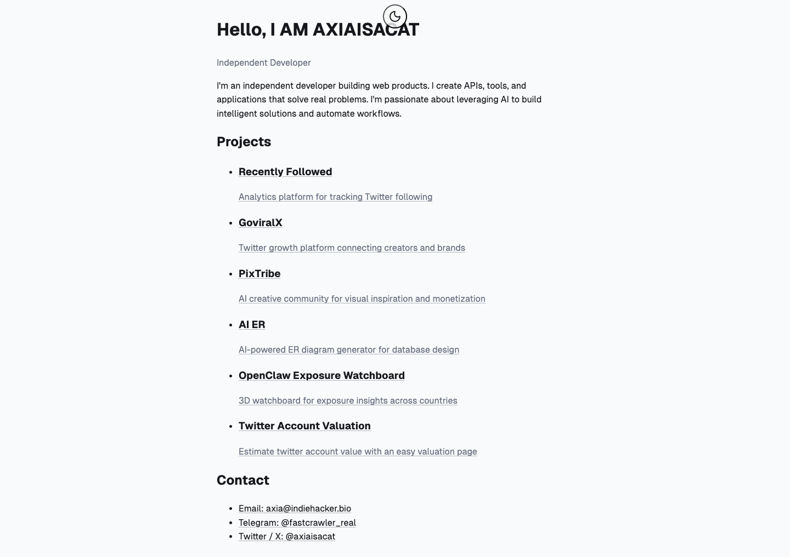

# AXIA
> Hello, I AM AXIAISACAT — Independent Developer  ·  [axiaisacat.indiehacker.bio](https://axiaisacat.indiehacker.bio/)

**What it is** — A hosted link-in-bio / mini-portfolio page on the indiehacker.bio platform for the indie developer 'axiaisacat' — the builder the Roundtable tweet credits with a viral Claude Code permanent-memory tool. It is a single static page that introduces the developer and lists their shipped products.

**What it shows** — A one-line intro ('I'm an independent developer building web products... passionate about leveraging AI to build intelligent solutions and automate workflows') followed by a bulleted Projects list — Recently Followed (Twitter-following analytics), GoviralX (creator/brand growth platform), PixTribe (AI creative community), AI ER (AI ER-diagram generator), OpenClaw Exposure Watchboard (3D country exposure board), and Twitter Account Valuation — then a Contact block with email, Telegram, and X handle. Notably, the Claude-memory repo the tweet is about is NOT linked here, so there is no resolvable subject site.

**How it works** — Pure top-to-bottom scroll, no JS framework and no animation — a moon-icon dark-mode toggle sits next to the H1, and each project name is an outbound link to its own domain. The page is roughly one screen tall on desktop (1017px) and stacks into a longer single column on mobile.

**How it's designed** — Deliberately minimal, document-like layout: near-white background (hsl(220 14% 98%)), almost-black ink (rgb(22,24,29)), a bold 32px Geist Sans H1, muted gray sub-labels, and underlined text links. No imagery, no cards, no accent fills beyond the single SVG toggle — the design leans entirely on typographic hierarchy and whitespace, the house style of the indiehacker.bio template.

**Palette** — Off-white canvas, near-black text, muted slate-gray secondary; a single blue ring token, otherwise monochrome.
**Fonts** — Geist Sans throughout (body + bold headings); no serif or accent webfont.

## Connections
**Aesthetics:** [[aesthetics/portfolio|portfolio]] [[aesthetics/minimal|minimal]] [[aesthetics/dark|dark]]
**Patterns:** `link-in-bio` `personal-portfolio` [[patterns/minimalist|minimalist]] [[patterns/single-screen|single-screen]] `dark-mode-toggle` [[patterns/text-only|text-only]] `project-list`
**Category:** [[categories/product|product]]
**Tech:** `Geist Sans (self-hosted)` [[tech/no-analytics-detected|no analytics detected]] `self-hosted on indiehacker.bio`
**Colors:** [[colors/dark|dark]] [[colors/monochrome|monochrome]] [[colors/cool|cool]]
**Fonts:** `GeistSans 100-900`

## Related sites
[[sites/daryl.cv|daryl.cv]] [[sites/richzou.com|richzou.com]] [[sites/amanml.com|amanml.com]] [[sites/anyblockers.com|anyblockers.com]] [[sites/daviskeene.com|daviskeene.com]]
