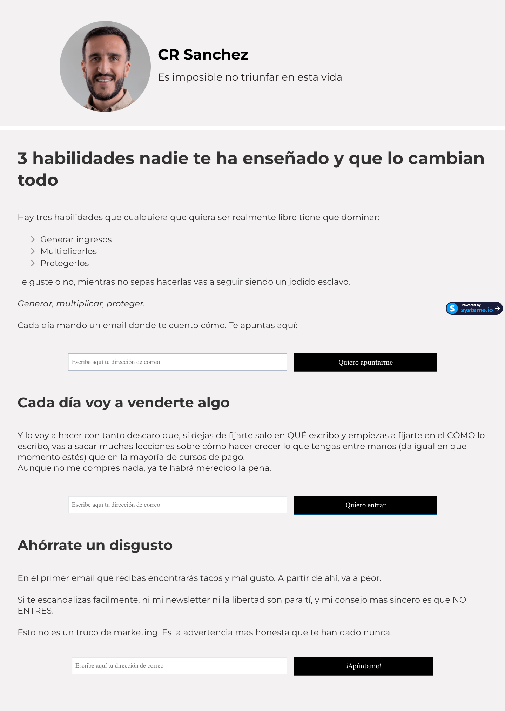

# CR Sanchez Newsletter
> Es imposible no triunfar en esta vida.  ·  [crsanchez.es](https://www.crsanchez.es/)

**What it is** — CR Sanchez's Spanish-language newsletter landing page — the only link in the tweet, and the author's own email-capture page rather than the AI parking-design tool the video shows (that tool isn't linked). It's a marketing/squeeze page built on Systeme.io.

**What it shows** — A personal newsletter pitch in Spanish: the author's avatar and tagline 'Es imposible no triunfar en esta vida', followed by stacked persuasive sections — '3 habilidades nadie te ha enseñado y que lo cambian todo', 'Cada día voy a venderte algo' and 'Ahórrate un disgusto' — each with copy and a repeated email field + solid-black CTA ('Quiero apuntarme', 'Quiero entrar', '¡Apúntame!').

**How it works** — A single-column squeeze/landing page that repeats the same email-capture form across its sections; the forms post to Systeme.io and a 'Powered by systeme.io' badge sits top-right. The whole page is a conversion funnel toward a newsletter subscription.

**How it's designed** — Plain and conversion-first: a white background with black body text and solid-black CTA buttons (rendered rgb(0,0,0) bg / white text), set entirely in Montserrat (400/700) with Font Awesome for icons. There are no semantic h1/h2 headings — section titles are styled text blocks — which is characteristic of the stock Systeme.io funnel template it's built on.

**Palette** — White background, black body text and solid-black CTA buttons (#000 on #fff); minimal, near-monochrome.
**Fonts** — Montserrat (400/700); Font Awesome icon set

## Connections
**Aesthetics:** [[aesthetics/light|light]]
**Patterns:** `newsletter-landing` [[patterns/email-capture|email-capture]] `squeeze-page` `systeme-io` `funnel` [[patterns/light-mode|light-mode]] `spanish`
**Category:** [[categories/product|product]]
**Tech:** `Systeme.io` [[tech/cloudfront|Cloudfront]] `Montserrat` `Font Awesome`
**Colors:** [[colors/light|light]] [[colors/monochrome|monochrome]]
**Fonts:** `Montserrat` `Font Awesome 7 Duotone`

## Related sites
[[sites/gregisenberg.com|gregisenberg.com]] [[sites/akira.sachi.dev|akira.sachi.dev]] [[sites/anyblockers.com|anyblockers.com]] [[sites/bigplayers.co|bigplayers.co]] [[sites/colf.dev|colf.dev]]
