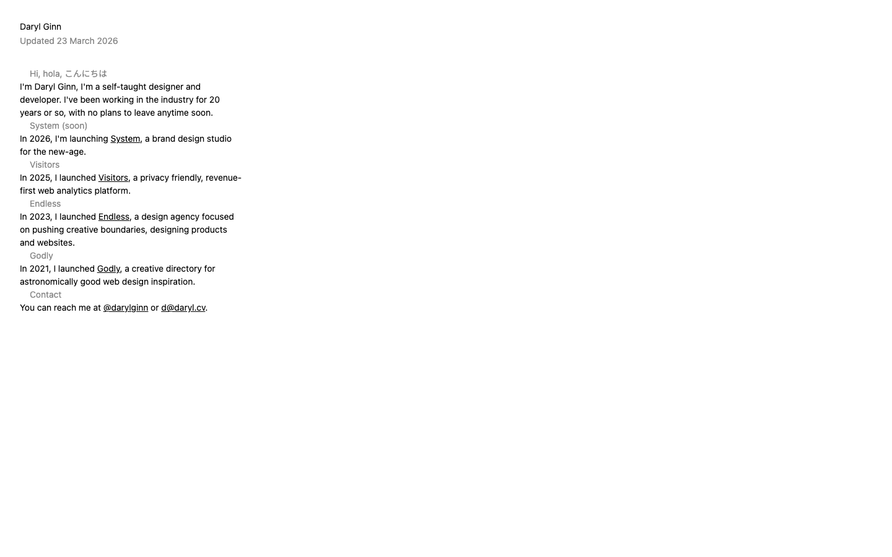

# Daryl Ginn — designer & developer
> A self-taught designer and developer from Australia.  ·  [daryl.cv](https://daryl.cv/)

**What it is** — daryl.cv is the personal index of Daryl Ginn — the tweet's author — 'a self-taught designer and developer' with ~20 years in the industry. It's the author-portfolio hub that lists the products and studios he's launched, of which Recent.design is the current one.

**What it shows** — A single-screen text page: a trilingual greeting ('Hi, hola, こんにちは'), a short bio, and a chronological list of his ventures — System (system.studio, a brand design studio launching 2026), Visitors (visitors.now, a 'privacy friendly, revenue-first web analytics platform', 2025), Endless (endless.design, a design agency, 2023), and Godly (godly.website) — plus a Contact line. An 'Updated 23 March 2026' stamp sits under his name.

**How it works** — Intentionally minimal — a hand-built single HTML screen (scrollHeight equals innerHeight at 900px), with zero images/svg/canvas/video, no CSS custom properties, and no webfonts at all. The only third-party script is his own visitors.now analytics (cdn.visitors.now).

**How it's designed** — Radical restraint, used as a designer's flex. From the DOM the page uses the system-ui font stack only — document.fonts is completely empty, so there's no webfont payload — with body and h1 at a uniform 14px in near-black (rgb(0,0,0)) on default white, and classic default-blue hyperlinks (rgb(0,0,238)). The whole thing reads like a plain-text résumé: deliberately anti-design.

**Palette** — Black text (rgb(0,0,0)) on default white, with browser-default-blue hyperlinks (rgb(0,0,238)) — no custom palette.
**Fonts** — System fonts only (system-ui / -apple-system) — no webfont payload; document.fonts is empty.

## Connections
**Aesthetics:** [[aesthetics/minimal|minimal]]
**Patterns:** [[patterns/minimalist|minimalist]] [[patterns/text-only|text-only]] [[patterns/system-fonts|system-fonts]] [[patterns/single-screen|single-screen]] `personal-index` `anti-design`
**Category:** [[categories/uncategorized|uncategorized]]
**Tech:** `Static HTML/CSS` `visitors.now (analytics)`
**Colors:** [[colors/cool|cool]]
**Fonts:** [[fonts/system-fonts|system-fonts]]

## Related sites
[[sites/axiaisacat.indiehacker.bio|axiaisacat.indiehacker.bio]] [[sites/richzou.com|richzou.com]] [[sites/amanml.com|amanml.com]] [[sites/anyblockers.com|anyblockers.com]] [[sites/bird.onethreenine.net|bird.onethreenine.net]]
