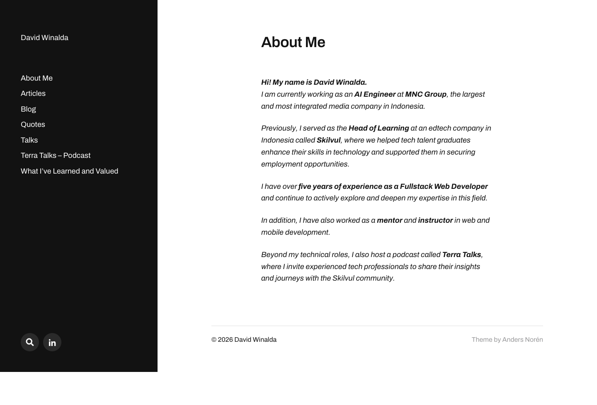

# David Winalda
> Personal site & blog — Articles, Blog, Quotes, Talks and the Terra Talks podcast.  ·  [davidwinalda.com](https://davidwinalda.com/)

**What it is** — David Winalda's personal WordPress site — the homepage doubles as an 'About Me' page and is the destination 0xMarioNawfal's shadcn/Claude-Code tweet links to. The nav reveals the scope: Articles, Blog, Quotes, Talks, a 'Terra Talks – Podcast', and a 'What I've Learned and Valued' page, plus a LinkedIn link. It is a writer/builder's home base rather than a product page.

**What it shows** — A clean light-on-white homepage led by the 'David Winalda' wordmark and an 'About Me' heading, with a horizontal top nav (Articles / Blog / Quotes / Talks / Terra Talks – Podcast / What I've Learned and Valued) and a search affordance. No imagery, video or SVG on the landing screen — it is essentially a typographic index page.

**How it works** — A classic WordPress build on an Anders Norén theme (the footer credits andersnoren.se), with WordPress's block-editor preset CSS variables sitting in :root and all CSS/JS served from davidwinalda.com itself. Archivo is the only text webfont (400/600/700) alongside Font Awesome 5 for icons; no SSR JS framework (__NEXT_DATA__/__NUXT__/Vue/Svelte/React all absent) and no third-party analytics host detected. The page is near-static and single-screen (~980px tall, 0 images/canvas/video/svg).

**How it's designed** — A minimal light theme: white body (rgb(255,255,255)) with near-black text (--wp--preset--color--black #121212, rendered rgb(18,18,18)) and a solid black button (rgb(18,18,18)) carrying white text for the primary action. Type is set entirely in Archivo over a Helvetica Neue fallback, and there is no accent color, gradient, imagery or motion — hierarchy comes purely from weight and scale.

**Palette** — White #fff background, near-black #121212 text, solid black buttons — no accent color
**Fonts** — Archivo 400/600/700 (with Font Awesome 5 icons), Helvetica Neue fallback

## Connections
**Aesthetics:** [[aesthetics/minimal|minimal]] [[aesthetics/light|light]]
**Patterns:** [[patterns/personal-site|personal-site]] `blog` [[patterns/minimalist|minimalist]] [[patterns/wordpress|wordpress]] [[patterns/light-theme|light-theme]] [[patterns/typographic|typographic]]
**Category:** [[categories/tools-build|tools-build]]
**Tech:** `WordPress (Anders Norén theme)` `Font Awesome 5` `self-hosted (no third-party analytics detected)`
**Colors:** [[colors/light|light]]
**Fonts:** `Archivo` `Font Awesome`

## Related sites
[[sites/alisawuffles.github.io|alisawuffles.github.io]] [[sites/performance.dev|performance.dev]] [[sites/richzou.com|richzou.com]] [[sites/willmanidis.com|willmanidis.com]] [[sites/amanml.com|amanml.com]]
