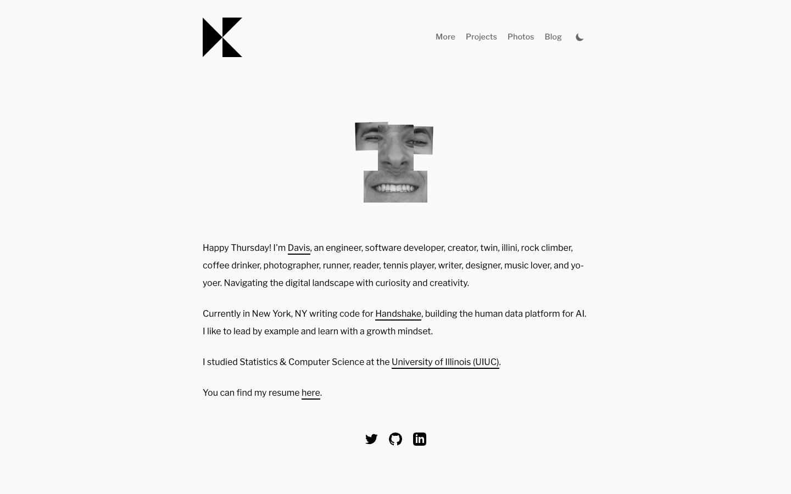

# Home | Davis Keene
> Davis Keene's personal website — engineer, software developer, creator  ·  [daviskeene.com](https://daviskeene.com/)

**What it is** — The personal homepage of Davis Keene, an engineer at Handshake. A deliberately minimal, text-first 'about me' page that he's been incrementally making 'more fun' with small interactive flourishes (the subject of his 'making my personal site more fun' posts).

**What it shows** — A centered single column on near-white. Up top: a geometric 'K' monogram (two black triangles) with a slim nav — More / Projects / Photos / Blog — and a moon icon for dark mode. Below it, a black-and-white self-portrait sliced into offset, scattered rectangles (a glitchy photo-collage effect), then a warm first-person intro: 'Happy Thursday! I'm Davis, an engineer, software developer, creator, twin, illini, rock climber, coffee drinker…' with inline underlined links to Handshake, UIUC and a résumé. Footer is three social glyphs (Twitter, GitHub, LinkedIn).

**How it works** — A plain vertical page you read top-to-bottom; navigate via the underlined inline links or the top nav to Projects / Photos / Blog. The main interactive control is a light/dark theme toggle (moon icon). The personality lives in micro-interactions — chiefly the fragmented portrait — rather than in heavy motion or layout tricks; it's the 'fun' experiment grafted onto an otherwise classic résumé page.

**How it's designed** — Restrained editorial minimalism: generous whitespace, a single centered measure of text set in Libre Franklin, near-black on off-white. No decorative color, almost no chrome — the lone visual play is the sliced grayscale self-portrait, which gives a standard personal page a quirky, hand-made feel. Tiny footprint (4 images, a handful of SVG social icons, one button), no canvas or video.

**Palette** — Off-white ground (#fafafa), near-black text (#000) with grey secondary (#666) — essentially monochrome, plus a dark-mode variant via the toggle.
**Fonts** — Libre Franklin (body + UI), serif fallback

## Connections
**Aesthetics:** [[aesthetics/minimal|minimal]] [[aesthetics/editorial|editorial]] [[aesthetics/dark|dark]] [[aesthetics/portfolio|portfolio]]
**Patterns:** [[patterns/minimalist|minimalist]] [[patterns/editorial|editorial]] [[patterns/single-column|single-column]] `centered` [[patterns/text-first|text-first]] `dark-mode-toggle` `monogram-logo` `glitch-portrait` [[patterns/personal-homepage|personal-homepage]] [[patterns/monochrome|monochrome]]
**Category:** [[categories/personal|personal]]
**Tech:** —
**Colors:** [[colors/dark|dark]] [[colors/monochrome|monochrome]]
**Fonts:** —

## Related sites
[[sites/nicolasbustamante.com|nicolasbustamante.com]] [[sites/asekachov.com|asekachov.com]] [[sites/designengineer.tools|designengineer.tools]] [[sites/arneshbanerjee.github.io|arneshbanerjee.github.io]] [[sites/axiaisacat.indiehacker.bio|axiaisacat.indiehacker.bio]]
