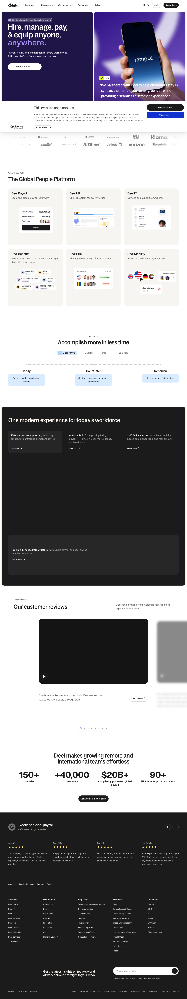

# Deel | Global Payroll, Compliance, HR Solutions | HRIS
> Hire, manage, pay, & equip anyone, anywhere.  ·  [deel.com](https://www.deel.com/)

**What it is** — The marketing homepage for Deel, the all-in-one global HR platform — its own pitch is the h1 "Hire, manage, pay, & equip anyone, anywhere." and the meta line "Hire, pay, and manage teams in 150+ countries." It sells global payroll, compliance, EOR, contractor management and HRIS as a single product.

**What it shows** — A deep-violet hero with a phone mockup of the app, a logo wall of customer brands, then a section-by-section product tour organized around the h2s "The Global People Platform", "Accomplish more in less time", "One modern experience for today's workforce" and "Our customer reviews", closing on big proof-point stats (150+ countries, +40,000 customers, $20B+, 90+) and a testimonial grid.

**How it works** — Long single-scroll landing page (~7,700px) with a sticky top nav whose product menus expand on hover; it's a content/CMS-driven marketing site rather than an interactive app, so the experience is scroll-through storytelling toward repeated "Book a demo / Get started" CTAs. Heavy instrumentation (HubSpot forms, Amplitude, GTM, a Navattic interactive demo embed) drives lead capture.

**How it's designed** — Confident SaaS brand system: a violet hero anchors an otherwise white, near-black-text canvas, with the custom Bagoss type family (Condensed for the big display h1 at 60px/weight 500, Standard + Extended elsewhere) giving the headlines a distinctive editorial voice while Inter carries body copy. Dense iconography (495 inline SVGs) and product screenshots fill the modular card sections; a couple of canvas elements power animated accents.

**Palette** — White canvas with near-black text (rgba(0,0,0,0.87)); deep-violet hero (per screenshot, og:image named 'General_Purple') carrying white h1 text
**Fonts** — Bagoss Condensed/Standard/Extended (custom display) for headlines; Inter for body

## Connections
**Aesthetics:** [[aesthetics/developer-product|developer-product]]
**Patterns:** [[patterns/saas-landing|saas-landing]] [[patterns/logo-wall|logo-wall]] `product-tour` `stat-proof-points` `testimonial-grid` `hover-mega-nav` `custom-display-type` `interactive-demo-embed`
**Category:** [[categories/uncategorized|uncategorized]]
**Tech:** `HubSpot (forms/analytics)` [[tech/amplitude|Amplitude]] [[tech/google-tag-manager|Google Tag Manager]] `Cookiebot` `Navattic` [[tech/cloudflare|Cloudflare]]
**Colors:** [[colors/cool|cool]]
**Fonts:** [[fonts/inter-100-900|Inter 100-900]] `BagossCondensedFont` `BagossStandardFont` `BagossExtendedFont` `BagossStandardVF`

## Related sites
[[sites/badmarketing.com|badmarketing.com]] [[sites/bigideasdb.com|bigideasdb.com]] [[sites/contralabs.com|contralabs.com]] [[sites/creao.ai|creao.ai]] [[sites/jenni.ai|jenni.ai]]
