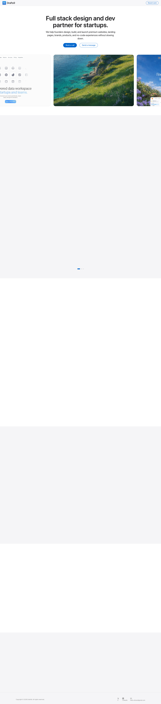

# Drafts9 — Full stack design and dev partner for startups
> Full stack design and dev partner for startups.  ·  [drafts9.com](https://www.drafts9.com/)

**What it is** — Drafts9 is the studio site of designer/developer Ahmed Hassan (@uihssn) — a 'full stack design and dev partner for startups' that ships premium websites, landing pages, brands, products, and no-code experiences on monthly plans. It's the home base behind the 'Dreamblur Gradients' background library the bookmarked tweet is promoting.

**What it shows** — A long single-page pitch: a hero headline ('Full stack design and dev partner for startups.') with 'Book a call' and 'Send a message' CTAs, a horizontally-scrolling carousel of recent work (a data-workspace product UI, polished travel/nature landing pages), a 'Trusted by startups and industry leaders' logo strip, a testimonials carousel that includes short video testimonials, a 'What we're best at' capabilities section, a 'Simple monthly plans for fast-moving startups' pricing block, an FAQ ('Questions founders usually ask'), and a closing 'Let's build something cool.' contact section.

**How it works** — A static, hand-built marketing page — no JS framework signature was detected (no __NEXT_DATA__, __NUXT__, or React/Vue/Svelte roots; document.scripts exposed no external hosts). Content is scroll-revealed, so most below-the-fold sections render blank in a static full-page capture until scrolled into view. Three self-hosted MP4s (video-01/02/03.mp4, served via HTTP 206 range requests) power the video testimonials, and the work showcase is a manual carousel with prev/next arrows and slide dots. Primary actions route off-site: 'Book a call' → Calendly, 'Send a message' → WhatsApp (wa.me), 'Recent work' → a Figma prototype.

**How it's designed** — Unapologetically Apple-flavored. The palette is built on Apple's own system: parchment/pearl off-whites (--canvas-parchment #f5f5f7, --surface-pearl #fafafc) against near-black ink (--ink #1d1d1f) with Apple blue accents (--primary #0066cc, --primary-focus #0071e3). Despite loading Inter, Instrument Serif, Archivo Black and DM Mono from Google Fonts, the body and the 56px/600 hero headline actually render in the Apple system stack (-apple-system / SF Pro Text / SF Pro Display) — only Instrument Serif reports as loaded, so most of the declared webfont payload appears unused on the home page. Generous 80px section rhythm, a 1440px max container, pill buttons, soft product shadows (0 30px 60px -25px rgba(0,0,0,.22)) and hairline dividers complete the calm, premium, conversion-focused feel.

**Palette** — Apple-system neutrals — parchment #f5f5f7 / pearl #fafafc surfaces, near-black ink #1d1d1f, muted grey body #86868b — with Apple blue #0066cc/#0071e3 CTAs.
**Fonts** — Renders in the Apple system stack (-apple-system / SF Pro Text / SF Pro Display) for body + hero; Instrument Serif is the one webfont actually loaded; Inter, Archivo Black and DM Mono are declared via Google Fonts but report unloaded on the home page.

## Connections
**Aesthetics:** [[aesthetics/minimal|minimal]]
**Patterns:** `apple-style` [[patterns/studio|studio]] `agency-landing` `scroll-reveal` `carousel` `video-testimonials` `pricing-tiers` `faq` [[patterns/system-fonts|system-fonts]] [[patterns/minimalist|minimalist]]
**Category:** [[categories/tools-build|tools-build]]
**Tech:** `Static HTML/CSS/JS (no framework detected)` [[tech/google-fonts|Google Fonts]] `self-hosted MP4 video` `Calendly` `WhatsApp` `Figma (work prototype)`
**Colors:** [[colors/cool|cool]]
**Fonts:** [[fonts/instrument-serif|Instrument Serif]]

## Related sites
[[sites/daryl.cv|daryl.cv]] [[sites/ravalabs.com|ravalabs.com]] [[sites/ryancarson.com|ryancarson.com]] [[sites/templatoria.com|templatoria.com]] [[sites/addyosmani.com|addyosmani.com]]
