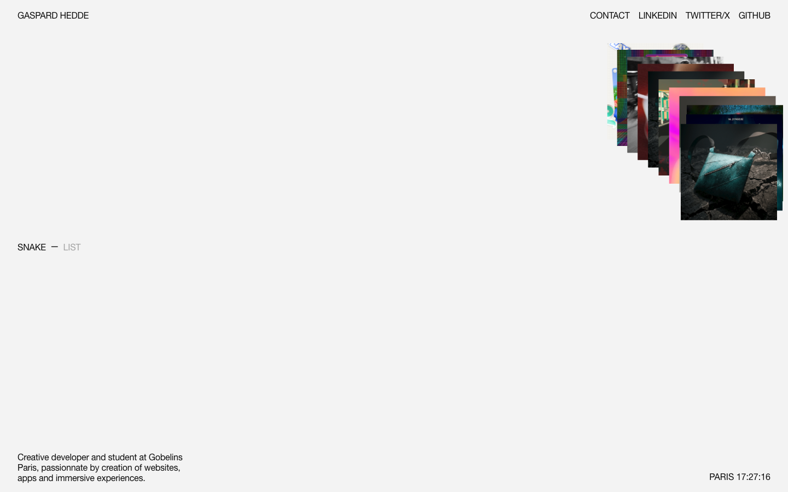

# Gaspard Hedde — Creative Developer
>   ·  [gaspardhedde.fr](https://gaspardhedde.fr)

**What it is** — The portfolio of Gaspard Hedde, a creative developer and Gobelins Paris student who builds websites, apps and immersive experiences. The site is itself a demo of that craft — a minimal frame around an interactive, WebGL-style project showcase.

**What it shows** — A pale grey canvas, almost empty by design: a thin 'GASPARD HEDDE' wordmark top-left, social links (CONTACT / LINKEDIN / TWITTER/X / GITHUB) top-right, a fanned 3D-ish stack of colorful project thumbnails floating in the upper right, a 'SNAKE — LIST' view toggle, and a live 'PARIS 17:27:16' clock with a one-line bio bottom-left.

**How it works** — A fixed single screen (no scroll, body overflow hidden) where the work lives in an interactive image stack rendered on a <canvas> — you browse projects spatially through the fanned deck, and a SNAKE/LIST toggle switches between the playful stacked view and a plain list. Immersive and motion-led rather than document-like.

**How it's designed** — Swiss-minimal meets creative-dev showcase: a light grey ground (#f3f3f3), ultra-thin Helvetica (weight 100) for all type, and near-total emptiness so the colorful, slightly glitchy project deck and the ticking Paris clock become the focus. The restraint frames the WebGL interaction as the hero — the layout gets out of the way.

**Palette** — Light grey ground (#f3f3f3), black text, white; saturated color only in the project-thumbnail stack.
**Fonts** — Helvetica (thin, weight 100)

## Connections
**Aesthetics:** [[aesthetics/experimental|experimental]] [[aesthetics/minimal|minimal]]
**Patterns:** `creative-developer` [[patterns/webgl|webgl]] `canvas-gallery` [[patterns/minimal|minimal]] [[patterns/swiss|swiss]] [[patterns/no-scroll|no-scroll]] `image-stack` `live-clock` `view-toggle`
**Category:** [[categories/design|design]]
**Tech:** —
**Colors:** [[colors/neutral|neutral]]
**Fonts:** —

## Related sites
[[sites/animations.dev|animations.dev]] [[sites/are.na|are.na]] [[sites/christophlocher.com|christophlocher.com]] [[sites/chusmargallo.space|chusmargallo.space]] [[sites/ditther.com|ditther.com]]
