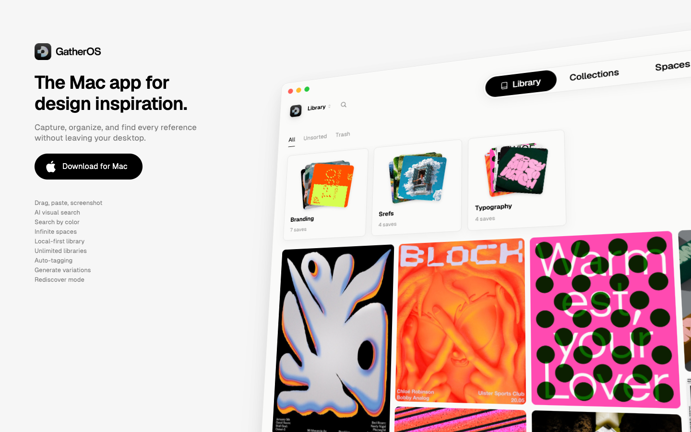

# GatherOS
> The Mac app for design inspiration. Capture, organize, and find every reference without leaving your desktop.  ·  [gatheros.co](https://www.gatheros.co/)

**What it is** — The marketing landing page for GatherOS, a native macOS app (currently in beta) for collecting design inspiration, built by Brett of Designjoy. The single-line pitch is the real on-page h1: 'The Mac app for design inspiration.' — capture, organize and find every reference image or website without leaving your desktop.

**What it shows** — A compact, single-screen pitch: the hero headline plus a polished preview of the app's own UI — a light, flat interface (its own CSS exposes a cream design-token system, --m-content-bg #FAFAF9, --m-text-primary #000) showing a saved reference with an auto-extracted palette, editable metadata and an AI 'Image Prompt'. The page leans on product screenshots (29 images) to sell the capture-and-organize workflow seen in the launch video.

**How it works** — A standard Webflow one-pager: at 1440 it fits in a single viewport (scrollHeight 900), so the whole pitch is above the fold with a download/try CTA; on smaller screens it unfolds into a taller scrolling column. Interaction is minimal — it's a marketing page pointing to the downloadable Mac app, not the app itself.

**How it's designed** — Light, calm and product-forward: a near-white body (rgb(246,246,246)) with pure-black text, so the colorful app screenshots carry the energy. Typography pairs Geist for UI/body copy with a 'Fg Culturetrial' display face for headlines (h1 38px, Geist). It's a Webflow build — the tell-tale webflow-icons font, jQuery and Webflow's CDN (d3e54v103j8qbb.cloudfront.net) — with fonts served from Google Fonts.

**Palette** — Warm off-white / near-white surfaces (#FAFAF9 app chrome, body rgb(246,246,246)), pure-black text (#000), muted grey for secondary text.
**Fonts** — Geist (UI/body), Fg Culturetrial (display headlines)

## Connections
**Aesthetics:** [[aesthetics/developer-product|developer-product]] [[aesthetics/light|light]]
**Patterns:** [[patterns/product-landing|product-landing]] [[patterns/single-screen|single-screen]] `app-preview` [[patterns/webflow|webflow]] [[patterns/light-mode|light-mode]] `mac-app`
**Category:** [[categories/product|product]]
**Tech:** [[tech/webflow|Webflow]] [[tech/jquery|jQuery]] [[tech/cloudfront|Cloudfront]] [[tech/google-fonts|Google Fonts]]
**Colors:** [[colors/light|light]] [[colors/warm|warm]]
**Fonts:** [[fonts/geist|Geist]]

## Related sites
[[sites/akira.sachi.dev|akira.sachi.dev]] [[sites/conigma.com|conigma.com]] [[sites/joonasvirtanen.com|joonasvirtanen.com]] [[sites/mo1.app|mo1.app]] [[sites/shanemac.com|shanemac.com]]
