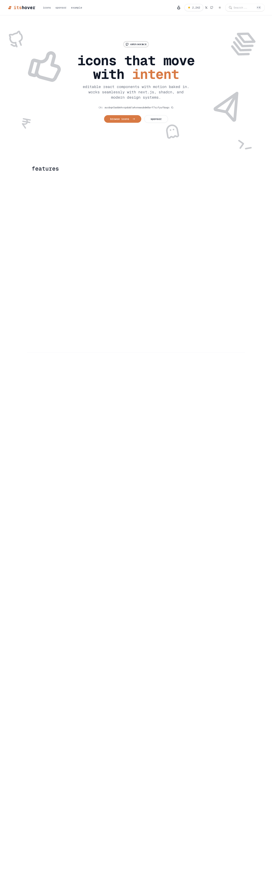

# Its Hover
> Animated icons that move with intent.  ·  [itshover.com](https://www.itshover.com/)

**What it is** — Its Hover, an open-source library of animated icons by Abhijit (@abhijitwt; github.com/itshover/itshover) — 'editable react components with motion baked in' that work with Next.js, shadcn and modern design systems (h1s: 'itshover' / 'icons that move with intent'). One of Devster's inspo-dump links.

**What it shows** — A hero where large grey line-icon glyphs (thumbs-up, stacked layers, paper plane, ghost, terminal prompt) float around the headline and animate on hover, with an 'OPEN SOURCE' pill, 'Browse Icons' / 'Sponsor' CTAs, a GitHub star count and a ⌘K search; below it, feature sections (open source, customize), a 'backed by' / 'loved by creators' block and a closing 'Ready to Bring your icons to life?' CTA. A crypto contract address is shown under the hero.

**How it works** — A single ~4,723px page built on the shadcn/ui token system; the icons are React components animated with Motion (52 inline <svg> plus 2 demo <video>). It uses Umami for analytics (cloud.umami.is), a light/dark theme toggle, and installs via the standard shadcn registry flow. No framework global is exposed but the Geist stack + tokens indicate a Next.js build.

**How it's designed** — Warm monospace developer aesthetic: a white ground (--background #fff) with near-black ink (--foreground #111827), a terracotta/burnt-orange primary (--primary #d87943) and a muted teal secondary (--secondary #527575) — the orange highlights the 'intent' word and the primary CTA. Type is mono-forward: Geist Mono is the UI sans (--font-sans) with JetBrains Mono as --font-mono, and a soft shadow scale keeps cards flat and light.

**Palette** — White ground (--background #fff) with near-black ink (--foreground #111827); a terracotta primary (--primary #d87943) and muted teal secondary (--secondary #527575) as the accent pair.
**Fonts** — Geist Mono (the loaded UI face, set as --font-sans) with JetBrains Mono declared as --font-mono; the Geist Sans variants are declared but stay unloaded on the home view.

## Connections
**Aesthetics:** [[aesthetics/developer-product|developer-product]]
**Patterns:** `icon-library` `animated-icons` [[patterns/open-source|open-source]] [[patterns/monospace|monospace]] [[patterns/react|react]] [[patterns/shadcn|shadcn]] `terracotta` [[patterns/developer-tool|developer-tool]]
**Category:** [[categories/uncategorized|uncategorized]]
**Tech:** [[tech/shadcn-ui-tokens|shadcn/ui tokens]] `Motion` `Umami (analytics)` `Geist Mono`
**Colors:** [[colors/cool|cool]]
**Fonts:** [[fonts/geist-mono-variable-100-900|Geist Mono (variable 100-900)]]

## Related sites
[[sites/akira.sachi.dev|akira.sachi.dev]] [[sites/patterncraft.fun|patterncraft.fun]] [[sites/sensory-ui.com|sensory-ui.com]] [[sites/printingpress.dev|printingpress.dev]] [[sites/21st.dev|21st.dev]]
