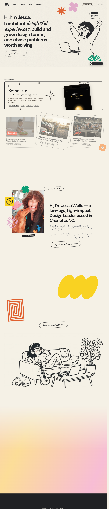

# Jessa Wolfe — Design Leader
> Hi, I'm Jessa. I architect delightful experiences, build and grow design teams, and chase problems worth solving. (from the h1; the page ships no meta description)  ·  [jessa.art](https://jessa.art/)

**What it is** — The 'delightful portfolio' the tweet praises: the personal site of product design leader Jessa Wolfe. The page title is 'Jessa Wolfe — Design Leader'; the h1 is 'Hi, I'm Jessa.' followed by 'I architect delightful experiences, build and grow design teams, and chase problems worth solving.' She is 'a low-ego, high-impact Design Leader based in Charlotte, NC' and is 'currently designing @ ACV Auctions'.

**What it shows** — A warm, hand-illustrated one-page portfolio on a cream 'paper' ground, mixing a subtly animated character illustration of Jessa with a grid of case-study cards (a performance-sportswear brand, a frictionless mobile-banking app, 'Somnar ✦' / 'A quieter place to read', two ACV dealer-tooling studies, and 'Designing with AI across the product lifecycle'), a Career Overview, a 'Talks for Designers' block and a 'Say hello' contact form. The probe counts 31 , 15 <video> (the animated case-study previews) and 12 <svg> doodle marks.

**How it works** — A hand-built static site — the probe found no meta-framework global at all (no React / Next / Nuxt / Svelte / Framer / GSAP / THREE) and no external script host; the only third-party stylesheet host is fonts.googleapis.com (Google Fonts). No analytics were detected. The playful motion is bespoke JavaScript over CSS custom properties.

**How it's designed** — A soft, editorial-illustrative system driven by CSS variables. getComputedStyle reports a warm cream page (html background rgb(245,241,230), the --paper #F5F1E6 token) with near-black ink (--ink #202124, rendered rgb(32,33,36)) and one electric-blue accent (--accent #0307ff). The type mixes four Google families for personality: 'DM Sans' (loaded 400/700) as the bold display hero (h1 at 66px/700), 'Plus Jakarta Sans' (loaded 400/500/600/700) for body/UI, the handwriting face 'Caveat' (loaded 600/700) for sticky-note / doodle labels, and 'Fraunces' (loaded 400 roman + italic) as a serif accent.

**Palette** — Warm cream 'paper' canvas (--paper #F5F1E6 / rgb 245,241,230) with near-black ink (--ink #202124) and a single electric-blue accent (--accent #0307ff).
**Fonts** — 'DM Sans' (loaded 400/700) for the display hero, 'Plus Jakarta Sans' (400/500/600/700) for body/UI, 'Caveat' (600/700) for handwritten doodle labels, and 'Fraunces' (400 roman + italic) as a serif accent — all via Google Fonts.

## Connections
**Aesthetics:** [[aesthetics/portfolio|portfolio]] [[aesthetics/playful|playful]]
**Patterns:** [[patterns/portfolio|portfolio]] [[patterns/personal-site|personal-site]] `hand-illustrated` `cream-paper` `doodle-accents` `animated-character` `case-study-grid` `static-site` [[patterns/no-framework|no-framework]] [[patterns/playful|playful]]
**Category:** [[categories/design|design]]
**Tech:** `Hand-built static site (no meta-framework global detected)` [[tech/google-fonts|Google Fonts]] `No analytics detected`
**Colors:** [[colors/warm|warm]] [[colors/cool|cool]]
**Fonts:** [[fonts/dm-sans|DM Sans]] `Plus Jakarta Sans` [[fonts/caveat|Caveat]] `Fraunces` `Fraunces 400 italic`

## Related sites
[[sites/kmk0.com|kmk0.com]] [[sites/maximin.design|maximin.design]] [[sites/addyosmani.com|addyosmani.com]] [[sites/alisawuffles.github.io|alisawuffles.github.io]] [[sites/ankit-rai.com|ankit-rai.com]]
