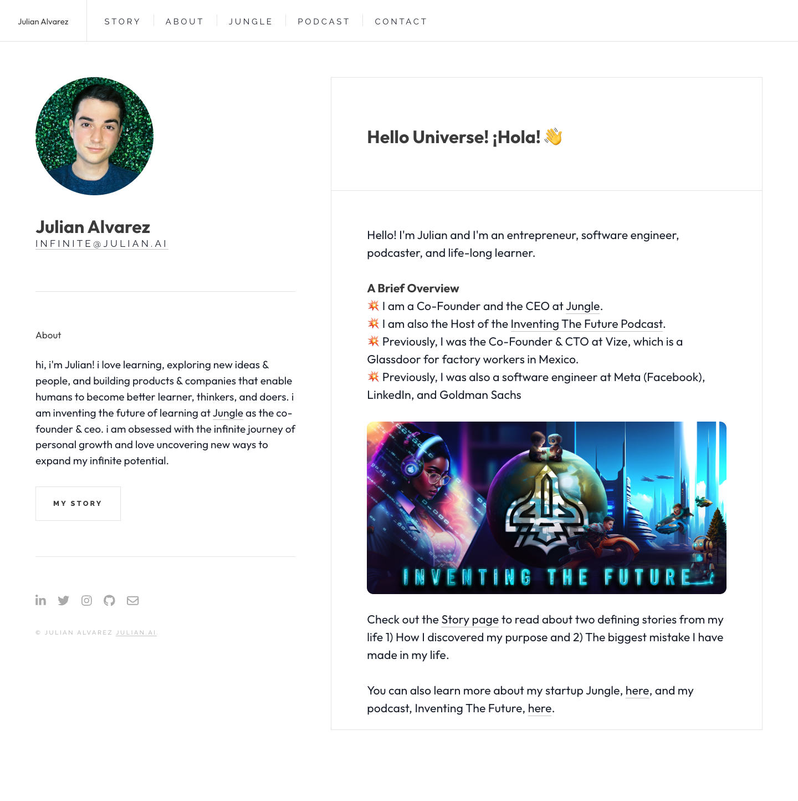

# Julian Alvarez
> Hello Universe! ¡Hola! 👋  ·  [julian.ai](https://www.julian.ai/)

**What it is** — The personal portfolio of Julian Alvarez — founder/CEO of Jungle, host of the 'Inventing The Future' podcast, ex-Meta/LinkedIn/Goldman engineer. (Note: the bookmark announces his 'unbounded ∞' second-brain app, but the tweet linked only this portfolio; the app itself has no public URL yet — the matching email is infinite@julian.ai.)

**What it shows** — A two-column profile page: a fixed left sidebar with a circular avatar, name, the 'INFINITE / JULIAN.AI' tagline and social icons (LinkedIn, X, Instagram, GitHub, email); a right column with a 'Hello Universe! ¡Hola! 👋' greeting, a bulleted career overview, and the 'Inventing The Future' podcast cover artwork.

**How it works** — A React single-page app styled with Chakra UI (the :root carries the full --chakra-* token set). PostHog is wired in for analytics (us-assets.i.posthog.com) and fonts come from Google Fonts; routes like /story, /about, /Jungle, /podcast, /contact are client-rendered.

**How it's designed** — Clean light theme — Chakra's default body bg #FFFFFF with body text rgb(26,32,44) (#1A202C). Display copy is set in the Outfit webfont (Raleway and others are also loaded), giving a friendly geometric-sans feel; Font Awesome powers the social glyphs. Sparse imagery (only 2 images, 5 SVGs) keeps it text-forward and personable.

**Palette** — White background, dark slate #1A202C text, blue link accents (Chakra default palette)
**Fonts** — Outfit (400/700) for display, Raleway (400/800) loaded too — via Google Fonts

## Connections
**Aesthetics:** [[aesthetics/portfolio|portfolio]] [[aesthetics/light|light]]
**Patterns:** [[patterns/portfolio|portfolio]] `personal` `chakra-ui` `two-column` [[patterns/light|light]] `podcast`
**Category:** [[categories/personal|personal]]
**Tech:** [[tech/react|React]] `Chakra UI` [[tech/posthog|PostHog]] [[tech/google-fonts|Google Fonts]]
**Colors:** [[colors/light|light]] [[colors/cool|cool]]
**Fonts:** [[fonts/outfit|Outfit]] `Raleway`

## Related sites
[[sites/ryancarson.com|ryancarson.com]] [[sites/21st.dev|21st.dev]] [[sites/addyosmani.com|addyosmani.com]] [[sites/animations.dev|animations.dev]] [[sites/ankit-rai.com|ankit-rai.com]]
