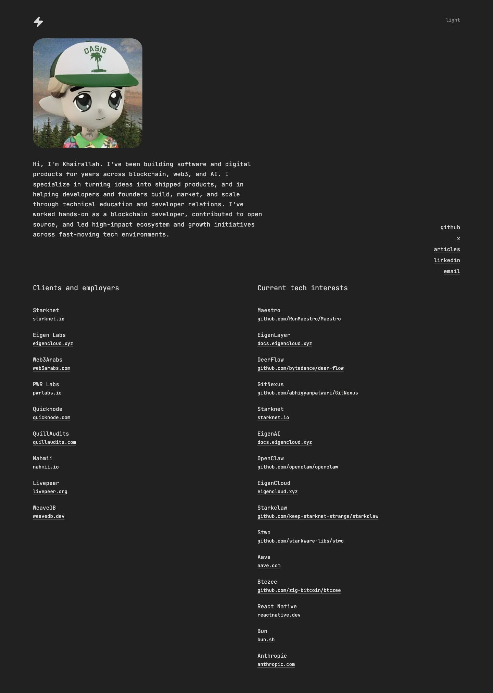

# Khairallah AL-Awady
> Hi, I'm Khairallah. I've been building software and digital products for years across blockchain, web3, and AI.  ·  [khairallah.xyz](https://khairallah.xyz/)

**What it is** — A single-page personal site / résumé for Khairallah AL-Awady, a blockchain/web3/AI developer (founder of web3arabs.com), built as a quiet text-first identity card rather than a marketing page.

**What it shows** — An anime-style avatar and a short intro bio at top, a top-right link cluster (github, x, articles, linkedin, email), then two link-dense columns: 'Clients and employers' (Starknet, EigenCloud, Web3Arabs, PWR Labs, QuickNode, QuillAudits, Nahmii, Livepeer, WeaveDB) and 'Current tech interests' (a reading-list of repos and docs — Maestro, EigenCloud, deer-flow, GitNexus, Starknet, OpenClaw, stwo, Aave, btczee, React Native, Bun, Anthropic).

**How it works** — A fully self-hosted static page — every script and stylesheet comes from khairallah.xyz itself, with no analytics, no framework runtime (no Next/Nuxt/Vue/Svelte globals) and only a single image and one inline SVG. The whole thing fits in ~2k px on desktop.

**How it's designed** — Terminal-minimalist: a flat dark-gray rgb(33,33,33) canvas with light-gray rgb(217,217,217) text, set entirely in JetBrains Mono (400 the only loaded weight). The stylesheet is a Tailwind build (token vars like --background, --foreground, --muted-foreground, --radius, --font-mono-stack present as HSL custom properties); links sit in near-white rgb(235,235,234) with no decorative color, keeping everything monochrome and document-like.

**Palette** — Dark-gray #212121 (rendered rgb(33,33,33)) background, light-gray text, near-white links — fully monochrome
**Fonts** — JetBrains Mono 400 (mono stack); no other webfont loaded

## Connections
**Aesthetics:** [[aesthetics/minimal|minimal]] [[aesthetics/developer-product|developer-product]] [[aesthetics/dark|dark]]
**Patterns:** [[patterns/minimalist|minimalist]] [[patterns/monospace|monospace]] [[patterns/dark-mode|dark-mode]] `personal-card` [[patterns/tailwind|tailwind]] `link-list` `web3`
**Category:** [[categories/personal|personal]]
**Tech:** [[tech/tailwind-css|Tailwind CSS]] `self-hosted static` `no analytics`
**Colors:** [[colors/dark|dark]] [[colors/monochrome|monochrome]]
**Fonts:** [[fonts/jetbrains-mono|JetBrains Mono]]

## Related sites
[[sites/ashpreetbedi.com|ashpreetbedi.com]] [[sites/davekrugman.com|davekrugman.com]] [[sites/northgarden.com|northgarden.com]] [[sites/objectives.md|objectives.md]] [[sites/ryancarson.com|ryancarson.com]]
