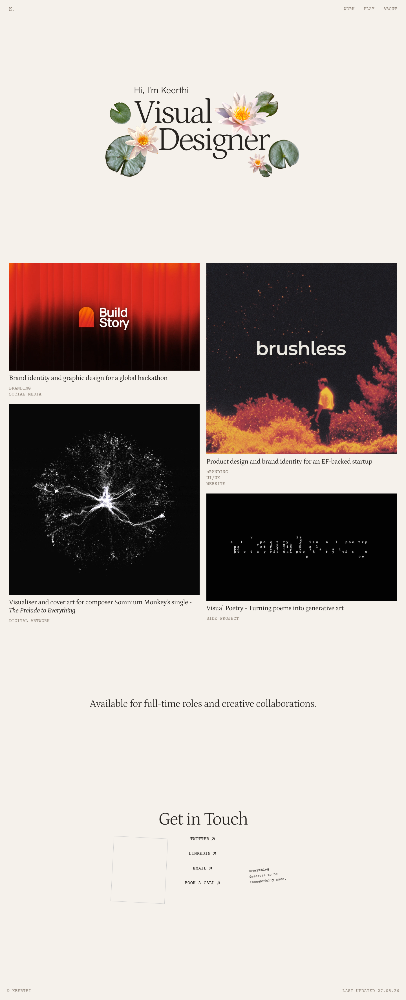

# Keerthi's Website
> Hi, I'm Keerthi — Visual Designer  ·  [kiira.in](https://kiira.in/)

**What it is** — The portfolio of Keerthi (@kiiradesign), described in its meta as 'a visual designer based in India.' Built on Framer.

**What it shows** — A hero — 'Hi, I'm Keerthi / Visual Designer' — wreathed in cut-out floral/lily-pad collage illustrations, then a two-column project grid: 'Build Story' (brand identity & graphic design for a global hackathon), 'brushless' (product design and brand identity for an EF-backed startup), a cover-art piece for composer Somnium Monkey's single 'The Prelude to Everything', and 'Visual Poetry' (turning poems into generative art). It closes with an 'Available for full-time roles and creative collaborations' line and a 'Get in Touch' contact card.

**How it works** — A Framer-hosted vertical-scroll page (~3,540px) with a top WORK / PLAY / ABOUT nav; project thumbnails sit in a two-up grid and one embedded iframe carries an interactive piece.

**How it's designed** — Warm cream canvas (#f5f1eb) with dark-brown ink (#282522), set almost entirely in Courier Prime monospace — the Framer font stack makes it the primary family — with Petrona serif and Satoshi as supporting faces. The token palette also stashes green (#13301b / #396e68), blue (#419fd9) and deep red (#900000) accents. The naturalistic floral collage against the typewriter type gives it a warm, handmade-zine feel.

**Palette** — Cream paper (#f5f1eb) and dark-brown ink (#282522), with green/teal/blue/red token accents
**Fonts** — Courier Prime (primary, monospace) with Petrona serif and Satoshi accents

## Connections
**Aesthetics:** [[aesthetics/portfolio|portfolio]] [[aesthetics/developer-product|developer-product]]
**Patterns:** [[patterns/portfolio|portfolio]] [[patterns/framer|framer]] `monospace-type` `collage` `project-grid` [[patterns/warm-palette|warm-palette]]
**Category:** [[categories/personal|personal]]
**Tech:** [[tech/framer|Framer]] [[tech/framerusercontent-cdn|framerusercontent CDN]] `Framer Analytics (events.framer.com)`
**Colors:** [[colors/warm|warm]] [[colors/cool|cool]]
**Fonts:** `Courier Prime` `Petrona` [[fonts/satoshi|Satoshi]]

## Related sites
[[sites/ankit-rai.com|ankit-rai.com]] [[sites/asekachov.com|asekachov.com]] [[sites/ravalabs.com|ravalabs.com]] [[sites/rotimi.design|rotimi.design]] [[sites/tyronec.com|tyronec.com]]
