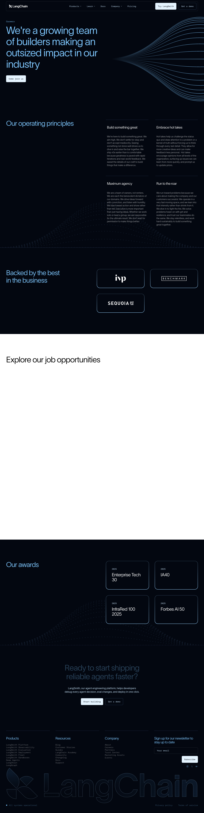

# LangChain Careers
> We're a growing team of builders making an outsized impact in our industry  ·  [langchain.com](https://www.langchain.com/careers)

**What it is** — The careers page of LangChain, the company behind the widely-used LangChain / LangGraph agent-building frameworks. It is a recruiting landing page that sells the team and culture, then embeds the live job board.

**What it shows** — A hero ('We're a growing team of builders making an outsized impact in our industry') over a flowing line-art motif, an 'Our operating principles' four-up grid (build something great, embrace humility, maximum agency, run to the rescue), a 'Backed by the best in the business' investor-logo row (IVP, Benchmark, Sequoia), an 'Explore our job opportunities' section powered by an Ashby embed, an awards/recognition strip (Enterprise Tech 30, IA40, InfraRed 100, Forbes AI 50), and a large LangChain wordmark in the footer.

**How it works** — A Webflow page (~5.7k px) with scroll reveals; the live roles are pulled in from an Ashby job board (jobs.ashbyhq.com) via iframe, and a HubSpot/Segment stack drives newsletter signup and tracking. CTAs route to the embedded openings.

**How it's designed** — Deep-navy near-black canvas (rgb(3,7,16)) with pale-blue text (rgb(204,233,255)), a light-weight 72px TWK Lausanne display headline, Aeonik for body, and JetBrains Mono for technical accents — a calm, premium, agent-infra house style. Generative flowing-line artwork in the hero supplies the only strong imagery; otherwise it leans on tight typography and a restrained blue/violet token system.

**Palette** — Deep-navy background, pale powder-blue text and headings, violet/blue accent tokens; light button fills.
**Fonts** — TWK Lausanne (display H1) + Aeonik (body), with JetBrains Mono for technical accents.

## Connections
**Aesthetics:** [[aesthetics/dark|dark]]
**Patterns:** `careers-page` `dark-navy` [[patterns/webflow|webflow]] `generative-line-art` `operating-principles-grid` `investor-logos` `ashby-embed` `agent-infra`
**Category:** [[categories/uncategorized|uncategorized]]
**Tech:** [[tech/webflow|Webflow]] `Ashby (job board)` [[tech/hubspot|HubSpot]] `Segment` [[tech/plausible|Plausible]] [[tech/google-tag-manager|Google Tag Manager]] `LinkedIn/Reddit/Twitter/Facebook pixels`
**Colors:** [[colors/dark|dark]] [[colors/cool|cool]]
**Fonts:** `Twklausanne` `Aeonik`

## Related sites
[[sites/b150.ai|b150.ai]] [[sites/badmarketing.com|badmarketing.com]] [[sites/claude.com|claude.com]] [[sites/coldiq.com|coldiq.com]] [[sites/conigma.com|conigma.com]]
