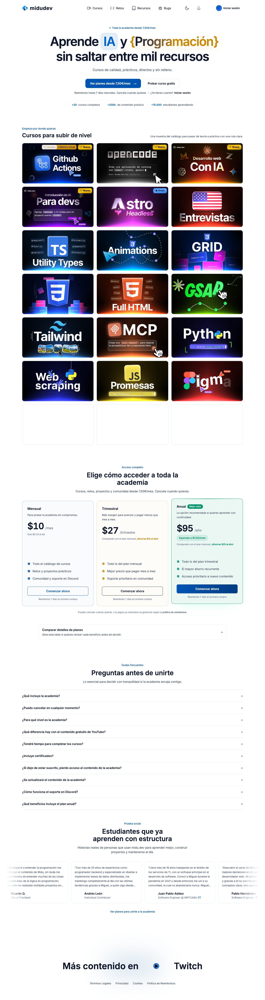

# midu.dev - Cursos de Programación y Desarrollo Web
> Aprende IA y { Programación } sin saltar entre mil recursos  ·  [midu.dev](https://midu.dev)

**What it is** — midu.dev is the Spanish-language programming academy of Miguel Ángel Durán (midudev). Its h1 pitch is 'Aprende IA y { Programación } sin saltar entre mil recursos' ('Learn AI and programming without jumping between a thousand resources'). NOTE: the bookmark itself is a teaser thread about mind-blowing Japanese ThreeJS sites — those sites weren't linked in the tweet body, so midu.dev is captured here only as the author's own (and only resolvable) destination.

**What it shows** — A bright marketing landing for a paid course catalogue: a large hero headline, then a long, scannable grid of course cards — GitHub Actions, OpenCode desde cero, Desarrollo Web con IA, Intro a la IA para Developers, Astro y Headless CMS, Utility Types en TypeScript, Animaciones en CSS, CSS Grid, GSAP, Tailwind, MCP intensivo, Python, scraping, Figma para Devs, experiencias 3D con Vue, and more — capped by pricing ('Ver planes desde 7,50€/mes') and a Stripe checkout CTA.

**How it works** — A static Astro site (astro-island hydration present): nav links to /cursos, /retos, /recursos; each course card deep-links to /curso/<slug>; pricing anchors to /#pricing-plans and 'Comenzar ahora' hits a Stripe checkout (/checkout/iniciar-pago?priceId=...). Ahrefs analytics is the only third-party script; everything else is self-hosted.

**How it's designed** — A clean, high-contrast light theme — white ground rgb(255,255,255) with deep slate ink rgb(15,23,42) — typeset entirely in Inter Variable (the loaded webfont), giving a crisp modern-SaaS look. The hero h1 is a big 68px on desktop (dropping to 48px on mobile). It leans heavily on visual catalogue chrome: 36 raster images (course thumbnails) and 75 inline SVGs (badges/icons like 'Nuevo', 'Gratis', durations), zero canvas/video. Astro ships minimal JS with island hydration.

**Palette** — Light SaaS: white ground rgb(255,255,255), deep slate text rgb(15,23,42); accent carried by course-card art rather than a global brand hue.
**Fonts** — Inter Variable (loaded) for all text, with an 'Inter Prevent Layout Shift' fallback; no serif or mono.

## Connections
**Aesthetics:** [[aesthetics/light|light]] [[aesthetics/developer-product|developer-product]]
**Patterns:** `course-catalogue` [[patterns/light-theme|light-theme]] [[patterns/card-grid|card-grid]] [[patterns/saas-landing|saas-landing]] `pricing-cta` [[patterns/inter|inter]] `astro-islands` `badge-chrome` `stripe-checkout`
**Category:** [[categories/design|design]]
**Tech:** `Astro (astro-island)` `Ahrefs Analytics` `self-hosted JS/CSS` `Stripe (checkout)`
**Colors:** [[colors/light|light]]
**Fonts:** [[fonts/inter-variable-100-900|Inter Variable 100-900]]

## Related sites
[[sites/bigideasdb.com|bigideasdb.com]] [[sites/jenni.ai|jenni.ai]] [[sites/linkeddit.com|linkeddit.com]] [[sites/varickagents.com|varickagents.com]] [[sites/animations.dev|animations.dev]]
