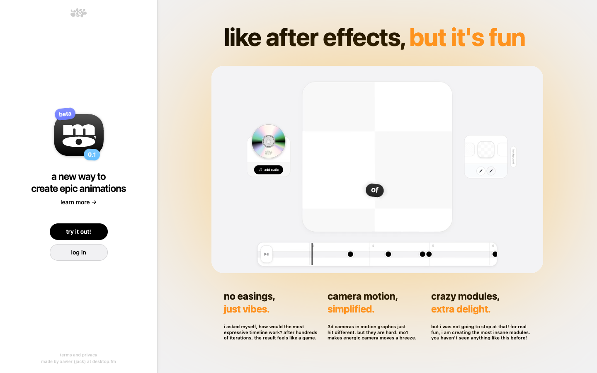

# mo¹
> like after effects, but it's fun  ·  [mo1.app](https://mo1.app/)

**What it is** — The landing page for mo¹ (mo1), a browser-based motion-graphics app pitched as 'like after effects, but it's fun.' It is in beta 0.1, made by xavier (jack) — the tweet's author, @KMkota0 — under the desktop.fm umbrella.

**What it shows** — A hero with a live mock of the editor (a keyframe timeline, an 'add audio' CD element, a camera/transform module) and three pitch columns: 'no easings, just vibes', 'camera motion, simplified', 'crazy modules, extra delight', each with a one-line note about the philosophy. A left sidebar carries the app icon (beta 0.1), 'a new way to create epic animations', a 'learn more' link and 'try it out!' / 'log in' buttons.

**How it works** — A single full-viewport screen (no scroll at desktop; scrollHeight == innerHeight == 900) with one <video> demoing the editor in motion. The primary CTA ('try it out!') opens the app; 'log in' is for returning users. Footer credits xavier (jack) / desktop.fm and links to socials.

**How it's designed** — Light, Apple-ish and playful: a cream/white ground with a soft warm-peach radial gradient behind the editor mock, solid black pill buttons, and a single orange highlight (#fe9024) reserved for the punchy phrases ('but it's fun', 'just vibes', 'simplified', 'delight'). Type is SF Pro (system sans) with EB Garamond as a serif accent — and notably it ships no webfont payload at all (document.fonts is empty), leaning entirely on system fonts.

**Palette** — Cream/white ground with a warm peach gradient panel, black text and black pill buttons, orange highlight (#fe9024).
**Fonts** — SF Pro (system sans, primary) + EB Garamond (serif accent) — system-only, no webfont payload.

## Connections
**Aesthetics:** [[aesthetics/developer-product|developer-product]] [[aesthetics/playful|playful]] [[aesthetics/light|light]]
**Patterns:** [[patterns/product-landing|product-landing]] [[patterns/single-screen|single-screen]] `hero-demo-video` `interactive-mock` `sidebar-cta` [[patterns/playful|playful]] [[patterns/system-fonts|system-fonts]] `orange-highlight` `beta`
**Category:** [[categories/product|product]]
**Tech:** `Nuxt / Vue` [[tech/cloudflare-insights|Cloudflare (insights)]] `desktop.fm analytics (e.dkp.fm)`
**Colors:** [[colors/light|light]] [[colors/warm|warm]]
**Fonts:** [[fonts/system-fonts|system-fonts]]

## Related sites
[[sites/kmk0.com|kmk0.com]] [[sites/bird.onethreenine.net|bird.onethreenine.net]] [[sites/daryl.cv|daryl.cv]] [[sites/gatheros.co|gatheros.co]] [[sites/addyosmani.com|addyosmani.com]]
