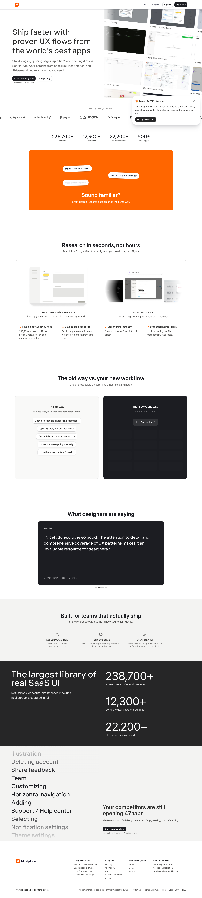

# Nicelydone — web apps design inspiration (UX & UI)
> Ship faster with proven UX flows from the world's best apps.  ·  [nicelydone.club](https://nicelydone.club/)

**What it is** — Nicelydone — 'Web apps design inspiration (UX & UI)': a searchable library of 237,100+ real UI screenshots from 500+ SaaS apps (pricing pages, onboarding flows, settings screens…), 'searchable like Google, draggable into Figma.' It's a product of Bertrand Bruandet's Forwards Labs and one of the two design directories his '10 great websites' tweet points to.

**What it shows** — A long marketing landing page (~6,356px). The hero h1 'Ship faster with proven UX flows from the world's best apps' sits over sections 'Sound familiar?', 'Research in seconds, not hours', 'The old way vs. your new workflow', 'What designers are saying', 'Built for teams that actually ship' and 'The largest library of real SaaS UI', plus an MCP integration, Pricing and a Stripe-backed 'Try it free' CTA.

**How it works** — A Nuxt UI / Tailwind-v4 token system (--ui-* and --container tokens on :root; the runtime global wasn't exposed) with assets served from Bertrand's own coquelicot.forwardslabs.com. The commerce/growth stack is Stripe (js.stripe.com), a Tolt affiliate script (cdn.tolt.io), PostHog analytics (eu-assets.i.posthog.com), Cloudflare Insights and jsDelivr. 18 img, 2 iframe.

**How it's designed** — A clean, near-monochrome SaaS-marketing look. From :root the canvas is white (--ui-bg = var(--color-white)) with a natural-gray text ramp (body/h1 rgb(49,49,48) ≈ naturalgray-900, muted UI text rgb(78,80,96)) and a hairline border (--color-border #1c1d2226); status colours are defined in OKLCH (success/info/warning/error). The display face is 'Klaus' (a warm, characterful sans at weight 600–700; the h1 is 52.8px) set against a system-ui body stack.

**Palette** — White with a natural-gray text ramp (near-black rgb(49,49,48) headings, rgb(78,80,96) UI text), a #1c1d2226 hairline border and OKLCH status colours — restrained so the app screenshots pop.
**Fonts** — 'Klaus' (a display sans, 600–700) for headings, with a system-ui stack for body.

## Connections
**Aesthetics:** [[aesthetics/developer-product|developer-product]] [[aesthetics/minimal|minimal]]
**Patterns:** [[patterns/directory|directory]] `saas-ui` `design-inspiration` `search-tool` `nuxt-ui` [[patterns/tailwind-v4|tailwind-v4]] `oklch` [[patterns/monochrome|monochrome]] `marketing-landing`
**Category:** [[categories/uncategorized|uncategorized]]
**Tech:** `Nuxt UI / Tailwind v4` `Stripe` [[tech/posthog|PostHog]] `Tolt (affiliate)` [[tech/cloudflare|Cloudflare]]
**Colors:** [[colors/monochrome|monochrome]]
**Fonts:** `Klaus`

## Related sites
[[sites/recent.design|recent.design]] [[sites/designengineer.tools|designengineer.tools]] [[sites/humanoid-index.com|humanoid-index.com]] [[sites/maxibestof.one|maxibestof.one]] [[sites/21st.dev|21st.dev]]
