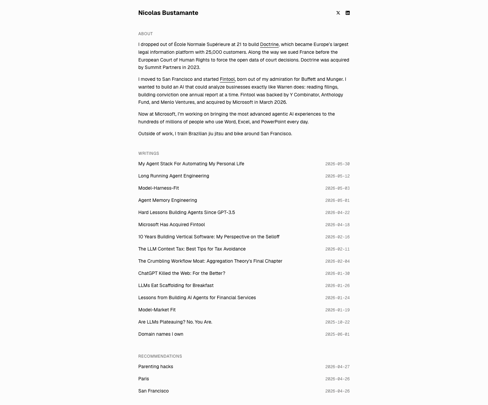

# Nicolas Bustamante — AI Entrepreneur
> AI Entrepreneur  ·  [nicolasbustamante.com](https://nicolasbustamante.com/)

**What it is** — The minimal personal site and blog of Nicolas Bustamante, a serial founder (Doctrine; Fintool, acquired by Microsoft) who now writes prolifically about building AI agents.

**What it shows** — A single narrow text column, no imagery at all. An 'About' intro, then a long 'Writings' index of agent-engineering essays ('Long Running Agent Engineering', 'Agent Memory Engineering', 'Model-Harness-Fit', 'Microsoft Has Acquired Fintool', 'Are LLMs Plateauing? No. You Are.'), and a 'Recommendations' section (Paris, San Francisco, Parenting hacks).

**How it works** — A plain read-top-to-bottom homepage; everything is a text link into a blog post or a recommendation page. No animation, no media, no interactive chrome beyond the links.

**How it's designed** — Ultra-minimal developer-blog aesthetic built on the Geist typeface and a shadcn/ui design-token system. It renders in light mode by default (white #fcfcfc ground, black text) while carrying a full dark theme in CSS variables (--background #0a0a0a / --foreground #fafafa). Zero images (img:0) — the content is the design.

**Palette** — Renders light by default — near-white ground (rgb(252,252,252)) with black text; a complete dark theme is defined in tokens (#0a0a0a ground / #fafafa text), with a coral destructive (#ff6568) and a blue (#1447e6) accent.
**Fonts** — Geist (body/UI) + Geist Mono

## Connections
**Aesthetics:** [[aesthetics/minimal|minimal]] [[aesthetics/portfolio|portfolio]] [[aesthetics/dark|dark]]
**Patterns:** [[patterns/minimalist|minimalist]] [[patterns/text-first|text-first]] [[patterns/personal-homepage|personal-homepage]] [[patterns/blog-index|blog-index]] [[patterns/shadcn|shadcn]] [[patterns/geist|geist]] `dark-mode-ready` [[patterns/single-column|single-column]] [[patterns/monochrome|monochrome]]
**Category:** [[categories/personal|personal]]
**Tech:** `Next.js (Geist font)` `shadcn/ui` [[tech/self-hosted|self-hosted]]
**Colors:** [[colors/dark|dark]] [[colors/monochrome|monochrome]] [[colors/cool|cool]]
**Fonts:** [[fonts/geist-100-900|Geist 100-900]] [[fonts/geist-mono-100-900|Geist Mono 100-900]]

## Related sites
[[sites/daviskeene.com|daviskeene.com]] [[sites/designengineer.tools|designengineer.tools]] [[sites/humanoid-index.com|humanoid-index.com]] [[sites/amanml.com|amanml.com]] [[sites/arneshbanerjee.github.io|arneshbanerjee.github.io]]
