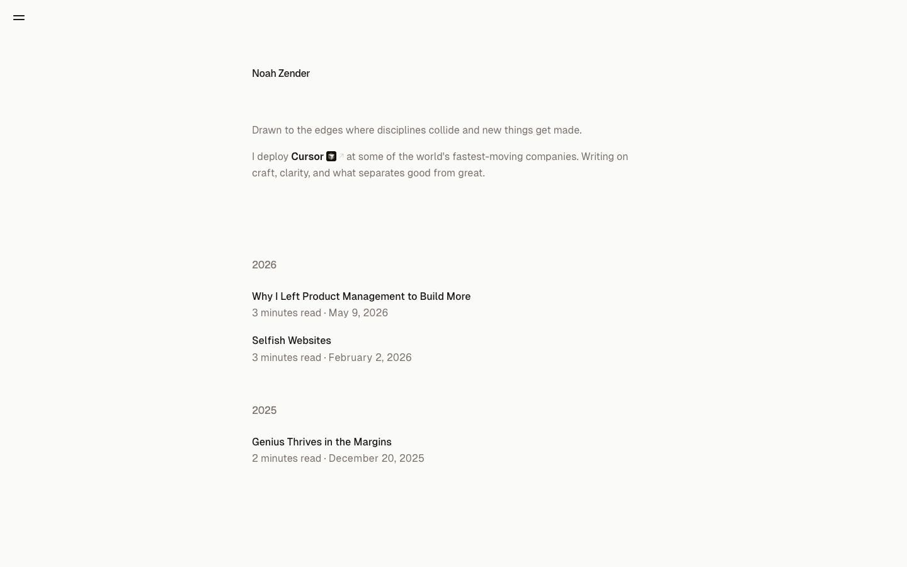

# Noah Zender
> Drawn to the edges where disciplines collide and new things get made.  ·  [noahzender.com](https://www.noahzender.com/)

**What it is** — The personal site of Noah Zender — described in its own meta as 'writer and product builder exploring the edges of creativity, technology, and clear thinking.' There is no <h1>; the page opens with the styled line 'Drawn to the edges where disciplines collide and new things get made,' then notes 'I deploy Cursor at some of the world's fastest-moving companies.' This is the 'notes' the bookmarked memory-agent prompt is designed to mine.

**What it shows** — An ultra-minimal essays index. A short intro paragraph sits above a reverse-chronological list grouped by year: under 2026, 'Why I Left Product Management to Build More' (May 9, 2026) and 'Selfish Websites' (Feb 2, 2026); under 2025, 'Genius Thrives in the Margins' (Dec 20, 2025) — each entry showing a read-time. A single 'Open menu' hamburger sits top-left, and each post deep-links to its own /slug page.

**How it works** — A Next.js site self-hosting everything from noahzender.com (no third-party script or font hosts). It uses Vercel's Geist Sans/Mono webfonts and a shadcn/ui token system (--card, --popover, --primary, --ring expressed in oklch). The home page is a single screen (scrollHeight 900 at desktop) — no canvas, video, or SVG, just one image.

**How it's designed** — A quiet, warm-minimalist theme: an off-white stone ground (oklch(0.985 0.001 106) ≈ #fafaf9) with very dark stone ink (oklch(0.147 0.004 49) ≈ #1c1917), backed by a full Tailwind 'stone' ramp defined as CSS vars. Amber is held in reserve purely for interaction — selection (#f59e0b), text highlight (#fef3c7), and accent-hover (#92400e) — never as page chrome. Geist Sans (loaded) carries all text; Geist Mono is registered but unloaded. The design leans almost entirely on whitespace and typographic hierarchy rather than imagery (1 img, 0 svg/canvas/video).

**Palette** — Warm minimalist: off-white stone ground (~#fafaf9), near-black stone ink (~#1c1917); amber (#f59e0b / #fef3c7 / #92400e) reserved for selection, highlight, and hover.
**Fonts** — Geist Sans (loaded, variable 100-900) for everything; Geist Mono registered but unloaded; system-ui fallback behind both.

## Connections
**Aesthetics:** [[aesthetics/minimal|minimal]]
**Patterns:** [[patterns/minimalist|minimalist]] [[patterns/personal-blog|personal-blog]] `whitespace` `stone-palette` `amber-accent` [[patterns/geist|geist]] [[patterns/nextjs|nextjs]] [[patterns/shadcn-tokens|shadcn-tokens]] `essay-index` [[patterns/single-screen|single-screen]]
**Category:** [[categories/tutorial|tutorial]]
**Tech:** [[tech/next-js|Next.js]] `Geist (Vercel fonts)` `Tailwind + shadcn/ui tokens` [[tech/self-hosted|self-hosted]]
**Colors:** [[colors/warm|warm]]
**Fonts:** [[fonts/geist-sans-100-900|Geist Sans 100-900]]

## Related sites
[[sites/richzou.com|richzou.com]] [[sites/humanoid-index.com|humanoid-index.com]] [[sites/anyblockers.com|anyblockers.com]] [[sites/axiaisacat.indiehacker.bio|axiaisacat.indiehacker.bio]] [[sites/daryl.cv|daryl.cv]]
