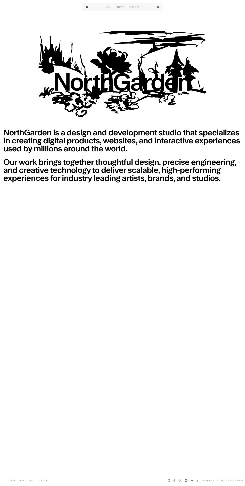

# About — NorthGarden
> NorthGarden is a design and development studio that specializes in creating digital products, websites, and interactive experiences used by millions around the world.  ·  [northgarden.com](https://www.northgarden.com/about)

**What it is** — The About page of NorthGarden (northgarden.com), a self-described "design and development studio creating digital products, websites, and interactive experiences for industry-leading artists, brands, and studios." The wordmark itself is the hero: an animated Three.js (r180) canvas renders a black ink-brush garden scene with the letters of "NorthGarden" set into it.

**What it shows** — A minimalist black-on-white studio page. A file-path-style top nav (N logo, WORK / ABOUT / CONTACT in monospace) sits above the illustrated wordmark, followed by a two-paragraph statement of purpose ("...used by millions around the world" / "Our work brings together thoughtful design, precise engineering, and creative technology..."), then the h2 sections "Trusted by" (client logos) and "What we build". A full-bleed contact CTA anchors the foot, with Instagram, X (@northgardenstu) and LinkedIn (@northgardenstudio) as the outbound links.

**How it works** — A short single-scroll page (~2,850px). The signature element is a WebGL canvas (data-engine="three.js r180") animating the ink-garden wordmark; the rest is static editorial layout. Everything is self-hosted — every script and stylesheet is served from northgarden.com, with no third-party analytics detected. The hashed /opengraph-image.png and /favicon.ico routes point to a Next.js App Router build, styled with Tailwind utility classes (font-grotesk, font-mono, text-neutral-*).

**How it's designed** — Pure monochrome restraint: a #fff background and #000 foreground driven by two CSS variables (--background / --foreground), with neutral greys (text-neutral-500) for the muted nav. Type does the work — the bespoke FT System Grotesk carries the headline copy while FT System Mono (300) handles the nav and labels, a grotesk/mono pairing that reads like a design tool's own UI. The hand-drawn Three.js garden is the only ornament, and the only color, in an otherwise pristine black-and-white frame.

**Palette** — Pure black ink (#000) on white (#fff), with neutral mid-greys for secondary nav text; the only imagery is a black ink-brush garden illustration
**Fonts** — FT System Grotesk (400/600) for headings and body; FT System Mono (300) for nav and labels — both self-hosted webfonts

## Connections
**Aesthetics:** [[aesthetics/portfolio|portfolio]] [[aesthetics/minimal|minimal]] [[aesthetics/experimental|experimental]]
**Patterns:** `studio-portfolio` [[patterns/minimalist|minimalist]] [[patterns/monochrome|monochrome]] `threejs-canvas` `webgl-wordmark` `grotesk-mono-pairing` [[patterns/single-page|single-page]] [[patterns/self-hosted|self-hosted]] [[patterns/nextjs|nextjs]] [[patterns/tailwind|tailwind]]
**Category:** [[categories/design|design]]
**Tech:** `Next.js (App Router — hashed /opengraph-image + /favicon routes)` `Three.js r180 (animated wordmark canvas)` [[tech/tailwind-css|Tailwind CSS]] `self-hosted assets (all from northgarden.com)` [[tech/no-third-party-analytics-detected|no third-party analytics detected]]
**Colors:** [[colors/monochrome|monochrome]]
**Fonts:** `FT System Grotesk 400/600` `FT System Mono`

## Related sites
[[sites/designengineer.tools|designengineer.tools]] [[sites/humanoid-index.com|humanoid-index.com]] [[sites/asekachov.com|asekachov.com]] [[sites/ashpreetbedi.com|ashpreetbedi.com]] [[sites/christophlocher.com|christophlocher.com]]
