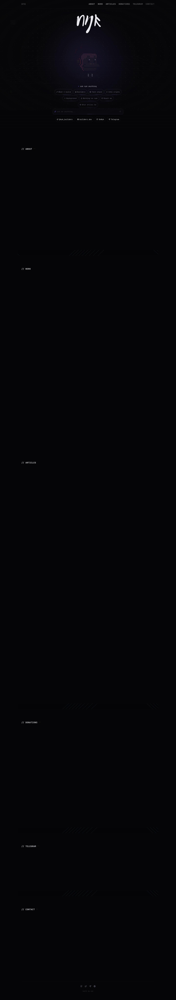

# nyk — Builder, Shipper, Architect
> Builder, Shipper, Architect — Co-Founder & CEO @ Builderz  ·  [nyk.dev](https://www.nyk.dev/)

**What it is** — The personal site of Nyk (@nyk_builderz), Co-Founder & CEO of Builderz — a builder/shipper portfolio centered on AI-agent infrastructure, Solana/DeFi systems and developer tooling. The meta pitch: "Shipping Solana infra, AI agents, trading systems, and client products. 155+ repos, 32+ products, 15 countries."

**What it shows** — A terminal-style hero — a decorative "nyk" wordmark, a pixel-avatar, and an interactive "> ask nyk anything_" chat prompt with suggestion chips (What I build, Builderz, Tech stack, 155+ repos, Into crypto, Background…). Headline stats read 155+ repos, 2.5K+ stars, 32+ products, 200+ followers. Scroll sections labelled in monospace (// ABOUT, // WORK, // ARTICLES, // DONATIONS, // TELEGRAM, // CONTACT) surface GitHub repos (Mission Control agent fleet ops, LACP, xint/xint-rs, Council of High Intelligence) and Builderz client work (pump.science, Reavers, SeaTrees, SEND).

**How it works** — Next.js (App Router — inferred from the /opengraph-image route and content-hashed favicon), with a heavy generative layer: 17 canvas elements and 81 inline SVGs drive animated backgrounds and data-viz, and section content animates in on scroll (so the static full-page capture shows the section labels but mostly empty dark panels). Analytics via Google Tag Manager; scripts and styles are self-hosted on nyk.dev.

**How it's designed** — A very dark, dev/terminal aesthetic: body background rgb(5,5,7), light-grey text rgb(232,232,237), and a single purple accent exposed as the CSS var --accent #7c6df0. Typography pairs Inter (sans body) with JetBrains Mono for the terminal prompt and the // section labels. It's a long single-page scroll (~8157px) with a glowing purple hero and monospace structural copy.

**Palette** — Near-black #050507 canvas, light-grey #e8e8ed text, single purple accent #7c6df0.
**Fonts** — Inter (variable sans) for body + JetBrains Mono for terminal prompt and section labels.

## Connections
**Aesthetics:** [[aesthetics/dark|dark]] [[aesthetics/experimental|experimental]] [[aesthetics/developer-product|developer-product]] [[aesthetics/portfolio|portfolio]]
**Patterns:** [[patterns/dark|dark]] `terminal` `dev-aesthetic` `ai-chat` `generative-canvas` `monospace-labels` [[patterns/single-page|single-page]] `purple-accent` [[patterns/portfolio|portfolio]]
**Category:** [[categories/uncategorized|uncategorized]]
**Tech:** `Next.js (App Router, inferred)` [[tech/google-tag-manager|Google Tag Manager]] `Canvas/SVG animation` [[tech/self-hosted|self-hosted]]
**Colors:** [[colors/dark|dark]] [[colors/cool|cool]]
**Fonts:** `JetBrains Mono 100-800 (variable)` `Inter 100-900 (variable, declared)`

## Related sites
[[sites/ankit-rai.com|ankit-rai.com]] [[sites/hex.inc|hex.inc]] [[sites/jasonyuan.design|jasonyuan.design]] [[sites/killedbyopenai.com|killedbyopenai.com]] [[sites/lab01.dev|lab01.dev]]
