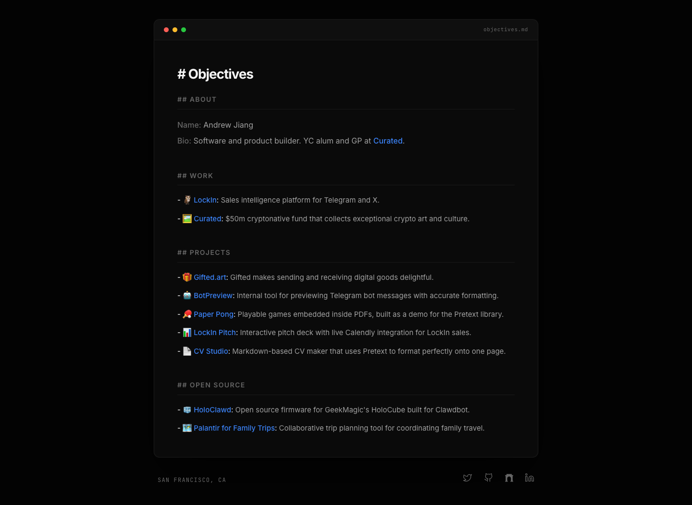

# Andrew Jiang
> # Objectives  ·  [objectives.md](https://objectives.md/)

**What it is** — The personal site of builder/investor Andrew Jiang (YC alum, GP at Curated), and the page the 'Palantir for Family Trips' tweet links to. It styles his whole résumé as a raw Markdown document — the <h1> is literally '# Objectives'.

**What it shows** — A single dark 'editor window' (with macOS traffic-light dots and an 'objectives.md' filename) rendering a Markdown CV: ## About (name + bio), ## Work (LockIn, Curated), ## Projects (Gifted.art, BotPreview, Paper Pong, LockIn Pitch, CV Studio), and ## Open Source — where 'Palantir for Family Trips' links out to its GitHub repo. Section markers like '## WORK' are shown verbatim as the design motif.

**How it works** — A self-hosted Next.js page (og image served from the /opengraph-image route convention; Inter Fallback / JetBrains Mono Fallback names are next/font's generated fallbacks). All scripts and styles come from objectives.md itself; project names are plain outbound <a> links.

**How it's designed** — Dev-tool aesthetic driven by explicit CSS vars: near-black --bg #030303 with a slightly lighter --window #0a0a0a card, off-white --text-primary #f5f5f5, muted --text-secondary #a0a0a0, a green --accent #22c55e and blue --link #3b82f6, hairline --border #1a1a1a. Body copy is Inter, with JetBrains Mono for the monospaced 'filename' and markdown-syntax accents — leaning into the 'a life as a .md file' concept. Image-free (0 imgs, 4 SVGs for the social icons).

**Palette** — Near-black #030303 canvas, off-white #f5f5f5 text, green #22c55e accent, blue #3b82f6 links
**Fonts** — Inter for prose, JetBrains Mono for code/markdown syntax — self-hosted via next/font

## Connections
**Aesthetics:** [[aesthetics/dark|dark]] [[aesthetics/minimal|minimal]] [[aesthetics/developer-product|developer-product]] [[aesthetics/portfolio|portfolio]]
**Patterns:** [[patterns/dark|dark]] `markdown` `developer` `terminal-window` [[patterns/minimalist|minimalist]] [[patterns/monospace|monospace]] [[patterns/portfolio|portfolio]]
**Category:** [[categories/product|product]]
**Tech:** [[tech/next-js|Next.js]] `Inter + JetBrains Mono (next/font)`
**Colors:** [[colors/dark|dark]] [[colors/cool|cool]]
**Fonts:** [[fonts/inter-100-900|Inter 100-900]] `JetBrains Mono 100-800`

## Related sites
[[sites/siddz.com|siddz.com]] [[sites/lab01.dev|lab01.dev]] [[sites/ankit-rai.com|ankit-rai.com]] [[sites/asekachov.com|asekachov.com]] [[sites/christophlocher.com|christophlocher.com]]
