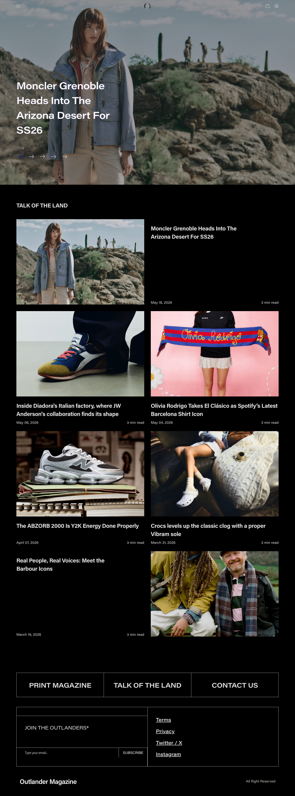

# Outlander Magazine
> Always First at Keeping You Tapped in To Fashion. Active In The Culture Since 2014.  ·  [outlandermag.com](https://outlandermag.com/)

**What it is** — Outlander Magazine, a streetwear / fashion editorial publication and shop that's been 'Active In The Culture Since 2014.' It pairs a steady run of sneaker- and fashion-news stories with a print magazine and a store; the tweet's Chanel × Bergdorf window clip is exactly the kind of culture moment it covers.

**What it shows** — A dark home page (~3.9k px) opening on a full-bleed editorial hero ('Moncler Grenoble Heads Into The Arizona Desert For SS26'), then a 'TALK OF THE LAND' article grid of large image cards — 'Olivia Rodrigo Takes El Clásico as Spotify's Latest Barcelona Shirt Icon', 'The ABZORB 2000 Is Y2K Energy Done Properly', Crocs × Vibram, 'Inside Diadora's Italian factory, where JW Anderson's collaboration finds its shape' — a 'JOIN THE OUTLANDERS' newsletter signup, and PRINT MAGAZINE / TALK OF THE LAND / CONTACT US footer links.

**How it works** — Runs on Shopify (window.Shopify is present, assets from cdn.shopify.com), so the editorial front end sits on top of a commerce backend for the print mag and merch. Fonts load from Adobe Typekit (use.typekit.net); a Mapbox embed (api.mapbox.com) powers a location/stockist map; Google Tag Manager handles tracking. Two iframes, 30 images.

**How it's designed** — High-contrast dark editorial. The body sits on pure black (rgb(0,0,0), with --black declared as #1d1d1d) and runs light-grey text (rgb(227,227,227)). Typography is Adobe's Acumin Pro and its Acumin Pro Wide cut (multiple weights actually loaded — 400/600/700 regular, 400/500/600/700 wide), and a CSS var reserves an 'ndot' display face (Nothing's dot-matrix font) for accents. Big full-bleed imagery and a tight magazine card grid carry the look.

**Palette** — Pure-black ground (rgb(0,0,0) / --black #1d1d1d) with light-grey body text (#e3e3e3) — stark, high-contrast dark editorial.
**Fonts** — Acumin Pro + Acumin Pro Wide (Adobe Typekit), with an 'ndot' dot-matrix display face reserved for accents.

## Connections
**Aesthetics:** [[aesthetics/editorial|editorial]] [[aesthetics/dark|dark]] [[aesthetics/luxury|luxury]]
**Patterns:** `fashion-editorial` `streetwear` [[patterns/dark-mode|dark-mode]] `shopify` `article-grid` `magazine` `full-bleed-hero`
**Category:** [[categories/irl|irl]]
**Tech:** `Shopify` `Adobe Fonts (Typekit)` `Mapbox` [[tech/google-tag-manager|Google Tag Manager]]
**Colors:** [[colors/dark|dark]]
**Fonts:** `acumin-pro` `acumin-pro-wide`

## Related sites
[[sites/backgrounds.supply|backgrounds.supply]] [[sites/badmarketing.com|badmarketing.com]] [[sites/davekrugman.com|davekrugman.com]] [[sites/daytona.io|daytona.io]] [[sites/ditther.com|ditther.com]]
