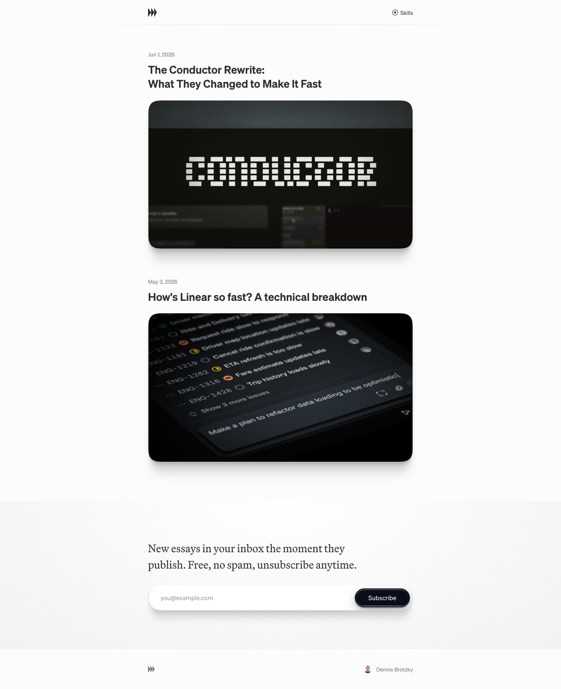

# Performance
> Essays on building fast, beautiful web apps and the craft behind them.  ·  [performance.dev](https://performance.dev)

**What it is** — Dennis Brotzky's personal essay blog about web performance craft — the companion site to the Fey performance thread. The meta description is the mission statement: "Essays on building fast, beautiful web apps and the craft behind them." (The page has no <h1>; the description carries the pitch.)

**What it shows** — A spare, light editorial index listing essays as large rounded preview cards — currently "The Conductor Rewrite: What They Changed to Make It Fast" (Jun 1, 2026) and "How's Linear so fast? A technical breakdown" (May 3, 2026) — each card showing a styled hero graphic. A footer pitches a no-spam email subscription and credits Dennis Brotzky (linked to x.com/brotzky).

**How it works** — No JS framework was detected (no Next/Nuxt/Vue/Svelte/React roots or globals) — it behaves as a static/hand-built site. The only third-party script is Cloudflare's cloudflareinsights analytics beacon; everything else, including the custom 'Performance Sans' and 'Performance Serif' webfonts, is served from performance.dev.

**How it's designed** — Light, print-like editorial: an off-white canvas (rgb(252,252,252)) with near-black ink text (rgb(43,47,41)) and a single dark-navy pill CTA (bg rgb(10,13,26), white label). It rides on an unusually elaborate CSS-variable design system for such a small site: a custom serif/sans pairing, a tiny UI type scale (--fs-body 11px up to --fs-xl 14px) alongside an 18px reading size, squircle card corners (--squircle-shape superellipse(1.6), 38px radius), layered media shadows (--shadow-media), a 720px --content-width measure and glass-blur tokens. The result reads like a meticulously typeset magazine column.

**Palette** — Off-white paper, near-black ink, a single dark-navy pill CTA.
**Fonts** — Custom 'Performance Sans' (400/600) for body/UI and 'Performance Serif' (400) for prose, with a system mono fallback; self-hosted.

## Connections
**Aesthetics:** [[aesthetics/editorial|editorial]] [[aesthetics/light|light]] [[aesthetics/minimal|minimal]]
**Patterns:** [[patterns/editorial|editorial]] [[patterns/blog-index|blog-index]] [[patterns/light-theme|light-theme]] `squircle-cards` `custom-typeface` [[patterns/design-tokens|design-tokens]] [[patterns/minimalist|minimalist]] `performance-craft`
**Category:** [[categories/design|design]]
**Tech:** `No JS framework detected (static/hand-built)` `Cloudflare (cloudflareinsights analytics)` [[tech/self-hosted-fonts|self-hosted fonts]]
**Colors:** [[colors/light|light]] [[colors/cool|cool]]
**Fonts:** `Performance Sans` `Performance Serif`

## Related sites
[[sites/rvivek.com|rvivek.com]] [[sites/amanml.com|amanml.com]] [[sites/asekachov.com|asekachov.com]] [[sites/christophlocher.com|christophlocher.com]] [[sites/davidwinalda.com|davidwinalda.com]]
