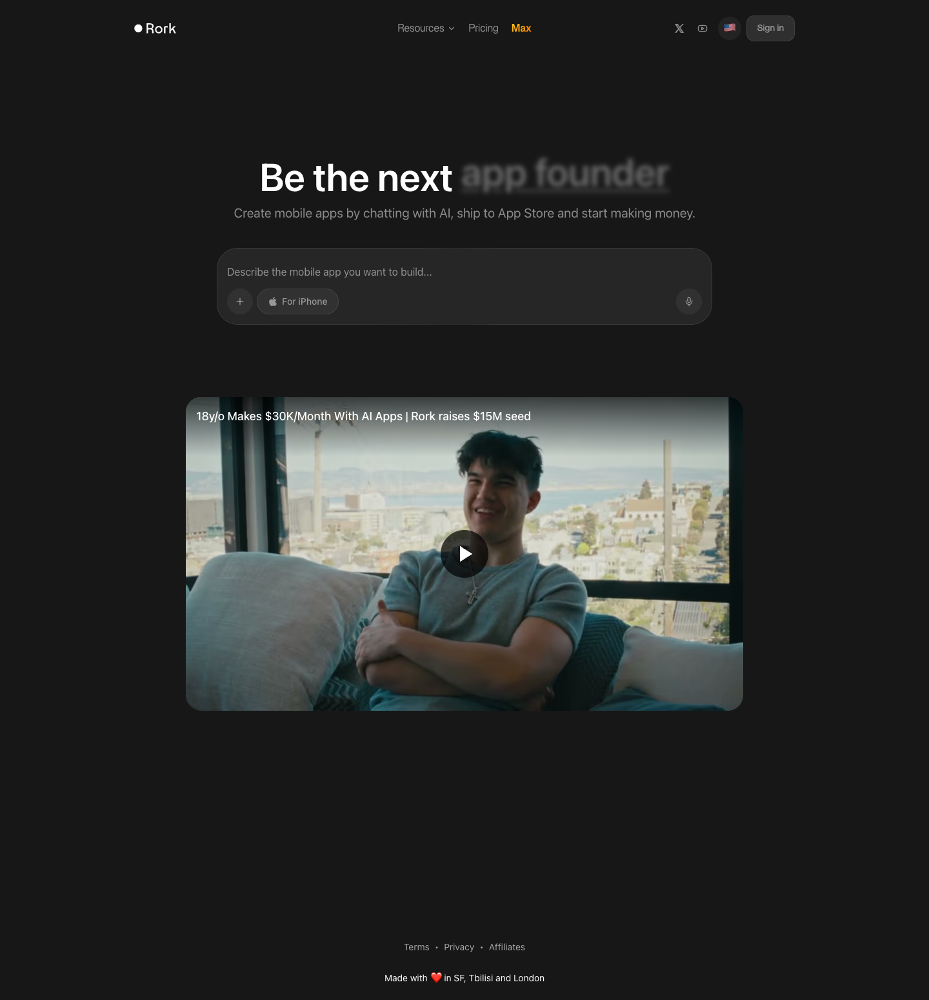

# Rork — create a mobile app using AI in minutes
> Be the next app founder  ·  [rork.com](https://rork.com/)

**What it is** — Rork is a text-to-app builder: you describe a mobile app and its AI generates a complete, production-ready Expo / React Native project that installs on-device in one click and publishes to the App Store in two. The marketing page frames it as the on-ramp for solo founders — its rotating hero pitch is "Be the next [app founder]".

**What it shows** — A single centered hero: a big rotating headline ("Be the next Nikita Bier" / "...app founder"), the subline "Create mobile apps by chatting with AI, ship to App Store and start making money", a prompt box reading "Describe the mobile app you want to build…" with a platform selector (For iPhone) and a submit arrow, and below it an embedded testimonial video titled "18yo Makes $30K/Month With AI Apps | Rork raises $15M seed".

**How it works** — Client-rendered single-page app — no SSR framework globals (__NEXT_DATA__, __NUXT__, data-v-app, sveltekit all absent); scripts are served from rork.com and toolkit.rork.com with the rest of the payload being a marketing/growth stack: Google Tag Manager, TikTok, Snapchat and Meta pixels, and the Tolt affiliate SDK, plus jsDelivr as a CDN. Stylesheets are self-hosted on rork.com.

**How it's designed** — A near-black, minimalist single-column hero (body background rgb(23,23,23), white text). The H1 renders at 60px / weight 600 using a system SF Pro stack with the custom brittiSans webfont as fallback; body copy and buttons use brittiSans (400–700). Buttons are fully pill-shaped (an effectively infinite border-radius) with translucent white fills. Only three images, ten inline SVGs, no canvas or video element of its own — the demo is an embedded player. The page runs ~1551px tall at desktop, a hair past a single screen.

**Palette** — Near-black #171717 background, white text, low-opacity translucent-white pill buttons.
**Fonts** — brittiSans (custom webfont, weights 400–700); system SF Pro / -apple-system stack for the hero headline with brittiSans as fallback.

## Connections
**Aesthetics:** [[aesthetics/dark|dark]] [[aesthetics/minimal|minimal]]
**Patterns:** [[patterns/dark|dark]] [[patterns/minimalist|minimalist]] `centered-hero` `prompt-input` `rotating-headline` `pill-buttons` `video-testimonial`
**Category:** [[categories/personal|personal]]
**Tech:** `Client-side SPA` [[tech/google-tag-manager|Google Tag Manager]] `TikTok/Snap/Meta pixels` `Tolt affiliate` `jsDelivr CDN`
**Colors:** [[colors/dark|dark]]
**Fonts:** `brittiSans`

## Related sites
[[sites/objectives.md|objectives.md]] [[sites/alisawuffles.github.io|alisawuffles.github.io]] [[sites/amanml.com|amanml.com]] [[sites/ankit-rai.com|ankit-rai.com]] [[sites/anyblockers.com|anyblockers.com]]
