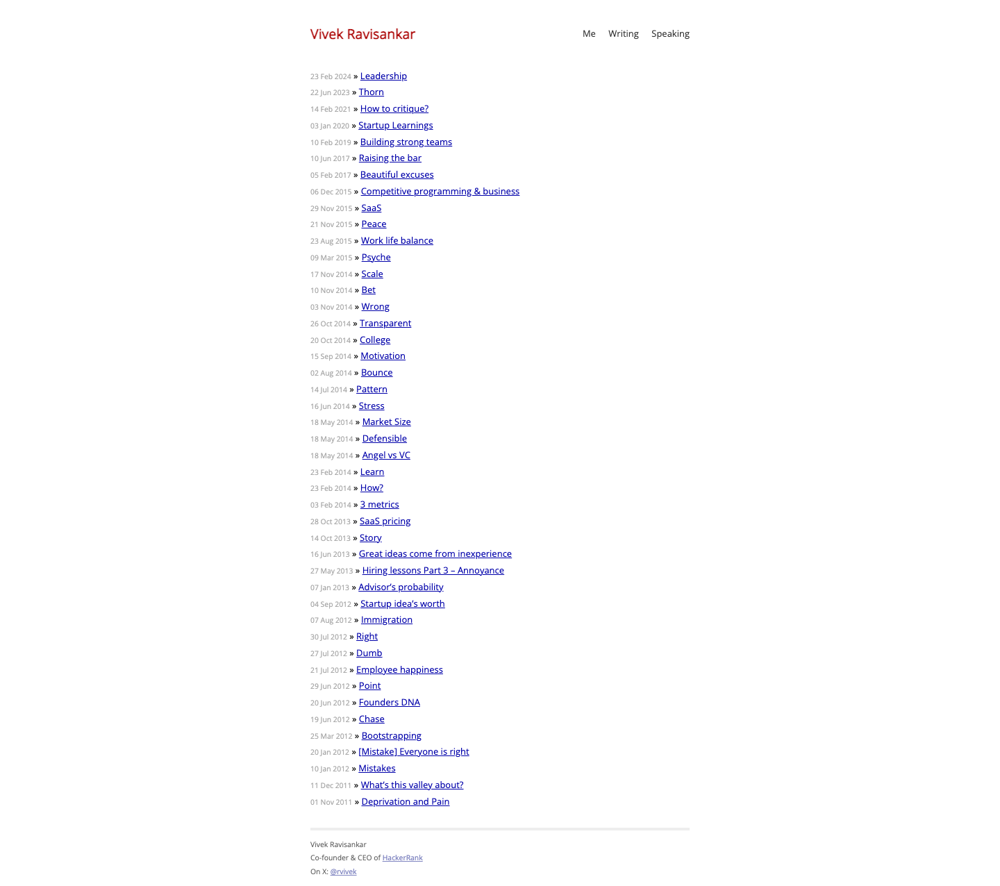

# Vivek Ravisankar
> Me · Writing · Speaking  ·  [rvivek.com](https://www.rvivek.com/)

**What it is** — The personal essay archive of Vivek Ravisankar (co-founder/CEO of HackerRank), a stripped-back writing blog whose homepage is just a reverse-chronological index of posts going back to 2014.

**What it shows** — A simple top nav (Me / Writing / Speaking) over a dated list of ~50+ short essays on startups, hiring, leadership and life — 'Leadership', 'Startup Learnings', 'Building strong teams', 'Raising the bar', 'SaaS', 'Work life balance', 'Market Size', 'Angel vs VC', and so on. No images, no hero, no cards — pure index.

**How it works** — A static, content-only site (no JS framework globals, zero images/canvas/video/svg, single same-origin stylesheet) with Adobe Typekit pulled in for webfonts. The full homepage is one ~1.3k px screen — essentially a hand-rolled or Jekyll-style blog index.

**How it's designed** — Classic editorial minimalism: white background, pure-black body text in Open Sans, with Inconsolata (Typekit) for monospace accents and a single dark-red rgb(170,0,0) link color as the only chrome. No CSS custom properties, no design system — typography and whitespace do all the work.

**Palette** — White background, black text, dark-red #aa0000 links
**Fonts** — Open Sans 400 (body) + Inconsolata (Typekit, mono accent)

## Connections
**Aesthetics:** [[aesthetics/minimal|minimal]] [[aesthetics/editorial|editorial]]
**Patterns:** [[patterns/minimalist|minimalist]] [[patterns/editorial|editorial]] [[patterns/blog-index|blog-index]] [[patterns/text-only|text-only]] `typekit` `static`
**Category:** [[categories/personal|personal]]
**Tech:** `static site (Jekyll-style)` [[tech/adobe-typekit|Adobe Typekit]]
**Colors:** [[colors/neutral|neutral]]
**Fonts:** [[fonts/open-sans|Open Sans]] `Inconsolata`

## Related sites
[[sites/amanml.com|amanml.com]] [[sites/performance.dev|performance.dev]] [[sites/anyblockers.com|anyblockers.com]] [[sites/asekachov.com|asekachov.com]] [[sites/axiaisacat.indiehacker.bio|axiaisacat.indiehacker.bio]]
