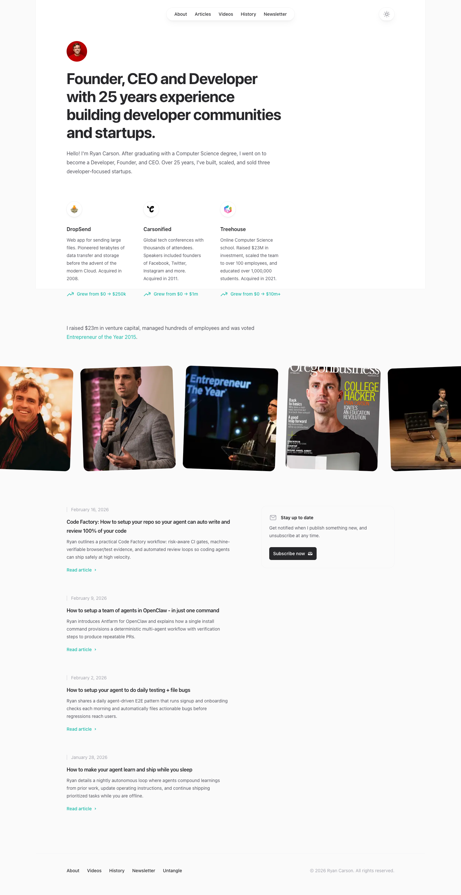

# Ryan Carson, Founder with 20 years of experience building companies.
> Founder, CEO and Developer with 25 years experience building developer communities and startups.  ·  [ryancarson.com](https://www.ryancarson.com/)

**What it is** — The personal site of serial founder Ryan Carson (DropSend, Carsonified, Treehouse). The hero <h1> reads 'Founder, CEO and Developer with 25 years experience building developer communities and startups.'

**What it shows** — A clean résumé-style homepage: a circular avatar and bio, a three-up row of past ventures (DropSend, Carsonified, Treehouse), a strip of media/talk thumbnails, then a reverse-chronological feed of recent posts — currently AI-agent how-tos ('Code Factory', 'set up a team of agents in OpenClaw', 'agent that learns and ships while you sleep') and a newsletter sign-up.

**How it works** — A static, content-first page built with Tailwind CSS; no SPA framework global is exposed (__NEXT__/__NUXT__/Vue/Svelte all absent), so it reads as a static export. The only third-party script is Google Tag Manager.

**How it's designed** — Minimal editorial layout on an off-white rgb(250,250,250) canvas with black body text and near-black rgb(39,39,42) headings; the only CSS custom properties present are Tailwind's own utility vars plus a few avatar/header layout vars (--header-height:180px, sticky header). No webfont is downloaded at all — document.fonts is empty, so it renders entirely in the system ui-sans-serif stack. Accent restraint, generous whitespace, a single small avatar as the only ornament.

**Palette** — Off-white #fafafa background, black body text, near-black #27272a headings — essentially monochrome
**Fonts** — System fonts only (ui-sans-serif / system-ui) — no webfont payload

## Connections
**Aesthetics:** [[aesthetics/minimal|minimal]] [[aesthetics/portfolio|portfolio]] [[aesthetics/editorial|editorial]]
**Patterns:** [[patterns/minimalist|minimalist]] `personal` [[patterns/portfolio|portfolio]] [[patterns/editorial|editorial]] [[patterns/system-fonts|system-fonts]] [[patterns/tailwind|tailwind]]
**Category:** [[categories/reading|reading]]
**Tech:** [[tech/tailwind-css|Tailwind CSS]] [[tech/google-tag-manager|Google Tag Manager]]
**Colors:** [[colors/monochrome|monochrome]]
**Fonts:** [[fonts/system-fonts|system-fonts]]

## Related sites
[[sites/asekachov.com|asekachov.com]] [[sites/christophlocher.com|christophlocher.com]] [[sites/addyosmani.com|addyosmani.com]] [[sites/ashpreetbedi.com|ashpreetbedi.com]] [[sites/daryl.cv|daryl.cv]]
