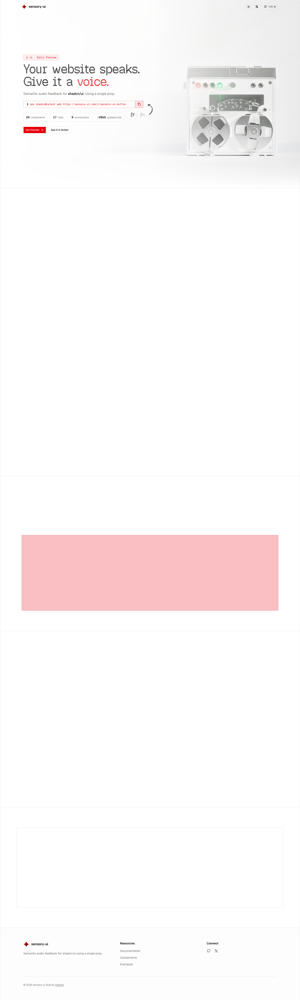

# sensory-ui - Semantic Sound for React & Next.js
> A semantic, opt-in sound layer for React and Next.js apps — meaningful audio feedback for UI, built for shadcn/ui.  ·  [sensory-ui.com](https://www.sensory-ui.com/)

**What it is** — sensory-ui, an opt-in semantic sound layer for React/Next.js apps by Satyam Vyas (github.com/SatyamVyas04/sensory-ui) — 'Your website speaks. Give it a voice.' It adds meaningful audio feedback to UI interactions with 17 sound roles across 24 components, built for shadcn/ui (v1 early preview). One of Devster's inspo-dump links.

**What it shows** — A hero with a photoreal 3D render of a translucent reel-to-reel tape machine beside the headline, a shadcn install command ('npx shadcn@latest add …/sensory-ui-switch'), and a stat strip (24 components · 17 roles · 9 sound packs · ~26kb gzipped); below, a 'Showcase — Feel the difference.' carousel and editorial sections ('Sound with intention.', 'The forgotten dimension.') making the case for UI sound, citing Material Design's sound guidelines.

**How it works** — A single ~4,785px page on the shadcn/ui token system; the demo components play audio on interaction (1 <video>, 73 inline <svg>, a hero-background.jpg) and the library installs via the shadcn registry CLI. Analytics are self-hosted (p.sensory-ui.com); no framework global is exposed but the Geist stack + tokens indicate a Next.js build, and a light/dark theme toggle is present.

**How it's designed** — Crisp editorial light theme with a single bold accent: a white ground (--background #fff) with near-black ink (--foreground #0c0a09) and a strong signal red (--primary #e40014) that colours the 'voice.' word, the CTA and the chart ramp (#ffa3a3 → #9f0712). The 'Your website speaks…' headline is set in GeistPixelCircle (a dotted pixel display face) with Geist Sans for prose and Geist Mono for the install command.

**Palette** — White ground (--background #fff) with near-black ink (--foreground #0c0a09) and a single bold red accent (--primary #e40014) running through CTA, headline highlight and a red chart ramp.
**Fonts** — GeistPixelCircle (dotted pixel display headline) + Geist Sans (prose) + Geist Mono (install command) — all three load.

## Connections
**Aesthetics:** [[aesthetics/developer-product|developer-product]] [[aesthetics/playful|playful]] [[aesthetics/editorial|editorial]] [[aesthetics/light|light]]
**Patterns:** [[patterns/developer-tool|developer-tool]] `sound-ui` [[patterns/shadcn|shadcn]] [[patterns/pixel-type|pixel-type]] [[patterns/editorial|editorial]] [[patterns/light-mode|light-mode]] `red-accent` [[patterns/open-source|open-source]]
**Category:** [[categories/uncategorized|uncategorized]]
**Tech:** [[tech/shadcn-ui-tokens|shadcn/ui tokens]] `Geist` `self-hosted analytics (p.sensory-ui.com)`
**Colors:** [[colors/light|light]]
**Fonts:** [[fonts/geist-variable-100-900|Geist (variable 100-900)]] [[fonts/geist-mono-variable-100-900|Geist Mono (variable 100-900)]] `GeistPixelCircle`

## Related sites
[[sites/akira.sachi.dev|akira.sachi.dev]] [[sites/patterncraft.fun|patterncraft.fun]] [[sites/itshover.com|itshover.com]] [[sites/designtools.fyi|designtools.fyi]] [[sites/joonasvirtanen.com|joonasvirtanen.com]]
