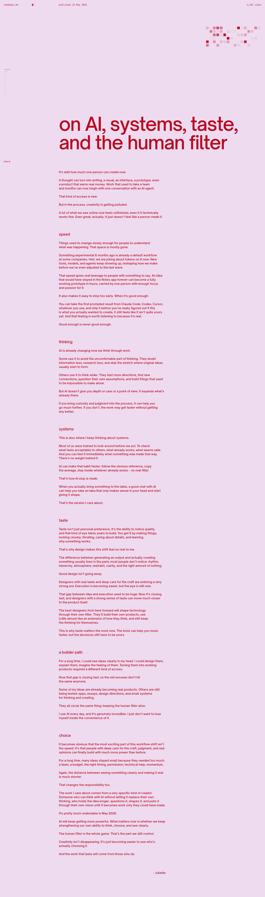

# On AI, systems, taste and the human filter
> An essay on what AI means for creativity, design and building your own things.  ·  [shedsgns.me](https://shedsgns.me/taste)

**What it is** — A long-form personal essay by Juliette (shedsgns), titled (verbatim h1) 'on AI, systems, taste, and the human filter' — reflections on what AI means for creativity, design and building your own things.

**What it shows** — A typographic, image-free read (0 images) on a lilac page with an oversized deep-red display headline, broken into named sections: speed, thinking, systems, taste, a builder path, and choice. The only outbound link is back to the shedsgns.me home.

**How it works** — A straightforward vertical long-read (~4,850px tall) — you scroll through the argument section by section. No interactive chrome; the experience is the writing plus the strong typographic treatment.

**How it's designed** — Bold, high-contrast editorial design: a lilac page (rgb(238,219,240) / ~#eedbf0) with crimson-red headings and links (rgb(186,11,33) / #ba0b21) and near-black body text. The hero headline is a huge 100px 'Open Sauce One Taste' display cut, while body copy falls back to system SF Pro (-apple-system) at 14px — no body webfont payload. The CSS carries a fuller dark zinc-based token system (--zinc-950 #0e0e0e, --accent → --pink-400 #fb5ab2), but this page renders in the light lilac/red theme. Built lightweight (LightningCSS) with visitors.now for analytics.

**Palette** — Lilac page (#eedbf0), crimson-red headings & links (#ba0b21), near-black body text (#0e0e0e); a hot-pink accent token (#fb5ab2) sits in the system.
**Fonts** — Open Sauce One Taste (display headline); system SF Pro / -apple-system (body, no webfont)

## Connections
**Aesthetics:** [[aesthetics/editorial|editorial]] [[aesthetics/light|light]]
**Patterns:** `long-form-essay` [[patterns/editorial|editorial]] [[patterns/typographic|typographic]] `fluid-type` [[patterns/high-contrast|high-contrast]] [[patterns/light-mode|light-mode]] `reading`
**Category:** [[categories/personal|personal]]
**Tech:** `LightningCSS` `visitors.now analytics` [[tech/google-fonts|Google Fonts]]
**Colors:** [[colors/light|light]]
**Fonts:** `Open Sauce One Taste`

## Related sites
[[sites/interfaces.dev|interfaces.dev]] [[sites/joonasvirtanen.com|joonasvirtanen.com]] [[sites/sensory-ui.com|sensory-ui.com]] [[sites/12matcha.com|12matcha.com]] [[sites/akira.sachi.dev|akira.sachi.dev]]
