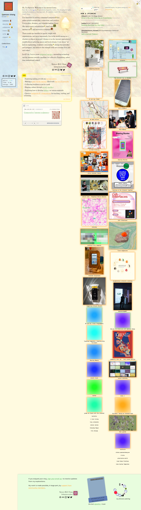

# ꜱᴘᴇɴᴄᴇʀ ᴄʜᴀɴɢ
> Welcome to my internet home — a living space shaped by visitors  ·  [spencer.place](https://spencer.place/)

**What it is** — The personal 'internet home' of Spencer Chang — artist, engineer and toymaker in San Francisco who makes 'technology that cultivates interdependence and human agency.' He is the maker behind the Wikipedia-multiplayer extension this bookmark is about, and the site itself is a living, collaboratively-editable room.

**What it shows** — A dark, room-like homepage that opens 'Hi, I'm Spencer. Welcome to my internet home.' A live presence counter shows 'ppl(4)' currently visiting, and the page invites you to change the lights, move the furniture, or leave a note. Emoji-tagged nav (welcome 🚪 / describe 🟠 / collaborate 🌻 / create 💽 / write 🖨️ / support 🫶 / fits 🧢) leads to collections of his creations — playhtml 'tiny social networks', 'game for the internet', 'internet debris', computing shrines — plus a now-page, current reading and exhibitions.

**How it works** — It's genuinely multiplayer: shared, persistent state (visitor count, movable furniture, lighting, notes) is powered by playhtml backed by a Cloudflare Worker ('sharingan'), so visitors edit the space in real time and the changes persist. You explore by scrolling the richly layered single page and clicking the emoji nav.

**How it's designed** — A cozy, lo-fi 'soft internet' aesthetic: a charcoal/teal ground (rgb(47,51,54)) with cream text (rgb(235,232,227)) and a soft-yellow accent (rgb(234,234,111)), warm orange links. Playful display typography pairs Cooper and Vulf Sans with retro mono faces (Sono, VT323), and emoji double as navigation. Built on Astro + playhtml, image-heavy (46 imgs, 8 inline videos) to feel hand-furnished rather than templated.

**Palette** — Charcoal/teal ground (rgb(47,51,54)) with cream text (rgb(235,232,227)) and a soft-yellow accent (rgb(234,234,111)); links are warm orange (hsl(33, 100%, 56%)).
**Fonts** — Vulf Sans + Cooper (display/body), Sono & VT323 (retro mono)

## Connections
**Aesthetics:** [[aesthetics/portfolio|portfolio]] [[aesthetics/retro|retro]] [[aesthetics/dark|dark]]
**Patterns:** [[patterns/personal-homepage|personal-homepage]] `multiplayer` `collaborative` `playhtml` `living-space` `cozy-web` `indie-web` `emoji-nav` `retro` [[patterns/dark|dark]] `astro`
**Category:** [[categories/product|product]]
**Tech:** `Astro` `playhtml (multiplayer state)` `Cloudflare Workers + Analytics` `unpkg`
**Colors:** [[colors/dark|dark]] [[colors/warm|warm]] [[colors/cool|cool]]
**Fonts:** `Vulf Sans` `Cooper` `Sono` `VT323` `unicons-line (icon font)`

## Related sites
[[sites/alisawuffles.github.io|alisawuffles.github.io]] [[sites/ankit-rai.com|ankit-rai.com]] [[sites/daviskeene.com|daviskeene.com]] [[sites/ddlabstudio.com|ddlabstudio.com]] [[sites/eko.lumaris.works|eko.lumaris.works]]
