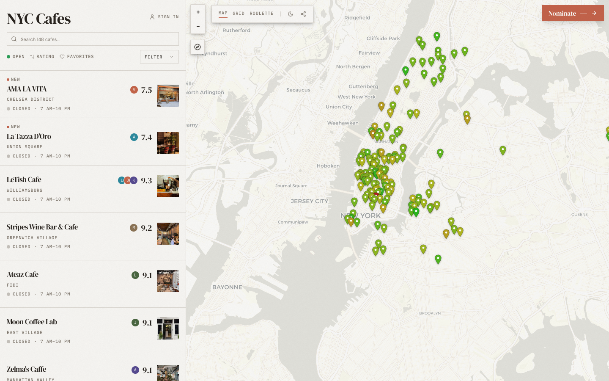

# NYC Cafe List
> A hand-curated guide to work-friendly coffee shops, across cities.  ·  [the-cafelist.com](https://the-cafelist.com/nyc/)

**What it is** — A hand-curated, Beli-style directory of work-friendly NYC coffee shops (the nyccafelist.com bookmark redirects here to the-cafelist.com/nyc/). The site's own pitch in the meta is 'A hand-curated guide to work-friendly coffee shops, across cities,' and the page's single h1 is simply 'NYC Cafes.'

**What it shows** — A two-pane app: a left scroll column of ranked cafes — each row with a name, neighborhood, a numeric score chip, and a thumbnail (e.g. Amaà Vidà 7.5, La Tazza D'Oro 7.4, Le Club Café 9.3, Stripes Wine Bar & Café) — beside a right-hand interactive map of Manhattan/Brooklyn dense with green location pins.

**How it works** — It behaves like a ranked map-directory rather than a scrolling page: the body fits the viewport (scrollHeight equals innerHeight at 1440x900) and the cafe list scrolls internally while the map stays pinned. Header controls cover search, sort/filter, and a 'Submit' (cafe nomination) CTA; rows pair with map pins so picking a cafe locates it.

**How it's designed** — Warm 'paper café' aesthetic rendered in a light theme — an off-white canvas (rgb 247,246,243) with espresso-brown ink (rgb 41,36,31) and a terracotta accent (--primary hsl 12 55% 58%) used for scores and the focus ring. Typography mixes a DM Serif Display masthead, DM Sans body, and IBM Plex Mono for the tabular score numerals (the CSS even sets tabular-nums); a Caveat handwriting face is defined in the stack but was not loaded. Built as a React single-page app styled with Tailwind and shadcn/sonner toasts; 157 inline SVGs (pin and UI icons) and 136 images (cafe thumbnails) carry the visual density.

**Palette** — Warm paper off-white (rgb 247,246,243) with espresso-brown ink (rgb 41,36,31) and a terracotta score/accent (hsl 12 55% 58%).
**Fonts** — DM Sans body, DM Serif Display headings, IBM Plex Mono numerals (Caveat handwriting accent defined but not loaded).

## Connections
**Aesthetics:** —
**Patterns:** `list-plus-map` `two-pane` `leaderboard-ranking` `interactive-map` `filter-chips` `curated-directory` `score-chips`
**Category:** [[categories/uncategorized|uncategorized]]
**Tech:** [[tech/react|React]] [[tech/tailwind-css|Tailwind CSS]] `shadcn/sonner toasts` [[tech/google-tag-manager|Google Tag Manager]] [[tech/self-hosted|self-hosted]]
**Colors:** [[colors/warm|warm]]
**Fonts:** [[fonts/dm-sans|DM Sans]] [[fonts/dm-serif-display|DM Serif Display]] [[fonts/ibm-plex-mono|IBM Plex Mono]]

## Related sites
[[sites/motionsites.ai|motionsites.ai]]
