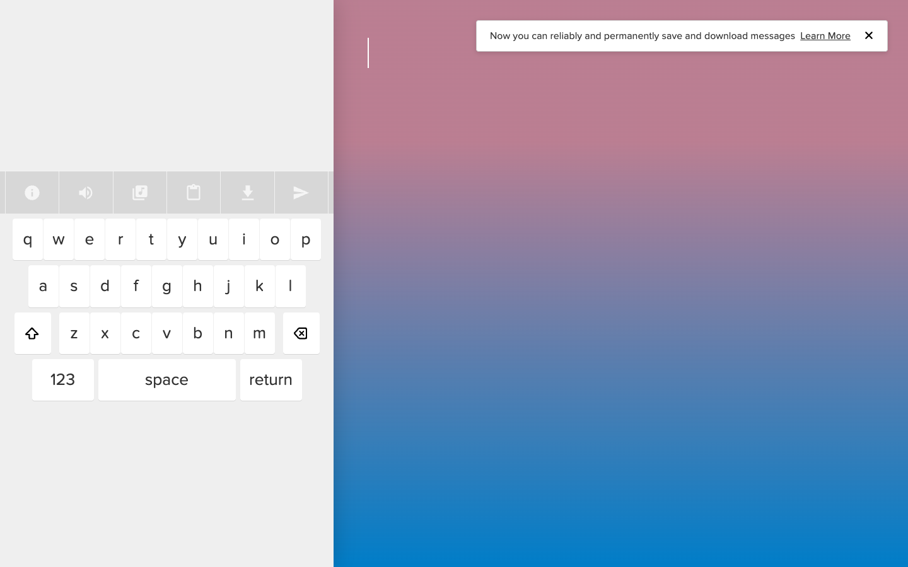

# Typatone — make music while you write
> The act of writing has always been an art. Now, it can also be an act of music.  ·  [typatone.com](https://typatone.com/)

**What it is** — Typatone — a minimalist interactive instrument where 'each letter you type corresponds to a specific musical note,' turning writing into generative melody (by Jono Brandel with Lullatone). It's the 'turns text into a generative melody' entry from Jonas's list.

**What it shows** — A near-empty off-white page with a text field; as you type, each keystroke plays a soft synth note and spawns reactive typographic/particle visuals, composing an ambient tune from your words — which you can then share or download.

**How it works** — Vanilla JS plus the Web Audio API driving two <canvas> layers (2 canvas, 0 img) for the reactive visuals; Adobe Typekit (use.typekit.net) serves the type and Google Tag Manager handles analytics. A fixed single-screen experience (scrollHeight 0).

**How it's designed** — Serene, Muji-like minimalism. From getComputedStyle the canvas is light grey (body rgb(239,239,239)) with black text; the 'Typatone' wordmark renders 42px in Proxima Nova Soft (proxima-nova-soft via Typekit) in soft dark-grey rgb(51,51,51). The rounded geometric sans deliberately mirrors the gentle, rounded synth tones — the page stays monochrome so the generated sound and visuals carry the piece.

**Palette** — A light-grey paper (rgb(239,239,239)) with near-black text and soft dark-grey headings (rgb(51,51,51)) — deliberately monochrome.
**Fonts** — Proxima Nova Soft (a rounded geometric sans, via Adobe Typekit) for the wordmark and UI.

## Connections
**Aesthetics:** [[aesthetics/minimal|minimal]] [[aesthetics/experimental|experimental]]
**Patterns:** `generative-music` `web-audio` `interactive` [[patterns/minimalist|minimalist]] [[patterns/canvas|canvas]] `typography` [[patterns/monochrome|monochrome]] `soft-sans`
**Category:** [[categories/uncategorized|uncategorized]]
**Tech:** `Vanilla JS + Web Audio API` [[tech/adobe-typekit|Adobe Typekit]] [[tech/google-tag-manager|Google Tag Manager]]
**Colors:** [[colors/monochrome|monochrome]]
**Fonts:** `Proxima Nova Soft`

## Related sites
[[sites/asekachov.com|asekachov.com]] [[sites/daviskeene.com|daviskeene.com]] [[sites/designengineer.tools|designengineer.tools]] [[sites/hiivearts.com|hiivearts.com]] [[sites/humanoid-index.com|humanoid-index.com]]
