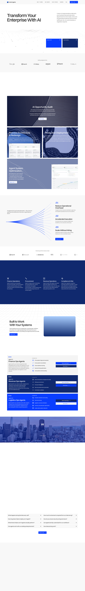

# Varick Agents - Transforming the Enterprise with AI
> Transform Your Enterprise With AI  ·  [varickagents.com](https://www.varickagents.com/)

**What it is** — Varick Agents is the marketing site for an enterprise AI-agents consultancy — a forward-deployed-engineering-style firm that builds and ships AI agents into a company's departments. Its h1 pitch is 'Transform Your Enterprise With AI' and the meta description promises 'faster, smarter moves with real time data and market intelligence.' It's the destination behind Aaron Levie's bookmarked post on FDEs; the footer credits Framer designer Yohann Varillon.

**What it shows** — A long-scroll enterprise landing page: a hero with an 'AI Opportunity Audit' call-to-action over an animated data-viz backdrop, then argument sections — 'We Don't Just Automate Tasks. We Transform Departments.', 'Only AI Native Orgs Will Survive', 'Where Our Agents Are Deployed', 'Built to Work With Your Systems', and 'Varick Agents Live in Production' — followed by per-vertical case studies (finance, sales, operations) each linking a live demo subdomain, an 'Explore what AI agents could look like inside your company' CTA, and an FAQ. Conversion runs through repeated 'Book a Call' buttons.

**How it works** — A Framer-published site: markup and assets come from framerusercontent.com, with two <canvas> elements driving the animated hero/section background graphics and one iframe embed. Booking goes to cal.com/team/varick-agents/discovery-call; demos and the audit live on demo.varickagents.com and audit.varickagents.com subdomains. Instrumentation is Google Tag Manager + Google Ads (doubleclick) plus Framer's own events.framer.com analytics; a stylesheet is pulled from unpkg.

**How it's designed** — A light, corporate-confident theme — white body ground rgb(255,255,255) with near-black ink (h1 rgb(32,32,32)) and an electric/navy blue accent family carried in CSS tokens (#0a3eff, #2934ff, #10296e, #6f9dff). Type is set in Switzer (loaded) for headings and body, with Chivo Mono (loaded) as a monospace accent used for labels and the numbered '1.1 / 2.1' nav scheme. The hero h1 is a large 76px at weight 500. The page is dense with structured card grids — 33 images, 56 inline SVGs, and 2 canvases for background data-viz — over a ~9,979px scroll.

**Palette** — Light enterprise: white ground rgb(255,255,255), near-black ink (rgb(32,32,32)), electric/navy blue accents (#0a3eff, #2934ff, #10296e, #6f9dff).
**Fonts** — Switzer (loaded, 400/500) for headings and body; Chivo Mono (loaded, 400) as a monospace accent for labels and section numbering. Framer also registers Inter and Fragment Mono as unloaded fallbacks.

## Connections
**Aesthetics:** [[aesthetics/developer-product|developer-product]] [[aesthetics/light|light]] [[aesthetics/experimental|experimental]] [[aesthetics/portfolio|portfolio]]
**Patterns:** [[patterns/framer|framer]] `enterprise-saas` `ai-agency` [[patterns/light-theme|light-theme]] [[patterns/card-grid|card-grid]] `switzer` [[patterns/mono-accent|mono-accent]] `data-viz-canvas` [[patterns/case-studies|case-studies]] `book-a-call`
**Category:** [[categories/reading|reading]]
**Tech:** [[tech/framer|Framer]] [[tech/google-tag-manager|Google Tag Manager]] `Google Ads (doubleclick)` `Framer Analytics (events.framer.com)` `CloudFront` `unpkg`
**Colors:** [[colors/light|light]] [[colors/cool|cool]]
**Fonts:** `Switzer` `Chivo Mono`

## Related sites
[[sites/rotimi.design|rotimi.design]] [[sites/asekachov.com|asekachov.com]] [[sites/ddlabstudio.com|ddlabstudio.com]] [[sites/gregisenberg.com|gregisenberg.com]] [[sites/midu.dev|midu.dev]]
