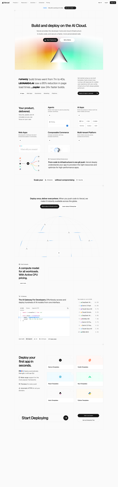

# Vercel: Build and deploy the best web experiences with the AI Cloud
> Build and deploy on the AI Cloud.  ·  [vercel.com](https://vercel.com/)

**What it is** — The marketing home of Vercel, the deploy/hosting platform that created and maintains Next.js. Its own <h1> pitches it as 'Build and deploy on the AI Cloud.'

**What it shows** — A long (≈5,900px desktop) scrolling landing page that walks through Framework-Defined Infrastructure, Fluid Compute, the AI Gateway, and a 'Deploy your first app in seconds' CTA, dense with product diagrams and logo proof — the probe counts 50 images, 111 inline SVGs and a canvas-driven hero animation.

**How it works** — Self-hosted Next.js app (App Router — no legacy __NEXT_DATA__ blob) rendered on Vercel itself; every script and stylesheet is served from vercel.com with no third-party CDNs in the head.

**How it's designed** — Textbook Geist Design System: the :root exposes the full --ds-* and --geist-* token scale (grays, the signature --geist-success #0070f3 blue, a 4px-based spacing grid, radius tokens). Body renders near-black text rgb(23,23,23) on an off-white rgb(250,250,250) field; the Geist and Geist Mono webfonts are loaded (KaTeX and DSEG7 faces are declared but stay unloaded). Crisp, high-contrast, restrained — color is reserved for status accents.

**Palette** — Off-white #fafafa surface, near-black #171717 text, signature Vercel blue #0070f3 accent (full Geist token ramp behind it)
**Fonts** — Geist (100–900) for UI, Geist Mono for code — both self-hosted via next/font

## Connections
**Aesthetics:** [[aesthetics/minimal|minimal]] [[aesthetics/developer-product|developer-product]]
**Patterns:** [[patterns/design-system|design-system]] [[patterns/minimalist|minimalist]] [[patterns/high-contrast|high-contrast]] `token-driven` [[patterns/product-landing|product-landing]] [[patterns/nextjs|nextjs]]
**Category:** [[categories/reading|reading]]
**Tech:** [[tech/next-js|Next.js]] `Geist Design System` [[tech/vercel|Vercel]]
**Colors:** [[colors/cool|cool]]
**Fonts:** [[fonts/geist-100-900|Geist 100-900]] [[fonts/geist-mono-100-900|Geist Mono 100-900]]

## Related sites
[[sites/humanoid-index.com|humanoid-index.com]] [[sites/fey.com|fey.com]] [[sites/noahzender.com|noahzender.com]] [[sites/northgarden.com|northgarden.com]] [[sites/nucleoapp.com|nucleoapp.com]]
