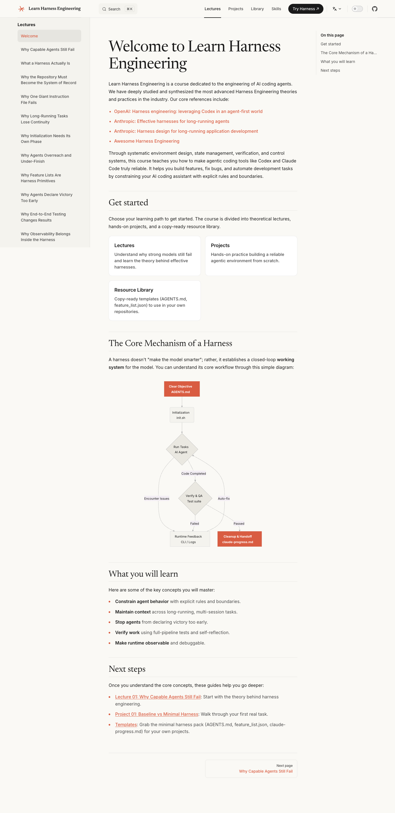

# Welcome to Learn Harness Engineering
> A project-based course on designing the environments, state, verification, and control systems that make Codex and Claude Code reliable.  ·  [walkinglabs.github.io](https://walkinglabs.github.io/learn-harness-engineering/en/)

**What it is** — A free, project-based online course on “harness engineering” — the discipline of building the environments, state, verification and control loops that make coding agents like Codex and Claude Code reliable. The h1 reads “Welcome to Learn Harness Engineering,” and the meta pitch frames it as a course “on designing the environments, state, verification, and control systems that make Codex and Claude Code reliable.” It's published as a docs site on GitHub Pages by walkinglabs.

**What it shows** — A classic documentation layout: a left sidebar listing the lecture sequence (“Why Capable Agents Still Fail,” “What a Harness Is,” “The Repository Must Become the System of Record,” “Long-Running Tasks: Lost Continuity,” “Agents Overreach and Under-Finish,” “End-to-End Testing Changes Results,” “Observability”…) and a wide reading column with a large serif hero, an intro paragraph, an on-this-page outline, a “Get started” card trio (Lectures / Projects / Resource Library), a “The Core Mechanism of a Harness” section with a closed-loop diagram, a “What you will learn” bullet list (constrain agent behavior, maintain context, stop agents from declaring victory too early, verify work, make runtime observable) and a “Next steps” link list.

**How it works** — It navigates like a textbook: the persistent sidebar is the course spine, each lecture is its own page, and an in-page “On this page” anchor list jumps between sections. The home page is a syllabus + overview that funnels into the first lecture via the “Get started” cards and the “Next steps” links. The hero “The Core Mechanism of a Harness” section embeds a diagram of the agent control loop (initialize → run tasks → verify / self-reflect → runtime feedback) to anchor the mental model before the lectures. Being a static VitePress build, everything is pre-rendered, instant, and link-driven.

**How it's designed** — A calm, editorial docs aesthetic on a warm ‘paper’ ground (rendered body bg rgb 250,249,245) with near-black text (rgb 26,26,26) and a single terracotta accent (links render rgb 217,92,65, echoed by the hand-drawn asterisk favicon stroked in #D95C41). The pairing is deliberate: a 56px Newsreader serif for headings against an Inter sans body, with JetBrains Mono declared for code (loaded on lecture pages). It's built on VitePress v1.6.4 (Vue-powered static-site generator) — the :root is full of default --vp-c-* theme tokens — but the palette is overridden to the light warm scheme rather than VitePress's stock indigo. The page is text-first and image-light (1 img, 1 svg), keeping the focus on prose and the one explanatory diagram.

**Palette** — Warm paper ground (rgb 250/249/245), near-black text (rgb 26/26/26), single terracotta accent on links (rgb 217/92/65 ≈ #D95C41).
**Fonts** — Newsreader serif for headings (56px), Inter for body/UI, JetBrains Mono for code (declared); all self-hosted, no third-party font CDN.

## Connections
**Aesthetics:** [[aesthetics/editorial|editorial]] [[aesthetics/minimal|minimal]]
**Patterns:** `docs-site` `sidebar-nav` `on-this-page-toc` [[patterns/editorial-serif|editorial-serif]] [[patterns/warm-paper|warm-paper]] `course-syllabus` `feature-cards` `explanatory-diagram` `static-ssg` [[patterns/text-first|text-first]]
**Category:** [[categories/tutorial|tutorial]]
**Tech:** `VitePress 1.6.4 (Vue SSG)` `GitHub Pages` [[tech/self-hosted-fonts|self-hosted fonts]]
**Colors:** [[colors/warm|warm]]
**Fonts:** [[fonts/inter|Inter]] [[fonts/newsreader|Newsreader]]

## Related sites
[[sites/cofounder.co|cofounder.co]] [[sites/daviskeene.com|daviskeene.com]] [[sites/emilkowal.ski|emilkowal.ski]] [[sites/farza.com|farza.com]] [[sites/jessyin.world|jessyin.world]]
