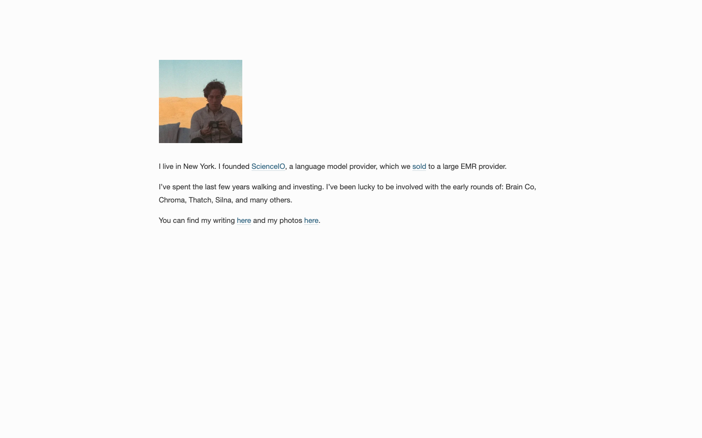

# Will Manidis
> I live in New York. I founded ScienceIO, a language model provider, which we sold to a large EMR provider.  ·  [willmanidis.com](https://willmanidis.com/)

**What it is** — A deliberately minimal single-screen personal homepage for Will Manidis, founder of ScienceIO (sold to a large EMR provider) and now an angel investor. The whole site is one quiet bio card; the only heading is his name.

**What it shows** — Three short paragraphs of first-person bio on a near-white page: living in New York; founding and selling ScienceIO; “walking and investing” with early rounds in Brain Co, Chroma, Thatch, Silna and others; and inline links to his writing and photos. The page holds a single image and two small SVGs — no hero art, no marketing.

**How it works** — There is no scroll — the document height equals the viewport (single screen). A small top “Home” nav sits above the bio, and the prose carries inline outbound links: ScienceIO, the Veradigm acquisition press release, LinkedIn, plus internal links to writing and photos. The experience is read-and-leave.

**How it's designed** — Classic understated personal-site restraint, built on Squarespace (assets.squarespace.com, sqspcdn). The ground is a warm off-white (rgb(252,252,252)) with dark-grey body copy (rgb(51,51,51)) set in Helvetica Neue, while the “Will Manidis” wordmark is Futura PT 700 at 42px. Fonts come from Adobe Typekit (use.typekit.net): futura-pt, proxima-nova, and adobe-garamond-pro are all loaded. Links use a muted teal-blue (rgb(41,95,124)). It's a text-first card with no imagery doing the talking — typography and whitespace are the whole design.

**Palette** — Warm off-white ground (rgb(252,252,252)), dark-grey ink (rgb(51,51,51)), near-black name (rgb(34,34,34)), muted teal-blue links (rgb(41,95,124)).
**Fonts** — Futura PT (name/wordmark), Helvetica Neue (body), with Proxima Nova and Adobe Garamond Pro also loaded from Adobe Typekit.

## Connections
**Aesthetics:** [[aesthetics/minimal|minimal]]
**Patterns:** [[patterns/personal-site|personal-site]] [[patterns/single-screen|single-screen]] [[patterns/minimalist|minimalist]] `bio-card` `squarespace` `understated` `founder-page` [[patterns/text-first|text-first]]
**Category:** [[categories/uncategorized|uncategorized]]
**Tech:** `Squarespace` [[tech/adobe-typekit|Adobe Typekit]]
**Colors:** [[colors/warm|warm]] [[colors/cool|cool]]
**Fonts:** `futura-pt` `proxima-nova` `adobe-garamond-pro`

## Related sites
[[sites/farza.com|farza.com]] [[sites/richzou.com|richzou.com]] [[sites/alisawuffles.github.io|alisawuffles.github.io]] [[sites/axiaisacat.indiehacker.bio|axiaisacat.indiehacker.bio]] [[sites/daryl.cv|daryl.cv]]
