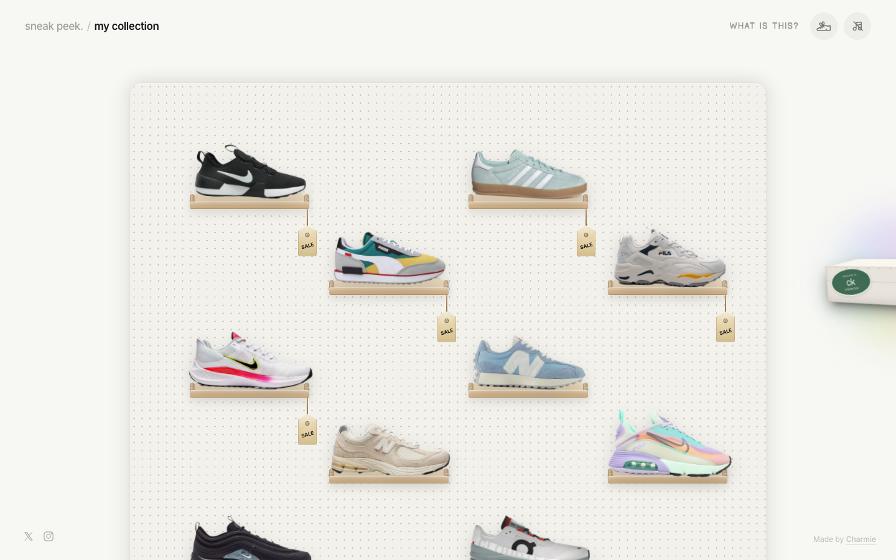

# sneak peek
> Welcome to my sneaker collection :)  ·  [sneakers.charmiekapoor.com](https://sneakers.charmiekapoor.com/)

**Vertical:** #vertical/portfolio  ·  **Vibe:** #vibe/playful #vibe/organic-warm  ·  **Topics:** #topic/fashion  ·  **Mode:** #mode/light

## What it is
A personal sneaker-collection showcase by Charmie Kapoor — per its own meta description, "Welcome to my sneaker collection :)" — presenting an individual's shoes as a browsable, playful mini-catalog.

## What it shows
Eight sneakers (Nike, Adidas, Puma, New Balance, Fila) rendered on illustrated wooden pegboard shelves against a cream dot-grid backdrop, each hung with a dangling "SALE" price tag, under the header "sneak peek / my collection" with a "WHAT IS THIS?" link and cart/profile icons.

## How it works
A React app (React root detected) pulling six Google Fonts (Gaegu, Gloria Hallelujah, Inter, Radio Canada Big, plus a custom Geist Pixel Square) and shipping Google Tag Manager for analytics — the handwritten/pixel font mix signals a hand-styled personal project rather than a generated template.

## How it's designed
Playful and handcrafted: a warm off-white ground (rgb(247,247,244)) with near-black text, pairing a casual handwriting font (Gaegu) for personality against Inter for structured UI text and a blocky pixel display face (Geist Pixel Square) for the wordmark — leaning into a scrapbook, sticker-tag aesthetic (16 SVGs likely powering the tag/pin illustrations).

## Design data
- **Palette:** Warm off-white background (rgb(247,247,244)), near-black text (rgb(23,23,23)), tan pegboard-shelf tones with cream "SALE" tags
- **Palette tokens:** body-color: rgb(23, 23, 23) (rendered), body-background: rgb(247, 247, 244) (rendered)
- **Fonts:** Gaegu (handwriting accents), Gloria Hallelujah, Inter (UI text), Radio Canada Big, Geist Pixel Square (wordmark)
- **Fonts loaded:** Gloria Hallelujah 400, Inter 400/500/600/700, Radio Canada Big 600, Geist Pixel Square 500
- **Tech stack:** React, Google Fonts, Google Tag Manager
- **Keywords:** personal-collection, playful, illustrated, pegboard-layout
- **Media mix:** img 29 · svg 16
- **Page height:** 900px (single-screen: True)
- **Responsive:** Content reflows to a tall single column at 390px, growing scroll height from 900px to 7481px as the pegboard grid stacks vertically.
- **Extracted:** 2026-09-22 · 1440x900 desktop + 390x844 mobile pass, logged_out: true

## Related sites
- [[jessa.art]] — shared: portfolio, playful, organic-warm, light
- [[jessyin.world]] — shared: portfolio, playful, organic-warm, light
- [[spencer.place]] — shared: portfolio, playful, organic-warm
- [[chusmargallo.space]] — shared: portfolio, playful, light
- [[designrebuilds.vercel.app]] — shared: portfolio, playful, light
- [[gyanl.com]] — shared: portfolio, playful, light
