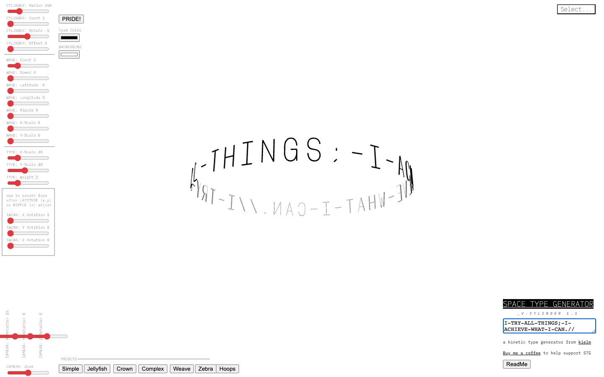

# SPACE TYPE GENERATOR
> "a kinetic type generator from kielm" — type a phrase and bend it through 3D space with dozens of live sliders and presets.  ·  [spacetypegenerator.com](https://spacetypegenerator.com/)

**Vertical:** #vertical/tool-app  ·  **Vibe:** #vibe/experimental #vibe/technical  ·  **Topics:** #topic/design  ·  **Mode:** #mode/light

## What it is
Space Type Generator (STG) by kielm — a browser-based kinetic typography tool. You enter a string and it is extruded and warped through 3D space on a canvas, here in its "_V.CYLINDER 1.1" mode wrapping the text "I-TRY-ALL-THINGS;-I-ACHIEVE-WHAT-I-CAN.//" around a cylinder.

## What it shows
A bright white stage with the live black type composition floating in the centre. A dense left rail of red-handled sliders controls the geometry — grouped CYLINDER (radius/count/rotate/offset), WAVE (count/speed/latitude/longitude/ripple/x-y scale), TYPE (x/y scale, weight) and TWEAK (x/y/z rotation) — while a bottom rail adds CAMERA rotation/zoom sliders and a row of one-click preset buttons (Simple, Jellyfish, Crown, Complex, Weave, Zebra, Hoops). Top-right holds a "Select..." preset dropdown and a "PRIDE!" button plus Type Color / Background swatches; the bottom-right card carries the title, the text input, a "Buy me a coffee" support link and a ReadMe button. The mode menu (CYLINDER / FIELD / STRIPES / COIL / FLAG / MORISAWA / CASCADE / RIBBON / LAYERS / DANGER / STRING / BADGE / CLUTTER) routes to a dozen sibling generators.

## How it works
The composition renders to a single <canvas>; window.THREE is not exposed as a global, so the 3D type is drawn on a self-contained canvas pipeline rather than the global Three.js object. Each generator mode is its own route (/field, /stripes, /coil, /flag, /morisawa, …). Libraries are pulled from cdnjs (Cloudflare), the site is fronted by Cloudflare (with cloudflareinsights beacon), and Google Analytics / Tag Manager are loaded. IBM Plex Mono is served from Google Fonts.

## How it's designed
A deliberately tool-like, almost engineering-UI look: stark white canvas, everything set in IBM Plex Mono (weights 100/300/400) so the labels read like a control panel, and saturated red slider thumbs as the single accent against the monochrome black-on-white type. The pitch copy is set as a highlighted h1 ("SPACE TYPE GENERATOR", white on a dark chip) in the lower-right. The chrome frames the stage on all four edges, keeping the kinetic type centred and uncluttered while exposing an intimidatingly deep parameter set.

## Design data
- **Palette:** White stage with black rendered type; UI labels in black IBM Plex Mono and saturated red (slider thumbs) as the lone accent; the title chip inverts to white-on-dark
- **Palette tokens:** h1-color: rgb(255, 255, 255) (rendered), button-bg: rgb(239, 239, 239) (rendered), button-color: rgb(0, 0, 0) (rendered)
- **Fonts:** IBM Plex Mono (weights 100 / 300 / 400, served from Google Fonts) throughout the UI
- **Fonts loaded:** IBM Plex Mono 100, IBM Plex Mono 300, IBM Plex Mono 400
- **Tech stack:** Canvas-based 3D type renderer (no global THREE detected), Libraries via cdnjs (Cloudflare), Cloudflare CDN + cloudflareinsights beacon, Google Analytics + Google Tag Manager, Google Fonts (IBM Plex Mono)
- **Keywords:** kinetic-typography, type-tool, canvas, 3d-type, generative, monospace-ui, control-panel, slider-driven, ibm-plex-mono, white-canvas
- **Media mix:** canvas 1
- **Page height:** 900px (single-screen: True)
- **Responsive:** Not responsive — at 390x844 the canvas keeps its fixed 1440px width (causing horizontal overflow) and the absolutely-positioned control rails do not reflow; STG is effectively a desktop-only tool.
- **Headings:** SPACE TYPE GENERATOR / _v.cylinder 1.1
- **Links out:** [kielm (author)](http://www.kielm.com/) · [Buy me a coffee](https://www.buymeacoffee.com/kieldm)
- **Weight:** None requests; hosts: spacetypegenerator.com, cdnjs.cloudflare.com, fonts.googleapis.com, www.google-analytics.com, www.googletagmanager.com, static.cloudflareinsights.com
- **Extracted:** 2026-06-06 · Playwright MCP, 1440x900 + 390x844 mobile pass, logged_out: true

## Related sites
- [[itshover.com]] — shared: tool-app, technical, design, light
- [[stitch.withgoogle.com]] — shared: tool-app, technical, design
- [[akira.sachi.dev]] — shared: tool-app, technical, light
- [[colf.dev]] — shared: tool-app, technical, light
- [[everynoise.com]] — shared: tool-app, technical, light
- [[patterncraft.fun]] — shared: tool-app, design, light
