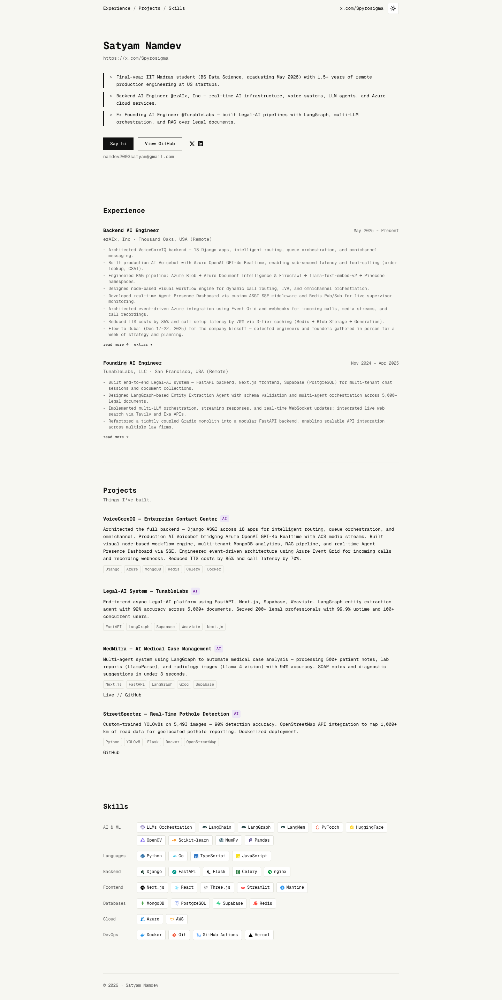

# Satyam Namdev | AI Engineer
> Backend AI Engineer @ezAIx — building production AI systems, RAG pipelines, and multi-agent orchestration.  ·  [spyrosigma.in](https://spyrosigma.in)

## What it is
The personal portfolio of Satyam Namdev (handle 'spyrosigma'), the builder behind Zendex. The meta pitch is 'Backend AI Engineer @ezAIx — building production AI systems, RAG pipelines, and multi-agent orchestration.' It's a single-page résumé/portfolio leading with his name as the h1.

## What it shows
A warm-paper, terminal-flavoured one-pager: a 'Satyam Namdev' hero, then stacked sections — Experience (ezAIx, Tunable Labs, each with 'read more →' detail pages), Projects (MedMitra with a live link + GitHub, StreetSpecter), and Skills. Outbound links go to x.com/Spyrosigma, GitHub, and a 'Say hi' mailto.

## How it works
Anchor nav (#experience / #projects / #skills) scrolls the single page; experience entries deep-link to sub-pages (/experience/ezaix, /experience/ezaix/extras, /experience/tunablelabs) and projects link out to live demos (medmitra.vercel.app) and GitHub repos. No framework global is exposed and all JS/CSS is self-hosted.

## How it's designed
A deliberate monospace 'engineer's notebook' aesthetic: a warm cream ground (--background #f7f7f2 rendered rgb(247,247,242)) with near-black ink (--foreground #111) and a single terracotta accent (--accent #d4541a), plus muted gray (--muted #5c5c5c) and a hairline border (--border #e2e2da) on white cards (--card-bg #fff). Type is exclusively GeistMono (the only loaded webfont; no sans, no serif), which gives the whole page a code-editor feel. Zero raster images — all iconography is inline SVG (37 svg, 0 img) — keeping it light and crisp. h1 renders at 30px on both desktop and mobile.

## Design data
- **Palette:** Warm cream paper #f7f7f2 with near-black ink #111, muted gray #5c5c5c, hairline border #e2e2da, white cards, and a single terracotta accent #d4541a.
- **Palette tokens:** --background: #f7f7f2 (var), --foreground: #111 (var), --accent: #d4541a (var), --muted: #5c5c5c (var), --border: #e2e2da (var), --card-bg: #fff (var), body-bg: rgb(247, 247, 242) (rendered), body-text: rgb(17, 17, 17) (rendered)
- **Fonts:** GeistMono only (monospace), used for all text; no sans or serif loaded.
- **Fonts loaded:** GeistMono 100-900
- **Tech stack:** self-hosted JS/CSS, CSS custom properties, no framework global exposed
- **Media mix:** svg 37
- **Page height:** 2866px (single-screen: False)
- **Responsive:** At 390x844 the page stays a single stacked column (the anchor nav and x.com link remain visible); content reflows taller from ~2866px to ~4336px with the 30px h1 unchanged.
- **Headings:** Satyam Namdev / Experience / Projects / Skills
- **Links out:** [x.com/Spyrosigma](https://x.com/Spyrosigma) · [View GitHub](https://github.com/Spyrosigma) · [MedMitra (Live)](https://medmitra.vercel.app/)
- **Extracted:** 2026-06-05 · playwright-mcp @ 1440x900 + 390x844 mobile; logged_out: true (redirects to www.spyrosigma.in)

## Related sites
[[lab01.dev]] [[nyk.dev]] [[objectives.md]] [[siddz.com]] [[addyosmani.com]] [[akira.sachi.dev]]

## Tags
#category/product #aesthetic/portfolio #aesthetic/developer-product #pattern/portfolio #pattern/monospace #pattern/warm-paper #pattern/single-page #pattern/anchor-nav #pattern/terracotta-accent #pattern/svg-only #pattern/engineer-resume #pattern/css-custom-properties #tech/self-hosted-js-css #tech/css-custom-properties #tech/no-framework-global-exposed #color/warm #font/geistmono-100-900
