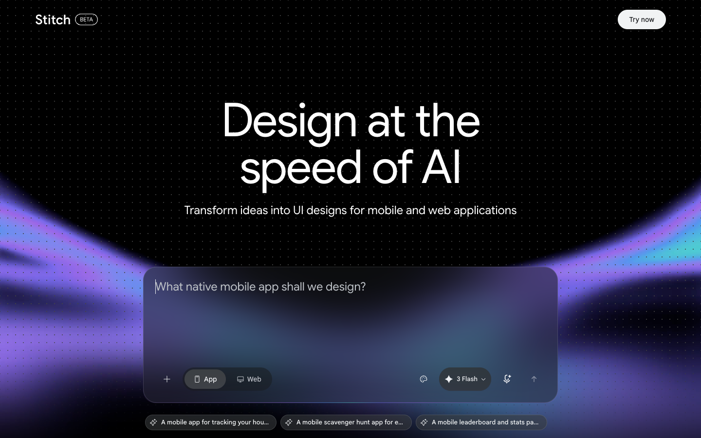

# Stitch - Design with AI
> Design at the speed of AI  ·  [stitch.withgoogle.com](https://stitch.withgoogle.com/)

## What it is
Stitch is Google Labs' AI design canvas that turns natural-language prompts (or wireframes/screenshots) into editable mobile and web UIs plus front-end code. Its own pitch, captured from the rendered app, reads "Design at the speed of AI — Transform ideas into UI designs for mobile and web applications", and the FAQ calls it "an AI-native software design canvas developed by Google Labs."

## What it shows
A product landing + live entry point in one: a prompt box ("What native mobile app shall we design?") with App/Web toggles and a Gemini model picker, three playful example prompts, a templates carousel (Studio Portfolio, Auralis Dashboard, Romer Analytics, Horizon SaaS, etc.), feature cards (Easy edits, Export code, Build with Gemini, Own your design), a "Vibe design is here" section, and an FAQ that highlights Figma export and a new MCP integration.

## How it works
The shell is an Angular app (ng-version detected) on stitch.withgoogle.com, but the entire landing/app UI is rendered inside an embedded iframe served from app-companion-430619.appspot.com (a Google App Engine host), with a gapi companion frame for Google auth. Scripts come from apis.google.com, gstatic.com and GTM; fonts load from fonts.googleapis.com.

## How it's designed
A dark Google-Labs aesthetic: the outer shell paints a deep charcoal (rgb(25,26,31)) behind white text, and the whole experience is typed in Google Sans / Google Sans Text (loaded via Google Fonts) with Google Material Icons — an unmistakably first-party Google product look. Color/typography here are reported from the outer document; the inner pitch UI lives in a cross-origin iframe so per-element colors weren't probed.

## Design data
- **Palette:** Deep charcoal canvas (rgb(25,26,31)) with white text — first-party Google dark UI.
- **Palette tokens:** html_bg (rendered): rgb(25, 26, 31) (rendered), body_color (rendered): rgb(255, 255, 255) (rendered)
- **Fonts:** Google Sans + Google Sans Text (and Google Material Icons).
- **Fonts loaded:** Google Sans 400, Google Sans Text 400/500/700, Google Material Icons 400
- **Tech stack:** Angular, Google App Engine (appspot), Google Identity (gapi), Google Tag Manager, Google Fonts
- **Media mix:** iframe 1
- **Page height:** 900px (single-screen: False)
- **Responsive:** At 390px the single app iframe reflows to full viewport width (390px) and the page height tracks the viewport; the app UI is responsive inside the frame.
- **Headings:** Design at the speed of AI / Get started with templates / Vibe design is here / Questions? / Easy edits / Export code / Build with Gemini / Own your design
- **Links out:** [Google Labs](https://labs.google.com) · [Privacy Notice](https://stitch.withgoogle.com/privacy)
- **Extracted:** 2026-06-06 · Playwright 1440x900 + 390x844, logged_out: true

## Related sites
[[backgrounds.supply]] [[badmarketing.com]] [[davekrugman.com]] [[daytona.io]] [[ditther.com]] [[flowstate.com]]

## Tags
#category/tools-build #aesthetic/dark #pattern/ai-design-tool #pattern/google-labs #pattern/prompt-to-ui #pattern/templates-gallery #pattern/angular #pattern/iframe-app #pattern/dark-mode #tech/angular #tech/google-app-engine-appspot #tech/google-identity-gapi #tech/google-tag-manager #tech/google-fonts #color/dark #font/google-sans #font/google-sans-text-400-500-700 #font/google-material-icons
