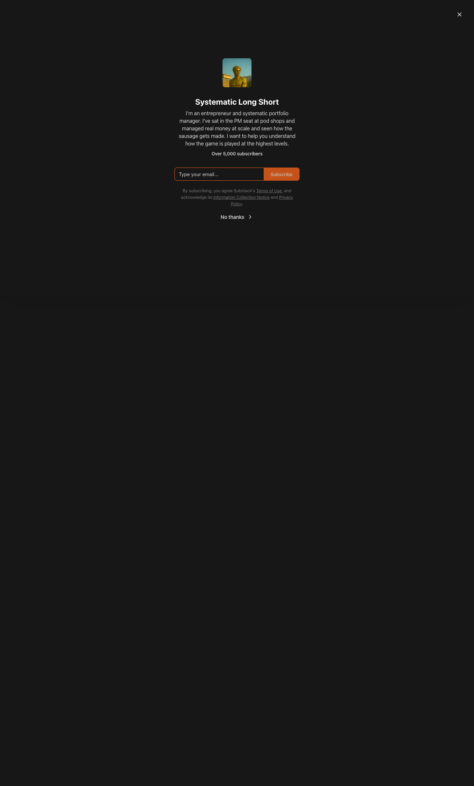

# Systematic Long Short | Substack
> Understand how the game is played at the highest levels  ·  [systematiclongshort.com](https://www.systematiclongshort.com/)

**Vertical:** #vertical/publication-newsletter  ·  **Vibe:** #vibe/editorial  ·  **Topics:** #topic/finance  ·  **Mode:** #mode/dark

## What it is
The custom-domain home of "Systematic Long Short", a Substack newsletter (h1 "Systematic Long Short") written by an entrepreneur and systematic portfolio manager about quant/hedge-fund investing — "I've sat in the PM seat at pod shops and managed real money at scale... I want to help you understand how the game is played at the highest levels." Over 5,000 subscribers per the on-page count.

## What it shows
The visit opens on Substack's full-screen subscribe gate: a classical golden-statue avatar, the title, the author's PM-credentials bio, "Over 5,000 subscribers", an email field with an orange Subscribe button, and a "No thanks" dismiss revealing the post archive behind it.

## How it works
Stock Substack publication on a custom domain — email-capture modal first, dismissible to reach the chronological finance post list; subscriptions and reading are Substack-hosted, with Sentry, Datadog RUM and GTM instrumentation.

## How it's designed
Near-stock Substack dark theme: a charcoal #171717 web background with Substack's signature brand orange (#FF6719) as the accent/pop color on the Subscribe CTA — i.e. the defaults left in place, contrasted with Dan Koe's customized sage variant. Same type system: Spectral serif for reading, SF Pro Display / system sans for the 24px h1 and UI. Imagery is limited to the statue avatar; it's a text-and-credibility play.

## Design data
- **Palette:** Charcoal canvas (#171717) with Substack default brand orange accent (#FF6719) on the Subscribe CTA; white headings, grey reading text
- **Palette tokens:** --web_bg_color: #171717 (var), --color_theme_accent: #ff6719 (var), --color_theme_bg_pop: #FF6719 (var), body-text: rgb(54, 55, 55) (rendered), h1-color: rgb(255, 255, 255) (rendered)
- **Fonts:** Spectral (serif) for reading body; SF Pro Display / system sans for UI + h1
- **Fonts loaded:** Spectral 400 (loaded); Inter + SF Pro Display declared via system stack
- **Tech stack:** Substack, Sentry, Datadog RUM, Google Tag Manager, Cloudflare
- **Keywords:** substack, newsletter, email-gate, subscribe-modal, dark-theme, serif-reading, finance, default-theme, custom-domain
- **Media mix:** img 16 · svg 57 · iframe 2
- **Page height:** 2388px (single-screen: False)
- **Responsive:** At 390x844 it stays single-column on the Substack responsive template; scrollHeight grows to ~2,836px with the subscribe gate filling the viewport.
- **Headings:** Systematic Long Short
- **Weight:** None requests; hosts: substackcdn.com, browser.sentry-cdn.com, datadoghq-browser-agent.com, googletagmanager.com
- **Extracted:** 2026-06-06 · Playwright MCP, 1440x900 + 390x844 mobile pass, logged_out: true

## Related sites
- [[letters.thedankoe.com]] — shared: publication-newsletter, editorial, dark
- [[outlandermag.com]] — shared: publication-newsletter, editorial, dark
- [[claude.com]] — shared: publication-newsletter, editorial
- [[geniusmargins.com]] — shared: publication-newsletter, editorial
- [[gregisenberg.com]] — shared: publication-newsletter, editorial
- [[interfaces.dev]] — shared: publication-newsletter, editorial
