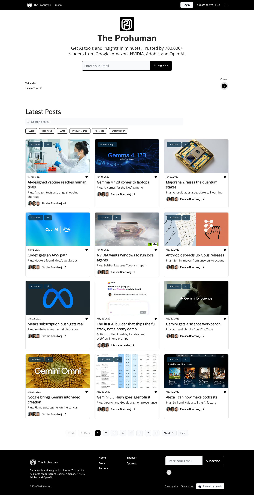

# The Prohuman
> Get AI tools and insights in minutes. Trusted by 700,000+ readers.  ·  [theprohuman.ai](https://www.theprohuman.ai/)

## What it is
The beehiiv home/archive of 'The Prohuman,' a daily AI newsletter (bylines include Hasan Toor and Rimsha Bhardwaj) — pitched in meta as 'Get AI tools and insights in minutes. Trusted by 700,000+ readers from Google, Amazon, NVIDIA, Adobe, and OpenAI.' Ihtesham Ali's tweet about a 'First Principles Breakdown' Claude prompt links here.

## What it shows
A white, magazine-style feed of recent issues — headlines such as 'AI-designed vaccine reaches human trials,' 'Gemma 4 12B comes to laptops,' 'Majorana 2 raises the quantum stakes,' 'Codex gets an AWS path' and 'Anthropic speeds up Opus releases' — each card tagged (AI stories / Breakthrough), bylined and timestamped, beneath a top nav of Sponsor and 'Subscribe (It's FREE)'.

## How it works
beehiiv-hosted (favicon, og:image and theme tokens all point to beehiiv) and styled with beehiiv's '--wt-*' variables; no SSR JS framework global is present. Open Sans is pulled from Google Fonts (fonts.googleapis.com) and is the only loaded webface, while the same beehiiv marketing/bot stack runs in the background — Google Tag Manager, PerimeterX (client.px-cloud.net), Birdie and Cloudflare Insights. The homepage is image-heavy (51 imgs, 19 inline SVG icons) and ~2809px tall on desktop.

## How it's designed
A bright editorial light theme: a pure-white background with dark-grey body text (--wt-text-on-background-color #222, rendered rgb(34,34,34)), a black primary color (--wt-primary-color #000) and pale-grey card surfaces (button rgb(249,250,251)). Headlines run large (h1 at 48px) in Open Sans, and the body is a dense grid of story cards with thumbnails, topic tags and author bylines.

## Design data
- **Palette:** White background, dark-grey #222 text, black primary, pale-grey #f9fafb cards
- **Palette tokens:** --wt-primary-color: #000000 (var), --wt-background-color: #FFFFFF (var), --wt-text-on-background-color: #222222 (var), body-text: rgb(34, 34, 34) (rendered), h1-color: rgb(34, 34, 34) (rendered), card-button-background: rgb(249, 250, 251) (rendered)
- **Fonts:** Open Sans (Google Fonts) — the only loaded webfont
- **Fonts loaded:** Open Sans 400
- **Tech stack:** beehiiv, Google Fonts (Open Sans), Google Tag Manager, PerimeterX, Birdie, Cloudflare Insights
- **Media mix:** img 51 · svg 19 · iframe 1
- **Page height:** 2809px (single-screen: False)
- **Responsive:** At 390x844 a hamburger menu appears, the issue feed stacks to a single column, the page grows from ~2809px to ~6258px, and the h1 scales from 48px down to 36px.
- **Headings:** The Prohuman / AI-designed vaccine reaches human trials / Gemma 4 12B comes to laptops / Majorana 2 raises the quantum stakes / Codex gets an AWS path / NVIDIA wants Windows to run local agents / Anthropic speeds up Opus releases / Meta's subscription push gets real / Gemini gets a science workbench / Gemini 3.5 Flash goes agent-first
- **Links out:** [Subscribe (It's FREE)](https://www.theprohuman.ai/subscribe) · [Sponsor](https://www.passionfroot.me/the-prohuman-ai)
- **Extracted:** 2026-06-06 · Playwright MCP, 1440x900 + 390x844, logged_out: true

## Related sites
[[bigplayers.co]] [[performance.dev]] [[12matcha.com]] [[animations.dev]] [[asekachov.com]] [[bigideasdb.com]]

## Tags
#category/tutorial #aesthetic/light #aesthetic/editorial #pattern/newsletter #pattern/ai-news #pattern/beehiiv #pattern/content-feed #pattern/light-theme #pattern/editorial #tech/beehiiv #tech/google-fonts-open-sans #tech/google-tag-manager #tech/perimeterx #tech/birdie #tech/cloudflare-insights #color/light #font/open-sans
