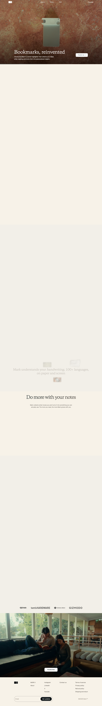

# The Smart Bookmark for Physical Books | Mark II
> Bookmarks, reinvented.  ·  [thinkwithmark.com](https://www.thinkwithmark.com/)

## What it is
The product site for Mark II, a $159 AI “smart bookmark” — a physical bookmark-plus-scanner for paper books. Per the meta description it lets you “capture quotes and voice notes as you read” and “revisit them all in the Mark app,” under the hero line “Bookmarks, reinvented.” It's the Mark II launch (a $1M-funded follow-up to the earlier $129 Mark 1) by thinkwithmark, sold through a Shopify storefront.

## What it shows
A long, cinematic product page built around video. The dark sepia hero shows the device resting in an open book beside “Bookmarks, reinvented” and a buy/learn CTA (plus a “Watch keynote” link to YouTube). Scrolling reveals chaptered sections its headings name — “An extension to your books,” “Do more with your notes,” “Quality you can feel,” and “Connect your knowledge / Migrate all your notes with a click of a button” — interleaving lifestyle photography of people reading with product/demo videos (8 <video>, 51 ). Press logos (Tom's Hardware, Gizmodo) lend credibility.

## How it works
It reads as a scrollytelling product tour: section after section pairs a claim with motion (the 8 inline videos demo scanning a quote, recording a voice note, and the companion app). A newsletter/email-capture modal overlays the page on load (an .email-popup-backdrop that intercepts clicks until dismissed). Navigation is a slim top bar (How it works / Pricing / Blog / FAQ / Login) feeding a Shopify checkout, with the “Migrate all your notes with a click” section pitching import from other note apps. Outbound press and a keynote video reinforce the launch.

## How it's designed
A warm, premium hardware aesthetic: a sepia/brown photographic hero with white headline text (h1 rendered rgb 255,255,255) giving way to an off-white body with deep near-black teal text (rendered rgb 13,27,30). The type is editorial-meets-techy — a 62px Copernicus serif for the big headings against Geist for UI/body (both genuinely loaded; Inter sits in the fallback stack). It's a Shopify build on the Hydrogen/Oxygen headless stack (assets served from cdn.shopify.com/oxygen-v2, favicon included), instrumented with Microsoft Clarity, Meta Pixel and Google Tag Manager. The craft signal is the video-per-section storytelling and large-format photography rather than UI chrome (only 6 svg). Exact section background colors are image/section-level rather than CSS tokens (:root exposes no custom props), so the sepia is asserted from the photography, not a DOM value.

## Design data
- **Palette:** Sepia/brown photographic hero with white headline text (rendered #fff); off-white body with deep near-black-teal text (rendered rgb 13/27/30). Section backgrounds are imagery, not CSS tokens.
- **Palette tokens:** body-text: rgb(13, 27, 30) (rendered), h1-color: rgb(255, 255, 255) (rendered), link: rgb(13, 27, 30) (rendered)
- **Fonts:** Copernicus serif for headings (62px), Geist for body/UI (both loaded); Inter in the fallback stack.
- **Fonts loaded:** Copernicus 400, Geist 400, Geist 600, Geist 700/800
- **Tech stack:** Shopify (Hydrogen / Oxygen), Microsoft Clarity, Meta Pixel, Google Tag Manager, jsDelivr
- **Media mix:** img 51 · video 8 · svg 6
- **Page height:** 9903px (single-screen: False)
- **Responsive:** At 390x844 the nav collapses to a hamburger, the Copernicus headline drops from 62px to 32px, and the video sections stack into one very tall single column (scrollHeight ~9903→12855).
- **Headings:** Bookmarks, reinvented / An extension to your books / Do more with your notes / Quality you can feel / Connect your knowledge / Migrate all your notes with a click of a button
- **Links out:** [Watch keynote](https://youtu.be/uni8Co2wRaM) · [Tom's Hardware coverage](https://www.tomshardware.com/peripherals/ai-powered-bookmark-wants-to-revolutionize-the-way-you-read-usd129-mark-1-offers-ai-generated-summaries) · [Gizmodo coverage](https://gizmodo.com/this-ai-bookmark-might-actually-help-you-finish-reading-books-2000569596)
- **Extracted:** 2026-06-06 · playwright-mcp @ 1440x900 (+ 390x844 mobile), logged_out: true

## Related sites
[[printingpress.dev]] [[12matcha.com]] [[cofounder.co]] [[eko.lumaris.works]] [[fantasypresidentcareer.com]] [[fey.com]]

## Tags
#category/product #aesthetic/developer-product #aesthetic/luxury #aesthetic/editorial #pattern/product-landing #pattern/scrollytelling #pattern/video-per-section #pattern/lifestyle-photography #pattern/warm-sepia #pattern/editorial-serif #pattern/email-capture-modal #pattern/press-logos #pattern/shopify-hydrogen #pattern/hardware-product #tech/shopify-hydrogen-oxygen #tech/microsoft-clarity #tech/meta-pixel #tech/google-tag-manager #tech/jsdelivr #color/cool #font/copernicus #font/geist #font/geist-700-800
