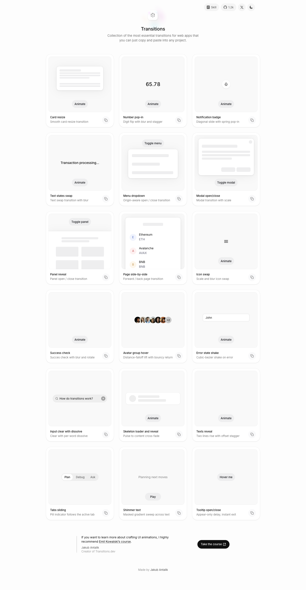

# Transitions.dev — Essential transitions for web apps
> Collection of the most essential transitions for web apps that you can just copy and paste into any project.  ·  [transitions.dev](https://transitions.dev/)

**Vertical:** #vertical/docs-resource  ·  **Vibe:** #vibe/minimal #vibe/technical  ·  **Topics:** #topic/engineering #topic/design  ·  **Mode:** #mode/light

## What it is
A free copy-paste library of essential UI transitions for web apps by Jakub Antalik (@jakubantalik) — the site the tweet is actually showcasing. The h1 is simply 'Transitions'.

## What it shows
A grid of interactive demos where each card runs a live micro-interaction — modals, dropdowns, sliding panels, an error shake, skeleton shimmer, staggered list reveals, tab switches — that you can copy as CSS. Roughly 18 named recipes are encoded directly in the stylesheet (--p1 … --p18). It also promotes Emil Kowalski's animations.dev course.

## How it works
A single light page (~2,764px) of self-contained demos. Each transition is parameterized by a block of CSS custom properties (--p1-* … --p18-*: durations, cubic-bezier eases, distances, blur, bounce) so the exact values are readable and copyable. It is deliberately lightweight — GoatCounter analytics (gc.zgo.at), Google Fonts, and no JS framework.

## How it's designed
Clean, near-white editorial UI (--bg #fdfdfd, --text #0d0d0d) sitting on a soft grey card/stage system (--card-bg #ffffff, --stage-bg #f9f9f9, --chip-bg #f4f4f4), with Inter for UI text and Roboto Mono (--font-mono) for the code and labels. Fifty inline SVG icons label the demos. The chrome is intentionally quiet so the motion is the content; the only saturated colour is an error-red (#e23014) reserved for the shake/error demo.

## Design data
- **Palette:** Near-white ground (--bg #fdfdfd), near-black text (--text #0d0d0d), soft grey cards/chips (#f9f9f9 / #f4f4f4); monochrome by design, with an error-red (#e23014) reserved for the shake demo.
- **Palette tokens:** --bg: #fdfdfd (var), --text: #0d0d0d (var), --card-bg: #ffffff (var), --stage-bg: #f9f9f9 (var), --chip-bg: #f4f4f4 (var), --p12-error-border: #e23014 (var), body background (rendered): rgb(253,253,253) (rendered)
- **Fonts:** Inter (UI sans) + Roboto Mono (code/labels), both loaded from Google Fonts.
- **Fonts loaded:** Inter 400, Inter 500, Roboto Mono 400
- **Tech stack:** vanilla (no JS framework), GoatCounter, Google Fonts
- **Keywords:** copy-paste, ui-transitions, micro-interactions, interactive-demos, css-variables, light-mode, developer-tool, minimal
- **Media mix:** img 11 · svg 50
- **Page height:** 2764px (single-screen: False)
- **Responsive:** At 390x844 the demo cards stack to a single column and the h1 drops to 20px; scrollHeight grows to ~7,103px.
- **Headings:** Transitions
- **Links out:** [Emil Kowalski's course (animations.dev)](https://animations.dev/) · [Jakub Antalik](https://x.com/jakubantalik)
- **Extracted:** 2026-06-05 · playwright-mcp @ 1440x900 (fullPage) + mobile 390x844

## Related sites
- [[animations.dev]] — shared: docs-resource, minimal, engineering, design, light
- [[makingsoftware.com]] — shared: docs-resource, technical, engineering, design, light
- [[designengineer.tools]] — shared: minimal, technical, engineering, design, light
- [[itshover.com]] — shared: minimal, technical, engineering, design, light
- [[humanityslastmachine.com]] — shared: docs-resource, technical, engineering, light
- [[lab01.dev]] — shared: minimal, technical, engineering, design
