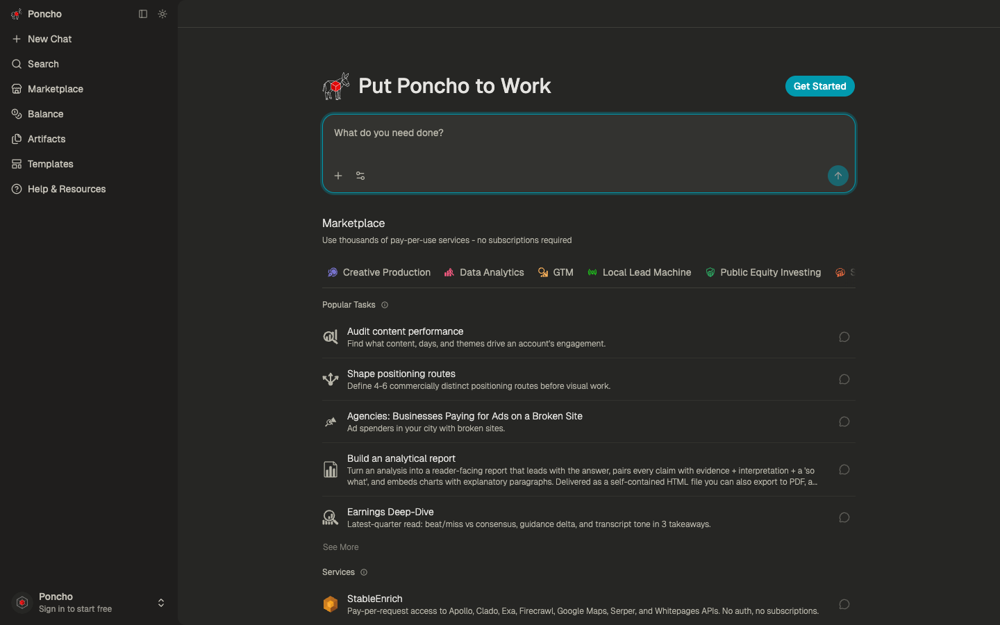

# Poncho — 'AI agents with 3000+ tools': a dark, pay-per-use agent workspace
> Access 3000+ tools from one account with Poncho. Find data at machine speed, automate work, and skip setup, subscriptions, and API keys.  ·  [tryponcho.com](https://tryponcho.com/)

**Vertical:** #vertical/tool-app  ·  **Vibe:** #vibe/technical  ·  **Topics:** #topic/ai #topic/productivity  ·  **Mode:** #mode/dark

## What it is
The product itself, not a marketing splash: tryponcho.com loads straight into Poncho's logged-out app shell. The page title is 'Poncho - AI agents with 3000+ tools' and its meta description is 'Access 3000+ tools from one account with Poncho. Find data at machine speed, automate work, and skip setup, subscriptions, and API keys.' The link shafu shared (link.tryponcho.com/shafu0x) is a Dub-tracked referral that redirects to tryponcho.com/redeem/shafu0x; the subject site is the Poncho app.

## What it shows
A dark charcoal workspace with a left sidebar (Poncho logo, New Chat, Search, Marketplace, Balance, Artifacts, Templates, Help & Resources, and a 'Poncho / Sign in to start free' footer). The main column headlines 'Put Poncho to Work' with a cyan 'Get Started' button and a large 'What do you need done?' chat input (cyan focus ring). Below it a 'Marketplace' rail ('Use thousands of pay-per-use services - no subscriptions required') with category chips (Creative Production, Data Analytics, GTM, Local Lead Machine, Public Equity Investing, Sales, Social Media Intel), a 'Popular Tasks' list (Audit content performance, Shape positioning routes, 'Agencies: Businesses Paying for Ads on a Broken Site', Build an analytical report, Earnings Deep-Dive) and a 'Services' section (e.g. 'StableEnrich - Pay-per-request access to Apollo, Clado, Exa, Firecrawl, Google Maps, Serper, and Whitepages APIs. No auth, no subscriptions.').

## How it works
A React-style single-page app built on shadcn/ui + Tailwind: :root carries the full shadcn token set in oklch (--background, --foreground, --card, --primary, --ring, --sidebar-*, --chart-*). Auth is Privy (a large --privy-* token block is injected), payments are Stripe (js.stripe.com), links are tracked via Dub (www.dubcdn.com - matching the dub_id on the shared redeem URL), and analytics via Google Tag Manager; the app talks to its own backend at barn.tryponcho.com. No public framework global (__NEXT_DATA__ etc.) is exposed. Media: 14 , 33 <svg>, 4 <iframe> (auth/payment embeds), 0 canvas/video; KaTeX fonts are declared (for math in chat answers) but unloaded.

## How it's designed
A restrained, developer-tool dark UI where a single cyan accent does the pointing. getComputedStyle/CSS vars report a warm charcoal canvas --background oklch(26.79% .0036 106.643) with near-white --foreground oklch(92% .0041 91.45); the interactive accent --primary/--ring is a cyan oklch(62.67% .1089 211.73) (the Get Started button and input focus ring), while the Poncho brand mark uses a red --brand oklch(63.68% .2078 25.3313). Type is Geist Variable (loaded) with Geist Mono Variable declared; corners are soft (--radius .5rem) and shadows are subtle - a clean shadcn baseline dressed in warm-grey + cyan.

## Design data
- **Palette:** Warm charcoal canvas (oklch 26.79% ~= near-black grey) with near-white text, a single cyan primary/focus accent (oklch 62.67% .1089 211.73) and a red brand mark (oklch 63.68% .2078 25.3313).
- **Palette tokens:** --background: oklch(26.79% .0036 106.643) (var), --foreground: oklch(92% .0041 91.45) (var), --primary: oklch(62.67% .1089 211.73) (var), --brand: oklch(63.68% .2078 25.3313) (var), --card: oklch(28.83% .0036 106.62) (var), body background: oklch(0.2679 0.0036 106.643) (rendered), body text: oklch(0.92 0.0041 91.45) (rendered)
- **Fonts:** Geist Variable (loaded, 100-900) for UI; Geist Mono Variable declared but unloaded; a full KaTeX family declared (math rendering) but unloaded. No other webfont payload.
- **Fonts loaded:** Geist Variable 100-900
- **Tech stack:** shadcn/ui + Tailwind (oklch tokens), Privy (auth), Stripe (payments), Dub (link tracking), Google Tag Manager
- **Keywords:** ai-agent, app-shell, dark, charcoal, cyan-accent, shadcn, tailwind, marketplace, pay-per-use, sidebar, geist
- **Media mix:** img 14 · svg 33 · iframe 4
- **Page height:** 900px (single-screen: True)
- **Responsive:** At 390x844 it stays a single-screen app shell (scrollHeight 844); the left sidebar collapses off-canvas and the task launcher + Marketplace/Popular-Tasks lists reflow to a full-width single column.
- **Headings:** Search tasks / Marketplace / Popular Tasks / Services
- **Weight:** None requests; hosts: tryponcho.com, barn.tryponcho.com, js.stripe.com, www.googletagmanager.com, www.dubcdn.com
- **Extracted:** 2026-07-08 · Playwright MCP, 1440x900 viewport (the single-screen app shell; fullPage timed out on the animated app, and since scrollHeight == innerHeight the viewport captures the whole page) + 390x844 mobile probe; logged_out: true.

## Related sites
- [[stitch.withgoogle.com]] — shared: tool-app, technical, ai, dark
- [[zendex.spyrosigma.in]] — shared: tool-app, technical, productivity, dark
- [[colf.dev]] — shared: tool-app, technical, ai
- [[cafe.endofday.studio]] — shared: tool-app, productivity, dark
- [[ditther.com]] — shared: tool-app, technical, dark
- [[akira.sachi.dev]] — shared: tool-app, technical
