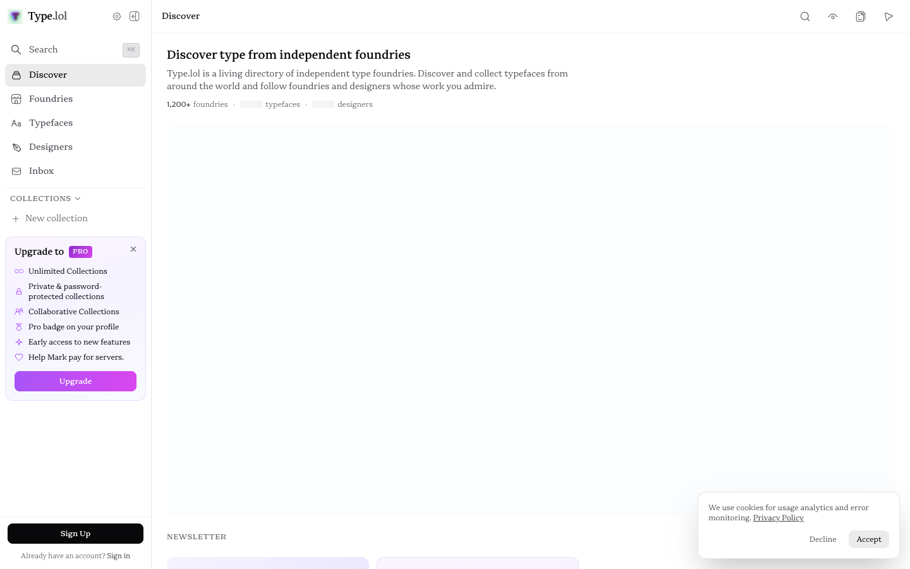

# Discover – type.lol
> Discover and explore independent type foundries from around the world. Browse 1,100+ foundries, 14,000+ typefaces, and 1,600+ designers.  ·  [type.lol](https://type.lol/)

## What it is
A discovery directory for independent type foundries. The h1 is 'Discover type from independent foundries' and the meta description reads 'Discover and explore independent type foundries from around the world. Browse 1,100+ foundries, 14,000+ typefaces, and 1,600+ designers.'

## What it shows
A crisp black-on-white editorial index of foundries and typefaces, using live type specimens embedded via <iframe> (5 iframes) and a large set of inline <svg> UI marks (49), grouped under section headings like 'Feeling Modern' with a 'Newsletter' block.

## How it works
A React application (a React root is present) served entirely from its own domain — the probe found no third-party analytics or CDN script hosts, only type.lol — which fits a self-published indie project. Type specimens render in sandboxed iframes so each foundry's own fonts can load in isolation.

## How it's designed
A restrained monochrome editorial system: getComputedStyle reports a white body background rgb(255,255,255) with near-black text rgb(9,9,11). The typography is, fittingly, entirely bespoke — document.fonts confirms the variable 'GORP Serif' (100–900) loaded as the primary family, with 'Covik Sans Mono', 'Retain' and 'ProGORP' also declared. The semantic <h1> is a small 18px label; the visual weight lives in the specimen previews rather than a giant hero headline. The only :root token is --ease-default: ease.

## Design data
- **Palette:** White canvas, near-black text (rgb 9,9,11); a deliberately monochrome shell so the foundry specimens provide any colour.
- **Palette tokens:** body background: rgb(255, 255, 255) (rendered), body text: rgb(9, 9, 11) (rendered), h1: rgb(9, 9, 11) (rendered)
- **Fonts:** Bespoke type throughout — variable 'GORP Serif' (100–900) loaded as the primary family, with 'Covik Sans Mono', 'Retain' and 'ProGORP' also declared; individual foundry specimens load their own fonts inside iframes.
- **Fonts loaded:** GORP Serif (variable 100-900)
- **Tech stack:** React, Self-hosted (no third-party analytics or CDN scripts detected)
- **Media mix:** img 1 · svg 49 · iframe 5
- **Page height:** 900px (single-screen: False)
- **Responsive:** At 390x844 a burger nav appears and the foundry grid reflows to a single 342px column with no horizontal overflow; the document height stays viewport-locked (internal app-shell scroll).
- **Headings:** Discover type from independent foundries / Feeling Modern / Newsletter
- **Weight:** None requests; hosts: type.lol
- **Extracted:** 2026-07-08 · Playwright MCP, 1440x900 fullPage + 390x844 mobile probe; logged_out: true. The page is an app shell with an internal scroll container, so document scrollHeight is viewport-height.

## Related sites
[[animations.dev]] [[asekachov.com]] [[daviskeene.com]] [[designengineer.tools]] [[eko.lumaris.works]] [[vanschneider.com]]

## Tags
#category/uncategorized #aesthetic/editorial #aesthetic/minimal #pattern/type-directory #pattern/foundries #pattern/editorial #pattern/monochrome #pattern/react #pattern/custom-fonts #pattern/specimen-iframes #pattern/minimal #tech/react #tech/self-hosted-no-third-party-analytics-or-cdn-scripts-detected #color/monochrome #font/gorp-serif-variable-100-900
