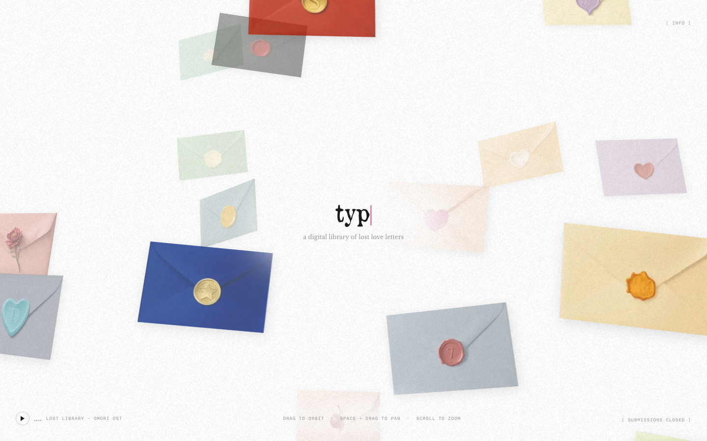

# typo.love — a digital library of lost love letters
> For all the words left unsaid.  ·  [typo.love](https://www.typo.love/)

## What it is
typo.love — 'a digital library of love letters … for all the words left unsaid,' a project by @lychkel. It's the 'library of love letters' from Jonas's list.

## What it shows
An infinite, pannable and zoomable canvas ('SPACE + DRAG TO PAN · SCROLL TO ZOOM') scattered with dozens of pastel, wax-sealed envelopes and a polaroid ('the stars and the moon'); each opens a stranger's submitted love letter. A lofi track (Lost Library — OMORI OST) plays and submissions are currently closed.

## How it works
Next.js (App Router — next/font fallbacks and App-Router opengraph-image/icon conventions), self-hosted with no third-party analytics scripts. The board is a single <canvas> (1 canvas) carrying 23 envelope images; it's a fixed, full-viewport experience (scrollHeight 0).

## How it's designed
A tender, analog-stationery aesthetic. From getComputedStyle the html/body backgrounds render transparent (rgba(0,0,0,0)) so the off-white paper canvas shows through, with near-black ink (body rgb(26,26,26)) and muted-grey UI (rgb(153,153,153)). The wordmark 'typo.love' is set 48px/400 in a vintage newspaper serif, OldNewspaper; UI labels ([INFO], [SUBMISSIONS CLOSED], the player) use Fragment Mono; and the letter body copy is Libre Baskerville (Instrument Serif is also declared).

## Design data
- **Palette:** An off-white paper canvas with near-black ink (rgb(26,26,26)) and muted-grey UI (rgb(153,153,153)); the envelope pastels (blush, sage, powder-blue, cream) supply the colour.
- **Palette tokens:** body color: rgb(26, 26, 26) (rendered), label/button color: rgb(153, 153, 153) (rendered), body background: rgba(0, 0, 0, 0) (rendered)
- **Fonts:** OldNewspaper (vintage serif wordmark), Fragment Mono (UI/labels) and Libre Baskerville (letters); Instrument Serif declared but unloaded.
- **Fonts loaded:** OldNewspaper 400, Fragment Mono 400, Libre Baskerville 400
- **Tech stack:** Next.js (App Router, next/font), self-hosted
- **Media mix:** img 23 · canvas 1 · svg 1
- **Page height:** 900px (single-screen: True)
- **Responsive:** At 390x844 it stays a full-viewport pannable canvas (scrollHeight 0) with the same [INFO]/[SUBMISSIONS CLOSED] chrome; touch pan/pinch-zoom simply replaces mouse drag — no hamburger.
- **Headings:** typo.love
- **Extracted:** 2026-07-05 · Playwright MCP, 1440x900 + 390x844 mobile pass, logged_out: true

## Related sites
[[animations.dev]] [[cafe.endofday.studio]] [[emilkowal.ski]] [[fey.com]] [[humanoid-index.com]] [[noahzender.com]]

## Tags
#category/uncategorized #aesthetic/experimental #pattern/infinite-canvas #pattern/pan-zoom #pattern/stationery #pattern/love-letters #pattern/serif #pattern/mono-ui #pattern/nextjs #pattern/lofi #pattern/interactive-art #tech/next-js-app-router-next-font #tech/self-hosted #color/warm #color/cool #font/oldnewspaper #font/fragment-mono #font/libre-baskerville
