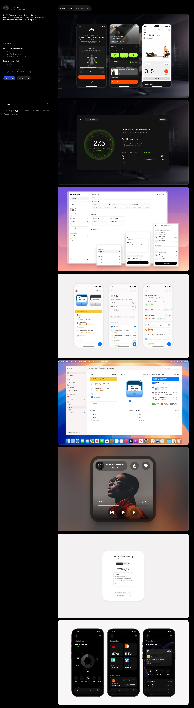

# Tyrone C. | Product Designer for Startups & Agencies
> Germany-based product designer helping startups and agencies ship polished mobile apps and Framer websites.  ·  [tyronec.com](https://www.tyronec.com/)

## What it is
The dark portfolio of Tyrone C., whose h1 reads 'Hi, i'm Tyrone, a product designer based in germany partnering with startups and agencies to turn products into unforgettable experiences.' The tweet showcases client brand explorations rather than this site directly; the site is his portfolio and the primary link surfaced from the tweet metadata.

## What it shows
A fixed left sidebar (the intro, a 'Services' list — Product Design Retainer, Framer Design Sprint, Framer Development — plus Socials, a live local time and Send Email / Contact-on-X buttons) beside a right-hand gallery of case studies with 'Product Design' and 'Framer Websites' tabs: a posture/fitness app 'Phy' (Postural Age 27.5, top imbalances), a SaaS dashboard on a warm gradient, iOS reminder/to-do apps (WWDC '24), a macOS list app, a media player, a 'Customisable Package $1999,89' pricing card and a crypto/finance wallet app (Total Balance $344,334.89).

## How it works
A Framer site (framework global exposed; assets from framerusercontent.com and events.framer.com) with no separate analytics beyond Framer's own events endpoint. It is media-light in markup — 9 , 4 <svg>, 0 canvas/video and 1 <iframe> — over a 5,242px page; the case-study visuals are image compositions rather than live embeds.

## How it's designed
A confident all-dark, product-first layout. getComputedStyle reports a pure-black body background rgb(0,0,0) with a white h1 rgb(255,255,255) set in Inter, and links render in classic web-blue rgb(0,0,238). Type is Inter / Inter Variable (loaded 400) throughout, with Geist declared but unloaded. The only colour comes from the soft gradient cards the app mockups sit on; the surrounding UI chrome stays strictly monochrome. No colour :root custom properties are exposed (only a corner-shape flag), so colours are read from the rendered page.

## Design data
- **Palette:** Pure-black canvas (#000) with white text and classic-blue links (#0000ee); colour arrives only via the gradient backdrops behind the app mockups.
- **Palette tokens:** body background: rgb(0, 0, 0) (rendered), h1: rgb(255, 255, 255) (rendered), link: rgb(0, 0, 238) (rendered)
- **Fonts:** Inter / Inter Variable (loaded, 400) for everything; Geist declared but unloaded — no other webfont payload.
- **Fonts loaded:** Inter 400, Inter Variable 400
- **Tech stack:** Framer
- **Media mix:** img 9 · svg 4 · iframe 1
- **Page height:** 5242px (single-screen: False)
- **Responsive:** At 390x844 the page swaps to Framer's phone breakpoint and becomes markedly more compact (scrollHeight 5,242 -> 2,747px), stacking the sidebar and work gallery into a single column.
- **Headings:** Hi, i'm Tyrone, a product designer based in germany partnering with startups and agencies to turn products into unforgettable experiences. / Services / Socials
- **Weight:** None requests; hosts: www.tyronec.com, framerusercontent.com, events.framer.com
- **Extracted:** 2026-07-08 · Playwright MCP, 1440x900 fullPage + 390x844 mobile probe; logged_out: true.

## Related sites
[[ankit-rai.com]] [[asekachov.com]] [[ddlabstudio.com]] [[hex.inc]] [[jasonyuan.design]] [[kiira.in]]

## Tags
#category/design #aesthetic/portfolio #aesthetic/dark #aesthetic/retro #pattern/portfolio #pattern/product-design #pattern/dark #pattern/black #pattern/inter #pattern/app-mockups #pattern/gradient-cards #pattern/sidebar #pattern/framer #pattern/retro-blue-links #tech/framer #color/dark #color/cool #font/inter #font/inter-variable
