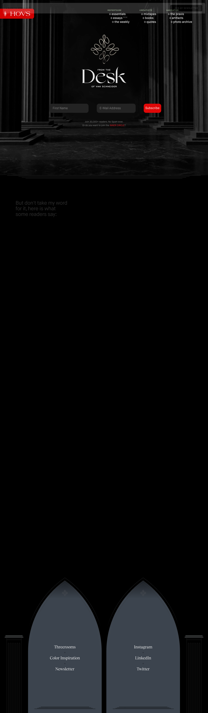

# Tobias van Schneider — House of van Schneider (HOVS), a creative-direction studio & portfolio
> I create, therefore I am.  ·  [vanschneider.com](https://vanschneider.com/)

**Vertical:** #vertical/studio-agency  ·  **Vibe:** #vibe/editorial #vibe/luxury  ·  **Topics:** #topic/design  ·  **Mode:** #mode/dark

## What it is
The portfolio and studio site of Tobias van Schneider — 'House of van Schneider' (HOVS), his New-York-based creative-direction studio 'that builds and runs its own products — and occasionally works with partners such as NASA/JPL to brand their space missions.' He is the maker growing mymind and the co-founder of Semplice and Carbonmade. This is the site the mymind 'Vibe Search' tweet resolves to via the export metadata — the author's own portfolio.

## What it shows
An enormous (34,491px) single-page editorial homepage. It opens on a black hero: a red ✣HOVS logo, a fine cathedral-arch line motif, an engraving of two cherubs holding a 'Crea Ergo Sum' banner, and a towering white headline 'I CREATE; THEREFORE I AM / DESIGN PRAXIS EST. 2000.' A tri-column magazine nav groups links under REPERTOIRE (essentials, essays, the weekly), CRÉATIVITÉ (mixtapes, books, quotes) and NARRATIVE (the praxis, artifacts, photo archive). Below sits an intro ('Currently growing mymind™… also co-founder of Semplice™ and Carbonmade™'), Featured Essays and case work (e.g. 'HOVS — a retro-futuristic interpretation of the original BMW airhead,' 'NASA — Branding NASA's mission to Jupiter's icy moon, Europa'), closing on 'Thank you for visiting the house.'

## How it works
A WordPress site built on van Schneider's own Semplice page-builder — the DOM is saturated with WordPress block presets (--wp--preset--color / gradient / spacing / shadow tokens) and jQuery, plus a large custom easing library (--ease-*-* cubic-beziers) driving its scroll/hover animation. Analytics run through Google Tag Manager and Google Fonts is linked, though the real display type is self-hosted. It is heavily media-driven: 147 images, 12 inline <video> clips and 105 inline SVGs across a 34k-pixel scroll, and it links out to his products — mymind.com (three times, 'Visit mymind.com'), semplice.com and carbonmade.com.

## How it's designed
Bold monochrome editorial with a single red accent. The stage renders near-black (a .column-content wrapper paints rgb(45,45,45); the <body> itself is transparent) with white type, and the brand accent is a saturated red — the red ✣HOVS logo and the red favicon, matching the site's own --wp--preset--color--vivid-red #cf2e2e. Display type is MaisonNeue (Book / Demi / Bold / Medium / Light, self-hosted) — the hero 'I CREATE; THEREFORE I AM' is MaisonNeue-Bold at ~130px — paired with his commissioned serif 'Tobias' (Tobias-Regular) and EngraversGothic-Bold for small-caps labels; muted sage-green group labels (REPERTOIRE / CRÉATIVITÉ / NARRATIVE) provide the only other colour. (Merriweather and Inter are declared but unloaded.)

## Design data
- **Palette:** Near-black stage (wrapper rgb(45,45,45)) with white type and one saturated brand red (#cf2e2e — the ✣HOVS logo & red favicon); muted sage-green nav labels as the lone secondary.
- **Palette tokens:** --wp--preset--color--vivid-red: #cf2e2e (var), --wp--preset--color--black: #000000 (var), --wp--preset--color--white: #ffffff (var), page wrapper background (.column-content): rgb(45, 45, 45) (rendered), default body text: rgb(0, 0, 0) (rendered)
- **Fonts:** MaisonNeue (Book/Demi/Bold/Medium/Light) for display & UI, his own 'Tobias' serif (Tobias-Regular) and EngraversGothic-Bold for small-caps labels — all self-hosted; Merriweather and Inter declared but unloaded.
- **Fonts loaded:** MaisonNeue-Book 400, MaisonNeue-Demi 400, MaisonNeue-Bold 400, MaisonNeue-Medium 400, MaisonNeue-Light 400, EngraversGothic-Bold 400, Tobias-Regular 400
- **Tech stack:** WordPress + Semplice, jQuery, Google Tag Manager, Google Fonts (linked)
- **Keywords:** editorial, monochrome, black-and-red, portfolio, studio, wordpress, semplice, long-scroll, engraving, grotesque-display, serif-pairing
- **Media mix:** img 147 · video 12 · svg 105
- **Page height:** 34491px (single-screen: False)
- **Responsive:** At 390x844 the tri-column magazine nav collapses to a hamburger menu and the layout reflows to a single column (scrollHeight 34,491 → ~30,618px).
- **Headings:** I CREATE; THEREFORE I AM / Featured Essays / Thank you for visiting the house. / HOVS — Building a retro-futuristic interpretation of the original BMW airhead / NASA — Branding NASA's mission to Jupiter's icy moon, Europa
- **Links out:** [Visit mymind.com](https://mymind.com/) · [Semplice™](https://www.semplice.com/) · [Carbonmade™](https://carbonmade.com/) · [oneYedeer](https://www.oneyedeer.com/)
- **Weight:** None requests; hosts: vanschneider.com, www.googletagmanager.com, fonts.googleapis.com
- **Extracted:** 2026-07-05 · Playwright MCP, 1440x900 fullPage + 390x844 mobile pass, logged_out: true

## Related sites
- [[ddlabstudio.com]] — shared: studio-agency, editorial, luxury, design, dark
- [[hex.inc]] — shared: studio-agency, luxury, design, dark
- [[coldiq.com]] — shared: studio-agency, editorial, luxury
- [[offthewall.studio]] — shared: studio-agency, editorial, design
- [[drafts9.com]] — shared: studio-agency, design
- [[eko.lumaris.works]] — shared: editorial, luxury, dark
